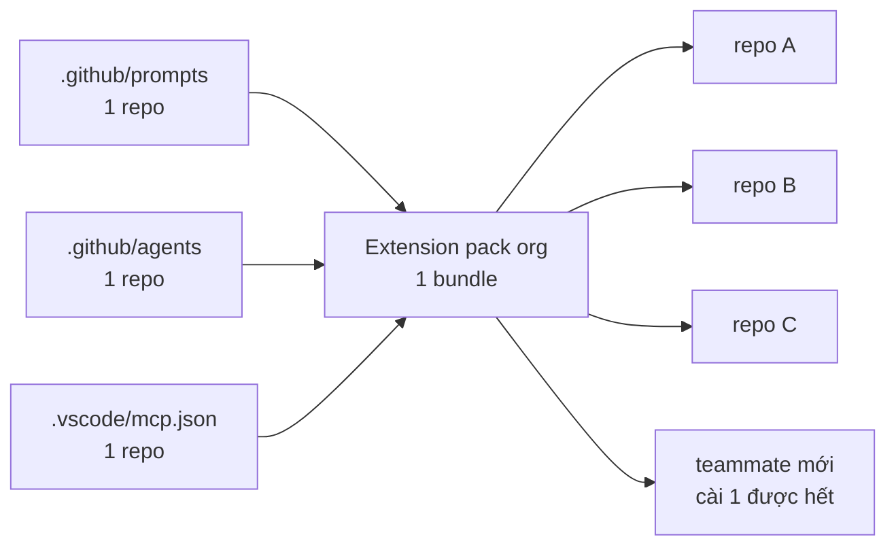
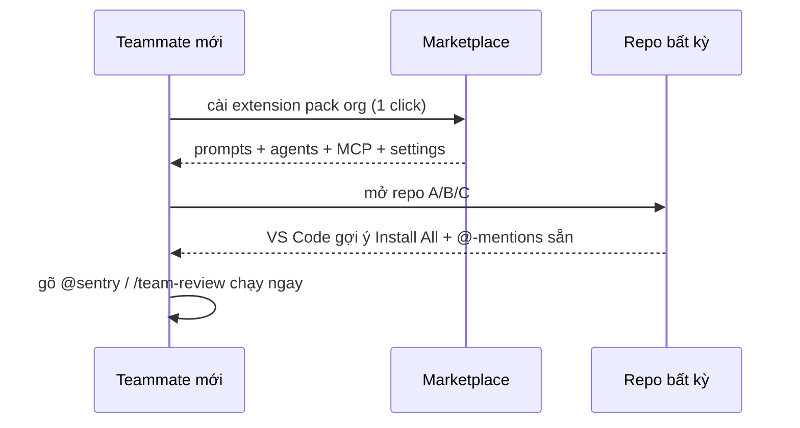

# 09 — Extensions & Marketplaces (Đóng Gói Cho Team)

> **Dành cho:** tech lead / admin đóng gói chuẩn tooling cho team, kèm dev mới cài extension lần đầu (bài 09 của series).
> **Vấn đề:** mỗi dev cài lẻ, mỗi repo một kiểu setup prompts / MCP / extension → teammate mới mất cả buổi. Extension lạ thì chạy với quyền của bạn.
> **Đọc xong:** phân biệt Copilot Extensions vs VS Code extensions, cài + pin version copy-paste, set org policy allow/block + version pin cho team.
> **Thời gian:** ~40 phút (bản mở rộng)

## Mục tiêu bài học

- Phân biệt rạch ròi **2 loại extension**: Copilot Extensions (GitHub Apps gọi qua `@`) và VS Code extensions (đồ nghề editor).
- Biết **ngưỡng đóng gói**: khi nào commit `.github/` thẳng, khi nào mới dựng extension pack / repo template.
- Cài được extension pack, **pin version** và cập nhật có kiểm soát để không gãy giữa sprint.
- Đặt **org policy allow/block** và biết checklist review một extension lạ trước khi cho vào org.
- Onboard teammate mới bằng **repo template** thay vì bắt cài tay từng thứ.

## Mục lục

1. [Vì sao extensions? (why)](#1-vì-sao-extensions-why)
2. [Sơ đồ: từ file lẻ tới extension pack](#2-sơ-đồ-từ-file-lẻ-tới-extension-pack)
3. [2 loại extensions — đừng nhầm](#3-2-loại-extensions--đừng-nhầm)
4. [Copilot Extensions: GitHub Apps expose skills cho @-mention](#4-copilot-extensions-github-apps-expose-skills-cho--mention)
5. [VS Code extensions: Copilot-related packs](#5-vs-code-extensions-copilot-related-packs)
6. [Cài + pin version (copy-paste)](#6-cài--pin-version-copy-paste)
7. [Org-level extension policy: allow/block](#7-org-level-extension-policy-allowblock)
8. [Hiểu nhầm thường gặp](#8-hiểu-nhầm-thường-gặp)
9. [Walkthrough + pitfalls + bài tập](#9-walkthrough--pitfalls--bài-tập)
10. [So sánh với Claude Code](#10-so-sánh-với-claude-code)
11. [Lỗi thường gặp (❌ SAI / ✅ ĐÚNG)](#11-lỗi-thường-gặp--sai--đúng)
12. [Best practices (kèm "vì sao")](#12-best-practices-kèm-vì-sao)
13. [Bài tập nhỏ](#13-bài-tập-nhỏ)
14. [Link chéo](#14-link-chéo)

---

## 1. Vì sao extensions? (why)

Khi nào nên đóng gói `.github/` + `.vscode/` thành extension, và khi nào commit thẳng rẻ hơn?

**Định nghĩa 1 câu:** File `.github/` lẻ chỉ giải quyết 1 repo; extension là **thùng combo đóng sẵn** — 10 repos và người mới đều dùng chung 1 chuẩn, update 1 nơi là cả team sync.

**Nôm na:** Quán phở mở chuỗi. 1 quán thì đầu bếp nêm tay (file lẻ). 10 quán thì phải có gói gia vị đóng sẵn từ trung tâm (extension). Quán nào nấu cũng cùng vị. Đổi công thức thì đổi 1 nơi.

**Ví dụ thật copy-paste:**

```text
 Không extensions: teammate mới → clone 5 repos → mỗi repo setup MCP tay +
   hỏi "prompt review ở đâu?" + cài lẻ từng VS Code extension.
 Có extensions:   teammate mới → cài 1 extension pack org → 5 repos đều có
   @-mention participants, prompt files, MCP servers kèm.
 Update:          bump extension version 1 nơi → cả team sync.
 # Verify: đếm repos team bạn. ≥3 repos cùng checklist → đáng đóng extension (mục 6).
```

**Ngưỡng đóng gói:** cùng 1 bundle dùng ở **≥3 repos HOẶC** onboarding **≥1 người/tháng**. Dưới ngưỡng → commit `.github/` thẳng rẻ hơn.

**Ai dùng lúc nào:**

- 1 repo, team nhỏ → commit `.github/` thẳng (bài 05/06), đừng đóng extension.
- ≥3 repos + onboard liên tục → đóng extension pack / repo template (mục 6).

**Vì sao quan trọng?** Đóng gói sai lúc là tự tạo thêm việc bảo trì. Nếu chỉ có 1 repo mà đi dựng extension pack, bạn vừa thêm một artifact phải version, vừa lặp lại thứ mà commit `.github/` đã làm được miễn phí.

**Nếu làm sai?** Đóng gói quá sớm → mỗi lần sửa 1 prompt phải bump version, publish, rồi mong teammate update. Ngược lại, không đóng gói khi đã 10 repos → teammate mới phải cài tay 10 nơi, và mỗi repo trôi một kiểu.

### 1.1. Bảng thuật ngữ extensions (tra nhanh)

Tra cứu nhanh, không cần đọc từ đầu.

| Thuật ngữ | Là gì (hiểu nôm na) | Ví dụ cụ thể | Khi nào dùng |
|---|---|---|---|
| **Copilot Extension** | Nhân viên biết gọi SaaS, ngồi ngay trong Chat | `@sentry list issues` gọi Sentry từ Chat | Cần gọi Linear/Jira/Sentry không mở web |
| **VS Code extension** | Đồ nghề gắn vào editor (lint, format, MCP) | ESLint, Prettier, GitLens, pack GitHub Copilot | Cần tooling chạy local trong IDE |
| **Extension pack** | Danh sách đồ nghề bắt buộc cho repo | `.vscode/extensions.json` → VS Code nhắc cài đủ | Mọi repo team khi mở lần đầu |
| **Marketplace** | Chợ extensions: chợ GitHub (GitHub Apps) và chợ VS Code (editor) | github.com Marketplace vs VS Code Marketplace | Lúc cài, lúc review nguồn extension |
| **@-mention** | Cách gọi đúng "nhân viên" trong Chat | Gõ `@workspace` hoặc `@linear` | Chọn participant cho câu hỏi |
| **Version pin** | Chốt extension ở 1 version, không lấy latest mù | `code --install-extension github.copilot-chat@0.26.0` | Giữa sprint, khi không được gãy workflow |
| **Org policy allow/block** | Bảo vệ cổng chợ: quầy đã vet mới được vào | Allowed extensions: github, linear, sentry | Admin org Business/Enterprise |

---

## 2. Sơ đồ: từ file lẻ tới extension pack

Cấu trúc đi từ file lẻ trong 1 repo tới extension pack cả team dùng trông ra sao.

**Space view — file lẻ gom thành pack, pack rải xuống repo + teammate mới:**



**Time view — chuyện gì xảy ra khi teammate mới onboard:**



> Nôm na: như hộp gia vị chuỗi quán phở (mục 1) — 1 hộp (pack) rải xuống 10 bếp (repo), ai mở repo là có đủ "đồ nghề" luôn.

---

## 3. 2 loại extensions — đừng nhầm

Cần gọi SaaS từ Chat thì cài chợ nào. Cần tooling editor thì cài chợ nào. Hai chợ khác hẳn nhau.

**Định nghĩa 1 câu:** Có 2 chợ khác nhau — **chợ GitHub** bán "người phục vụ biết gọi SaaS" (`@linear`, `@sentry`), **chợ VS Code** bán "đồ nghề cho editor" (lint, format, MCP local).

**Nôm na:** Siêu thị có 2 quầy: quầy đồ ăn chín (mua về ăn ngay = Copilot Extension gọi SaaS từ Chat) và quầy dụng cụ bếp (mua về nấu = VS Code extension cài vào editor).

**Ví dụ thật copy-paste:**

| Loại | Nôm na là gì | Cài ở đâu | Ví dụ copy-paste | Ai dùng lúc nào |
|---|---|---|---|---|
| **Copilot Extensions** | Nhân viên gọi món SaaS (`@linear`) | github.com → Org/Repo → Installed Apps + VS Code Chat `@` | `@linear tạo task Y`, `@sentry list issues` | Cần gọi Linear/Jira/Sentry từ Chat |
| **VS Code extensions** | Đồ nghề bếp (dao, thớt) | VS Code Marketplace / `.vscode/extensions.json` | Copilot pack, ESLint, Prettier, GitLens | Cần lint/format/snippets/MCP local |

```text
 Quan hệ giữa 2 loại:
 - Copilot Extension (@linear) → gọi từ Chat bằng @-mention, chạy trên GitHub infra.
 - VS Code extension (pack) → cài local, có thể TỰ THÊM MCP servers + participants.
 - 1 VS Code extension có thể wrap 1 Copilot Extension (cài 1 được 2).

 Cây quyết định (dán lên wiki):
 Cần gọi SaaS (Linear/Jira/Sentry) từ Chat? → Copilot Extension @-mention.
 Cần tooling editor (lint, format, snippets, MCP local)? → VS Code extension.
 Share chuẩn team cross-repo? → cả 2 + org policy (mục 7).
 # Verify: gõ @ trong Chat → thấy @-mentions nào? Thiếu → chưa cài Copilot Extension.
```

---

## 4. Copilot Extensions: GitHub Apps expose skills cho @-mention

> **GA date: February 19, 2025** — Copilot Extensions are now generally available (github.blog
> changelog). Auth uses native third-party tokens (no more `X-GitHub-Token`). Available in VS Code,
> github.com, Visual Studio, JetBrains, **and GitHub Mobile**. For the full 2025/2026 picture — GA
> timeline, third-party agents, Copilot CLI, Enterprise features, and Mobile — see
> [`../copilot-extensions-ai-powered/README.md`](../../copilot-extensions-ai-powered/README.md)
> (EN).

Cài Copilot Extension theo flow nào, chọn extension nào cho team, và khi nào phải tự viết extension riêng.

**Nôm na 1 câu:** Copilot Extension là **GitHub App đăng ký quầy riêng** trong Chat. Gõ `@tên-quầy` là gọi đúng nhân viên quầy đó (Sentry tra lỗi, Linear tạo task).

> Copilot Extension = GitHub App đăng ký với Copilot → hiện thành `@-mention` trong Chat (VS Code, github.com, mobile).

### 4.1. Cài + dùng (copy-paste flow)

Dành cho mọi dev. Cài 1 lần cho tài khoản, dùng lại ở mọi repo được cấp quyền.

```text
 Bước 1: github.com → Marketplace → tìm extension (vd "Sentry", "Linear").
 Bước 2: Install → chọn Org/Repos được phép (đừng chọn All repos nếu chưa tin).
 Bước 3: VS Code Chat → gõ "@" → phải thấy @sentry/@linear mới.
 Bước 4: Test: "@sentry list unresolved issues của project X" / "@linear tạo task Y".
 Bước 5: Không hợp → github.com → Settings → Applications → Uninstall/Restrict.
 # Verify: bước 3 phải thấy @-mention mới. Không thấy → reload window + check repo được phép (bước 2).
 # Kỳ vọng: 2 prompts trả về dữ liệu thật từ SaaS, không phải "không thấy integration".
 # Ai dùng lúc nào: team dùng Linear/Sentry mỗi ngày → cài. Không dùng tracker đó → bỏ (đỡ rác @ list).
```

```bash
# Kiểm tra extensions đã cài cho org (cần admin, copy-paste):
gh api orgs/{org}/installations --jq '.installations[] | {app: .app.slug, repo_selection}'
# Liệt kê repos được phép:
gh api orgs/{org}/installations/{id}/repositories --jq '.repositories[] | .full_name'
# Verify: app.slug có tên extension? repo_selection có gồm repo bạn? Không → admin chưa cấp.
```

### 4.2. 5 extensions team hay dùng (2026)

| Extension | `@-mention` | Nôm na để làm gì | Khi prune (ai quyết) |
|---|---|---|---|
| GitHub (built-in) | `@workspace` | Hỏi code, PR, issues trong repo | Không bao giờ |
| Linear/Jira | `@linear` | Tạo/xem tasks từ Chat, khỏi mở web | Team không dùng tracker đó |
| Sentry/Datadog | `@sentry` | Tra lỗi prod + stack trace từ Chat | Không có observability SaaS |
| LaunchDarkly/PostHog | `@flags` | Check feature flags đang bật/tắt gì | Không dùng flags |
| Notion/Confluence | `@docs` | Tra docs team từ Chat | Docs đã local hết |

```text
 Quy tắc: ≤5 Copilot Extensions. Quá → "@" list dài, Copilot chọn sai participant.
 Mỗi extension sâu nên có 1 prompt file kèm (vd .github/prompts/triage-sentry.prompt.md
 dạy format "lỗi → root cause → fix" để output đồng đều).
 # Verify: đếm @-mentions team đang có. >5 → prune 1 cái ít dùng nhất.
```

### 4.3. Viết Copilot Extension đơn giản (khi nào + khung)

**Nôm na:** Tự mở quầy riêng trong chợ. Chỉ đáng khi nhà bạn có món độc quyền (API/runbook nội bộ) mà chợ chưa bán, và ≥3 teams "ăn".

```text
 Khi nào viết extension riêng (thay vì dùng sẵn)?
 - Internal API/docs chỉ org bạn có (vd tra runbook nội bộ, deploy staging riêng).
 - Dưới ngưỡng → prompt file + MCP http server là đủ (bài 05/08). Viết extension
   là GitHub App (manifest, OAuth, hosting) — overhead lớn, chỉ đáng khi ≥3 teams dùng.
   Ai dùng lúc nào: platform team phục vụ nhiều teams → viết. Team lẻ → dùng sẵn.

 Khung (high-level, chi tiết xem docs GitHub "Building Copilot Extensions"):
 1. Tạo GitHub App → enable "Copilot Chat" permission → định nghĩa skills (name,
    description, input schema — giống agent frontmatter bài 06).
 2. Host endpoint (vd https://copilot-ext.acme.example) nhận Chat requests.
 3. Install vào org test → "@acme ..." → verify → publish private marketplace org.
 4. Secrets (APP_PRIVATE_KEY, WEBHOOK_SECRET) qua hosting env, KHÔNG commit.
 # Verify: "@acme ..." trả lời được trên org test? Chưa → check permission + hosting logs.
```

---

## 5. VS Code extensions: Copilot-related packs

Pack nào nên commit vào repo, và khi nào dùng pack thay vì dotfiles cá nhân.

### 5.1. Pack chuẩn team (copy-paste)

**Nôm na:** Pack là **danh sách đồ nghề bắt buộc** dán ở cửa bếp. Ai vào bếp (mở repo) là VS Code nhắc "cài đủ dao thớt này".

```json
// .vscode/extensions.json — VS Code tự gợi ý cài khi mở repo (commit cho team):
{
  "recommendations": [
    "github.copilot",
    "github.copilot-chat",
    "dbaeumer.vscode-eslint",
    "esbenp.prettier-vscode",
    "eamodio.gitlens",
    "ms-playwright.playwright-vscode",
    "github.vscode-github-actions"
  ],
  "unwantedRecommendations": [
    "some.noisy-theme",
    "some.conflicting-formatter"
  ]
}
// Ai dùng lúc nào: mọi repo team → commit file này. Personal theme/keymap → không commit.
```

```jsonc
// .vscode/settings.json — settings đi kèm pack (format/lint on save):
{
  "editor.formatOnSave": true,
  "editor.defaultFormatter": "esbenp.prettier-vscode",
  "editor.codeActionsOnSave": {
    "source.fixAll.eslint": "explicit"
  },
  "github.copilot.enable": { "*": true },
  "github.copilot.chat.toolAutoRun": "ask"
}
```

```bash
# Cài pack từ CLI (copy-paste, onboarding máy mới):
cat .vscode/extensions.json | jq -r '.recommendations[]' | while read -r ext; do
  code --install-extension "$ext"
done
code --list-extensions | grep -i "copilot\|eslint\|prettier"  # verify
# Kỳ vọng: list hiện đủ copilot + eslint + prettier. Thiếu → cài tay ID đó.
```

### 5.2. Khi nào extension vs dotfiles?

Tra cứu nhanh: chọn 1 dòng phù hợp tình huống của bạn rồi làm theo cột cuối.

| Tình huống | Nôm na chọn gì | Ví dụ | Ai dùng lúc nào |
|---|---|---|---|
| 1–2 prompt files, 1 repo | Dán giấy nhớ thẳng lên tủ (commit `.github/`) | Prompt review của 1 project | Team nhỏ, 1 repo |
| Tooling editor (lint/format/git) | Mua bộ dao thớt (VS Code pack) | ESLint + Prettier + GitLens | Mọi dev |
| Gọi SaaS từ Chat | Thuê nhân viên quầy (`@-mention`) | `@sentry`, `@linear` | Team dùng SaaS đó |
| Chuẩn cross-repo (instructions+agents+MCP) | Mở chuỗi nhượng quyền (template + pack) | Org template repo + pack | Org nhiều repos |
| Preferences cá nhân | Đũa riêng (personal, không commit) | Theme, keymap riêng bạn | Cá nhân |

---

## 6. Cài + pin version (copy-paste)

Làm sao update extension mà không gãy giữa sprint, và chia sẻ chuẩn team bằng repo template.

### 6.1. Pin version (tránh breaking giữa sprint)

**Nôm na 1 câu:** Pin version như **chốt công thức không đổi giữa tuần bán hàng**. Update để cuối tuần (cuối sprint), test xong mới đổi.

```bash
# Cài version cụ thể (không lấy latest mù):
code --install-extension github.copilot-chat@0.26.0
code --install-extension dbaeumer.vscode-eslint@3.0.0

# Xem versions có sẵn:
code --list-extensions --show-versions | grep -i "copilot\|eslint"
# Kỳ vọng: hiện version đang cài. Khác wiki table → lệch version, sync lại.

# Update có kiểm soát (cuối sprint, không giữa sprint):
code --list-extensions | xargs -I{} code --install-extension {} --force
# → test 1 ngày trên repo thử trước khi announce team.
```

```text
 Quy ước team (dán vào wiki — ai giữ: tech lead):
 - Pin versions trong wiki table (extension → version → ngày verify).
 - Update cuối sprint. Breaking change (hooks/behavior đổi) → giữ version cũ
   cho repos production, note lý do.
 - Teammate mới: cài theo table, không cài latest mù.
 # Verify: wiki table có đủ 3 cột? Version local khớp table?
```

### 6.2. Repo template (share chuẩn team — thực tế hơn viết extension mới)

**Nôm na:** Template là **khuôn nhà mẫu**. Làm nhà mới (repo mới) thì đúc từ khuôn. Có sẵn điện nước (instructions, agents, mcp, pack).

```text
 acme-copilot-template/           # repo template org (Template repository: ON)
   .github/copilot-instructions.md
   .github/instructions/*.instructions.md
   .github/agents/*.agent.md
   .github/prompts/*.prompt.md
   .vscode/{mcp.json,settings.json,extensions.json}
   .husky/pre-commit
   README.md (onboarding 10 phút)

 Teammate: New repo → "Use template" → có ngay chuẩn team.
 Update chuẩn: PR vào template → announce → các repos cherry-pick (hoặc script sync).
 # Ai dùng lúc nào: org nhiều repos mới mỗi tháng → dựng template 1 lần, dùng mãi.
```

```bash
# Tạo repo từ template (copy-paste):
gh repo create acme/new-service --template acme/acme-copilot-template --private --clone
cd new-service && cat .vscode/extensions.json  # verify pack đi kèm
# Kỳ vọng: repo mới có đủ .github/ + .vscode/ + .husky/. Thiếu → template chưa bật Template repository.
```

---

## 7. Org-level extension policy: allow/block

Admin allow/block extension ở đâu, và kiểm tra extension lạ trước khi cho vào org. Dành cho admin/org owner (Business/Enterprise); dev thường chỉ xem + request.

**Nôm na 1 câu:** Org policy là **bảo vệ cổng chợ**. Quầy nào sạch (đã vet) thì cho vào. Quầy lạ chạy shell / đọc files thì chặn.

```text
 Admin (github.com → Org Settings → Copilot → Policies → Extensions):
 - Allowed extensions: github, linear, sentry (list rõ, còn lại block).
 - VS Code marketplace: restrict (chỉ extensions đã review) — Enterprise.
 - Audit log: ai cài extension nào, khi nào (review hàng tháng).
 # Ai làm: admin org (Business+). Dev thường chỉ xem + request.

 Admin (VS Code marketplace org):
 - Private marketplace/allowlist: chỉ pack org + extensions đã vet.
 - Block categories: themes lạ không sao, block extensions chạy shell/network chưa vet.
```

```bash
# Audit extensions team đang dùng (mỗi tháng, copy-paste):
code --list-extensions --show-versions > /tmp/exts.txt
cat /tmp/exts.txt
# So với allowlist wiki: cái nào ngoài list? Hỏi owner: còn dùng không?
# Ngoài list + không ai nhận → uninstall: code --uninstall-extension <id>
# Kỳ vọng: list khớp allowlist. Lệch → prune.
```

**Checklist review extension lạ (trước khi cho vào org):**

| Kiểm tra gì | Vì sao |
|---|---|
| Đọc permissions (chạy shell? đọc files? gọi mạng?) | Extension chạy với quyền bạn — đọc `.env` được nếu bạn cho |
| Nguồn: official / org / cá nhân lạ? | Lạ → test repo thử trước |
| MCP servers kèm: URL lạ? secrets qua env? | Tránh exfiltrate (bài 08) |
| Version pinned? CHANGELOG có breaking? | Tránh gãy giữa sprint |
| 2 extensions cùng chức năng? | Chọn 1, gỡ kia (đỡ conflict) |

---

## 8. Hiểu nhầm thường gặp

Bảng tra nhanh, không cần đọc từ đầu. Gặp câu quen thì đọc cột "Sự thật".

| Hiểu nhầm | Sự thật |
|---|---|
| "Copilot Extension và VS Code extension là 1" | Sai. Copilot Extension = GitHub App gọi qua `@` từ Chat. VS Code extension = plugin editor (có thể bundle MCP). Cài 1 đôi khi được 2 |
| "Cài càng nhiều extensions càng mạnh" | Sai. >5 `@-mentions` → Copilot chọn sai. Pack phình 30 extensions → VS Code chậm. Giữ pack core 7-10 |
| "Extension lạ cài thử, sao đâu" | Sai. Extension chạy với quyền bạn (đọc files, chạy shell, gọi mạng). Review permissions + test repo thử trước |
| "Update latest luôn cho mới" | Sai. Update giữa sprint dễ gãy workflow. Pin version, update cuối sprint + test 1 ngày |
| "Repo template dựng 1 lần là xong" | Sai. Template 6 tháng không sync → lỗi thời. Cuối sprint sync PR template → repos |
| "MCP server và extension khác nhau hoàn toàn" | Sai. Extension có thể bundle MCP servers — cài extension là có thêm MCP (review URL/secrets như bài 08) |

---

## 9. Walkthrough + pitfalls + bài tập

Setup chuẩn đi từng bước thế nào, lỗi thường gặp fix ra sao, và làm bài gì để tự kiểm chứng.

### 9.1. Walkthrough: setup extensions chuẩn (25 phút)

```text
 Bước 1 (5 phút): commit .vscode/extensions.json + settings.json (mục 5.1).
   Teammate mở repo → VS Code gợi ý cài → bấm Install All.
   # Verify: mở repo fresh → có popup gợi ý? Không → check file path .vscode/extensions.json.

 Bước 2 (10 phút): cài 1 Copilot Extension (@linear hoặc @sentry, mục 4.1).
   Test @-mention 2 prompts. Ghi output có đúng format team?
   # Verify: gõ @ thấy extension? 2 prompts trả về đúng format?

 Bước 3 (5 phút): pin versions (mục 6.1). Ghi table wiki: extension → version.
   # Verify: table đủ 3 cột (tên, version, ngày verify)?

 Bước 4 (5 phút): admin set allowlist org (mục 7). Verify extension lạ bị block.
   # Verify: cài extension ngoài list → bị block + log audit?
 # Kỳ vọng cuối: teammate mới clone 1 repo → "Install All" → chạy được @-mention + /prompts ngay.
```

### 9.2. Pitfalls + fix

| Pitfall | Vì sao | Fix |
|---|---|---|
| Cài extension lạ, nó đọc `.env` | Không review permissions | Checklist mục 7; content exclusion vẫn làm lưng (bài 07) |
| 2 formatters conflict (Prettier vs Beautify) | Cài pack + extension lạ | `unwantedRecommendations` + `defaultFormatter` rõ ràng |
| Update extension giữa sprint gãy workflow | Latest mù | Pin version, update cuối sprint |
| 10 `@-mentions` → Copilot chọn sai | Tham extensions | ≤5, prune định kỳ |
| Extension pack phình (30 extensions) → VS Code chậm | Bundle quá nhiều | Tách pack core (7–10) + optional theo role (frontend/backend) |
| Repo template lỗi thời (6 tháng không sync) | Không lịch sync | Cuối sprint: PR sync template → repos (hoặc script) |

### 9.3. Bài tập thực hành

Bài tập của bài này nằm ở [mục 13 — Bài tập nhỏ](#13-bài-tập-nhỏ) bên dưới. Làm ngay sau khi nắm hết pitfalls ở mục 9.2.

---

## 10. So sánh với Claude Code

Cả hai đều có khái niệm "đóng gói chuẩn cho team", nhưng cơ chế phân phối khác nhau. Bảng dưới chỉ so những điểm chắc chắn.

| Việc | Copilot | Claude Code | Ghi chú |
|---|---|---|---|
| Đóng gói chuẩn team | Copilot Extensions (GitHub App) + VS Code extension pack | Plugins (`.claude-plugin/`, marketplace) gói command/agent/skill/MCP | Cùng tư tưởng "1 gói dùng chung"; khác cơ chế phân phối |
| Gọi SaaS trong Chat | `@-mention` (`@linear`, `@sentry`) | MCP server + slash command (`.claude/commands/`) | Copilot có GitHub-App `@`; Claude Code dùng MCP/command thay thế |
| Tooling editor (lint/format) | VS Code extension pack (`.vscode/extensions.json`) | Không có tương đương trực tiếp (terminal-first) | Copilot gắn chặt với editor; Claude Code không quản lý extension editor |
| Cài 1-click từ chợ | VS Code Marketplace + GitHub Marketplace | Plugin marketplace (`/plugin marketplace add`) | Cả hai đều có chợ để browse + cài |
| Pin version | `code --install-extension name@version` | Pin qua commit/revision của plugin | Cùng mục tiêu: tránh breaking giữa sprint |
| Org policy allow/block | Org Settings → Copilot → Policies (allowlist) | Managed settings org-wide | Cả hai đều có cổng admin gác |
| Bundle MCP kèm | Extension có thể tự thêm MCP servers | Plugin có thể bundle MCP servers | Cả hai đều "cài 1 được nhiều thứ" — nhớ review secrets |

> **Đọc bảng này thế nào:** nếu bạn quen Claude Code, coi Copilot Extensions ≈ "plugin + marketplace", và VS Code extension pack là phần *không có tương đương* bên Claude Code (vì Claude Code terminal-first, không quản lý đồ nghề editor).

---

## 11. Lỗi thường gặp (❌ SAI / ✅ ĐÚNG)

**1. Cài extension lạ mà không review quyền**

```text
❌ SAI: cài extension "tiện" nào cũng được → nó chạy shell / đọc .env với quyền của bạn
✅ ĐÚNG: đọc permissions (shell? files? network?) + test trên repo thử trước khi cho vào org
```
**Bài học:** extension chạy bằng quyền bạn — một extension lạ có thể đọc secrets của bạn.

**2. Update latest giữa sprint**

```text
❌ SAI: "update all cho mới" ngay giữa sprint → behavior đổi, workflow gãy
✅ ĐÚNG: pin version, update cuối sprint, test 1 ngày trên repo thử rồi mới announce
```
**Bài học:** "mới nhất" không đồng nghĩa "ổn định nhất" — breaking change giữa sprint tốn hơn vài tính năng mới.

**3. Nhồi quá nhiều `@-mentions` / pack phình**

```text
❌ SAI: 10 extension @-mention + pack 30 extensions → Copilot chọn sai participant, VS Code chậm
✅ ĐÚNG: ≤5 Copilot Extensions, pack core 7–10, phần còn lại tách optional theo role
```
**Bài học:** nhiều lựa chọn làm cả Copilot lẫn editor chậm và dễ chọn nhầm.

**4. Không commit `.vscode/extensions.json`**

```text
❌ SAI: mỗi dev tự cài tay → teammate mới thiếu tool, setup mỗi người một kiểu
✅ ĐÚNG: commit extensions.json để VS Code gợi ý "Install All" khi mở repo
```
**Bài học:** đóng gói danh sách đồ nghề vào repo là cách onboarding rẻ nhất.

---

## 12. Best practices (kèm "vì sao")

- **Chỉ đóng gói khi vượt ngưỡng ≥3 repos hoặc ≥1 người/tháng.** *Vì sao?* Dưới ngưỡng, commit `.github/` thẳng rẻ hơn nhiều so với version + publish + sync.
- **Commit `.vscode/extensions.json` + `settings.json`.** *Vì sao?* VS Code gợi ý cài đủ khi mở repo — teammate mới không phải đoán cần tool gì.
- **Pin version, update cuối sprint.** *Vì sao?* Update giữa sprint dễ gãy workflow; cuối sprint có thời gian test trước khi cả team đổi.
- **≤5 Copilot Extensions; pack core 7–10.** *Vì sao?* Quá nhiều `@`-mention làm Copilot chọn sai participant; pack phình làm VS Code chậm.
- **Review permissions trước khi thêm extension lạ.** *Vì sao?* Extension chạy với quyền bạn — đọc file, chạy shell, gọi mạng đều có thể.
- **Ưu tiên repo template trước khi viết extension mới.** *Vì sao?* Template dựng 1 lần là dùng được ngay; viết GitHub App (manifest, OAuth, hosting) là overhead lớn chỉ đáng khi ≥3 teams dùng.
- **Audit định kỳ và sync template cuối sprint.** *Vì sao?* Extension thừa và template lỗi thời tích tụ âm thầm — prune + sync giữ chuẩn team luôn đúng.

---

## 13. Bài tập nhỏ

1. **(15 phút)** Commit `.vscode/extensions.json` (mục 5.1) vào 1 repo. Clone fresh trên máy khác (hoặc profile mới) → verify VS Code gợi ý cài.
2. **(20 phút)** Cài 1 Copilot Extension (`@linear`/`@sentry`/tương đương). Test 3 prompts. Viết 1 prompt file kèm để output đúng format team.
3. **(15 phút)** Pin versions (mục 6.1). Lập table wiki. Thử update 1 extension lên latest trên repo thử → có breaking không? Ghi lại.
4. **(15 phút)** Audit extensions team (`code --list-extensions`). So với allowlist — cái nào thừa? Gỡ 1 cái và ghi khác biệt startup time.
5. **(20 phút)** Tạo repo từ template (mục 6.2) hoặc dựng template tối thiểu (instructions + agents + mcp.json + extensions.json). Onboard 1 teammate thử.

---

## 14. Link chéo

Tra cứu nhanh: nối bài này với các bài còn lại trong series.

- **Bài 03 — Instructions:** instructions đi kèm extensions (format output `@sentry`).
- **Bài 05 — Prompt files:** prompt kèm extension (review/triage) cho output đồng đều.
- **Bài 06 — Custom agents:** agents gọi `@-mention` extensions trong quy trình.
- **Bài 07 — Guardrails:** allowlist MCP/extensions + content exclusion (defense in depth).
- **Bài 08 — MCP:** extension bundle MCP — cài 1 được 2, review URL/secrets.
- **Bài 10 — Modes & permissions:** tool approval cho extension tools + plan differences.
- **Bài 12 — SDK & CI:** extensions trong Actions runners (cài CLI extensions cho CI).
- **[copilot-extensions-ai-powered](../../copilot-extensions-ai-powered/README.md)** (EN): Copilot Extensions GA 2025, custom agents, Copilot in GitHub Actions, Copilot Enterprise, Copilot CLI GA 02/2026, Copilot in GitHub Mobile.

## Reference

- GitHub Copilot docs: https://docs.github.com/copilot
- VS Code Copilot docs: https://code.visualstudio.com/docs/copilot
- VS Code Marketplace: https://marketplace.visualstudio.com/vscode

---

> **Chốt bài 09:** extension chỉ đáng đóng gói khi bạn đã vượt ngưỡng — và khi đã đóng gói, hãy pin version, giữ pack gọn, review quyền từng extension lạ, vì tất cả chúng chạy bằng quyền của bạn.
