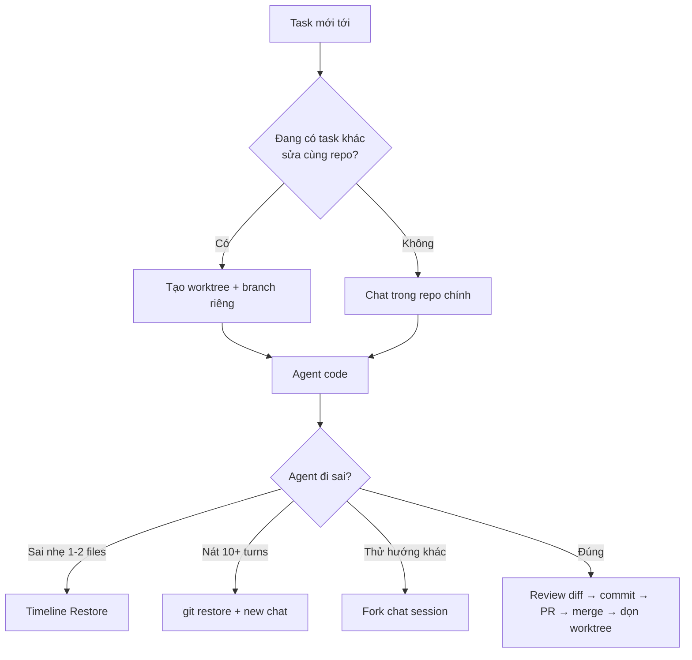

# 11 — Git Worktrees & Checkpoints: Chạy Agent Song Song Không Giẫm Chân Nhau

> **Dành cho:** dev đã quen Copilot trong VS Code, muốn chạy nhiều agent song song không giẫm chân, và muốn "quay lại" khi agent đi sai.
> **Vấn đề:** 2 sessions cùng sửa 1 working dir → conflict, đè file, test flaky; hoặc agent sửa 15 turns vẫn sai, càng sửa càng nát mà bạn tiếc credits đã đốt.
> **Đọc xong:** chạy được worktree cho parallel agents, undo đúng lúc bằng Timeline/Fork chat/`git restore`, và theo đúng branch strategy `copilot/*`.

## Mục tiêu bài học

- Tạo **worktree** để 2 agent chạy song song trên 2 branch riêng, không conflict file.
- Phân biệt **3 cơ chế undo** của VS Code (Timeline / Fork chat / `git restore` + new chat) và chọn theo mức hỏng.
- Theo đúng **branch strategy** `copilot/*` (của agent) vs `feat/*` (của bạn) khi review PR coding agent cloud.
- Có phản xạ **rewind sớm**: sai 2 lần thì restore + chat mới, thay vì argue 10 turns đốt AI Credits.
- Nhớ: worktree cách ly **nơi làm việc**, checkpoint cứu **kết quả sai** — không thay thế nhau.

---

## 1. Hai vấn đề, ba lớp công cụ

```text
Vấn đề 1 — Giẫm chân: 2 sessions cùng sửa 1 working dir → conflict, đè file, test flaky.
  → Vá bằng worktrees: mỗi session 1 checkout riêng, branch riêng.
Vấn đề 2 — Đi sai đường: agent sửa 15 turns vẫn sai, càng sửa càng nát.
  → Vá bằng checkpoints: undo code + conversation về điểm trước khi nát.
```

| Lớp | Vai trò | Nôm na |
|---|---|---|
| **Git** (commit/PR) | Nguồn sự thật cuối cùng | Sổ cái kế toán |
| **Checkpoints** (VS Code) | Undo local nhanh, không commit | Ctrl+Z của IDE |
| **Worktrees** | Cách ly không gian làm việc | Mỗi thợ 1 phòng riêng |



> **Ví dụ tiền (AI Credits):** argue với agent 10 turns mỗi turn tốn 1+ lượt gọi model; `git restore` + chat mới tốn ~0 credits thêm. Sai 2 lần vẫn sai → rewind luôn, đừng tiếc turns.

---

## 2. Checkpoints: 3 cơ chế undo

> **Lưu ý quan trọng:** Copilot KHÔNG có lệnh `/rewind` như Claude Code. Bạn undo bằng đúng 3 cơ chế của VS Code dưới đây.

| Cơ chế | Hiểu nôm na | Ví dụ | Khi nào dùng |
|---|---|---|---|
| **Timeline** (file history) | Undo từng file về bản trước | Agent phá `login.ts` → Timeline → Restore bản 9h sáng | Sai 1–2 files, còn lại đúng |
| **Chat session fork** | Rẽ nhánh hội thoại, giữ mạch chính | Fork chat ở turn 5 để thử JWT thay vì session | Muốn thử hướng khác |
| **Git restore + new chat** | Lật bàn cờ, đánh ván mới | `git restore src/auth/` + chat mới với prompt đủ ý | Agent nát 10+ turns (rewind thật) |

```bash
# 3 cách xem "đã hỏng gì" trước khi quyết undo:
git diff HEAD -- src/auth/login.ts   # file này agent sửa gì chưa commit?
git diff --stat                      # scope phình chưa? (>5 files khi chỉ cần 2 = lan)
git log --oneline -5 -- src/auth/login.ts  # điểm restore nào an toàn?
```

> **Nguyên tắc 30 giây:** sửa 2 lần vẫn sai → đừng argue, `git restore` + chat mới. Rẻ hơn 10 turns cãi nhau, và prompt mới có context sạch.

---

## 3. Worktrees deep-dive (lệnh thuộc lòng)

```bash
# Tạo (branch mới từ HEAD):
git worktree add ../myrepo-worktrees/feat-login -b feat/login
# Verify: git worktree list → thêm 1 dòng "feat-login [feat/login]"

# Tạo từ main mới nhất:
git fetch origin
git worktree add ../myrepo-worktrees/feat-pay -b feat/pay origin/main

# Mở session trong worktree (1 window = 1 branch):
code ../myrepo-worktrees/feat-login
# Verify: title window hiện "feat-login".

# Dọn sau merge:
git worktree remove ../myrepo-worktrees/feat-login          # worktree sạch
git worktree remove --force ../myrepo-worktrees/feat-login  # có changes chưa commit (cẩn thận!)
git worktree prune                                           # dọn metadata xóa tay
# Verify: git worktree list → mất dòng feat-login.
```

```text
Quy ước tên:
../<repo>-worktrees/<ten>  → đặt NGOÀI repo chính (git status sạch, không sửa .gitignore).
feat/<ten>                 → branch local, PR riêng từng worktree.
copilot/<issue>-<slug>     → prefix coding agent cloud dùng (mục 4) — đừng đặt tay trùng.
Dọn sau merge              → worktree tồn = branch tồn = nợ.
```

> **Worktree rẻ hơn clone:** worktree chia sẻ `.git` objects của repo gốc, chỉ thêm working files (vài trăm MB) — `git clone` mới tốn gấp 5–10x vì copy cả `.git`. Verify: `du -sh ../myrepo-worktrees/feat-x`.

---

## 4. Branch strategy của coding agent (`copilot/*`)

```text
Luồng coding agent chuẩn:
1. BẠN: mở issue (mục tiêu + acceptance criteria + label "ready") → Assign to Copilot.
2. AGENT (cloud): tạo branch copilot/issue-123-<slug> từ main → code → push →
   mở PR draft (gắn issue, checklist tests, session log).
3. BẠN: review PR (diff + Copilot review + CI) → request changes (agent iterate)
   hoặc approve → merge → branch tự xóa (auto-delete head branches: ON).
```

**Quy tắc branch (dán vào CONTRIBUTING):**

- `copilot/*` → của agent. Bạn KHÔNG push tay vào (trừ hotfix, phải báo trước).
- `feat/*` → của bạn local (worktrees). Không đặt `feat/copilot-*` gây nhầm.
- `main` → protected: không ai push trực tiếp, kể cả agent (bài 07).

```bash
# Theo dõi + review coding agent:
git fetch origin
git branch -r | grep "copilot/"                     # agent đang làm branches nào?
gh pr list --repo acme/api --author "app/copilot" --state open
gh pr view 45 --json title,headRefName,reviews,state --jq .

# Checkout PR về local để test (KHÔNG sửa trên branch của nó):
gh pr checkout 45 --branch review-45
pnpm install --frozen-lockfile && pnpm test

# Dọn sau merge:
git branch -d feat/my-done-task
git worktree remove ../api-worktrees/feat-my-done-task
git worktree prune && git worktree list             # Verify: sạch
```

> **Tin tốt 2026:** coding agent khởi động nhanh hơn 50% (changelog 19/03/2026) — tạo PR từ đầu và feedback loop nhanh hơn hẳn, nên luồng assign → review → iterate bớt chờ đợi.

---

## 5. 3 worktree workflows copy-paste

| Pattern | Nôm na | Khi nào dùng |
|---|---|---|
| **A — 2 features song song** | 2 thợ 2 phòng | 2 task độc lập làm cùng lúc |
| **B — Thử 2 phương án (spike)** | Cắm 2 mầm, giữ cây khỏe hơn | Chưa biết hướng nào đúng |
| **C — Bạn local + agent cloud fan-out** | Bạn giữ việc chính, thuê robot làm phụ | Vừa code tay vừa giao issue cho coding agent |

```bash
# Pattern A — 2 features song song:
git fetch origin
git worktree add ../myrepo-worktrees/feat-a -b feat/a origin/main
git worktree add ../myrepo-worktrees/feat-b -b feat/b origin/main
# Window 1 (feat-a) Agent mode: "implement login rate-limit theo plan, chạy focused test"
# Window 2 (feat-b) Agent mode: "migrate users table thêm last_login_at, test local"
# Xong: review diff → commit → push → gh pr create → merge → dọn:
git worktree remove ../myrepo-worktrees/feat-a && git branch -d feat/a

# Pattern B — spike 2 phương án:
git worktree add ../myrepo-worktrees/spike-1 -b spike/option-1 origin/main
git worktree add ../myrepo-worktrees/spike-2 -b spike/option-2 origin/main
# Mỗi bên: implement + test + đo → giữ spike-2, bỏ spike-1:
git worktree remove --force ../myrepo-worktrees/spike-1
git branch -D spike/option-1 && git branch -m spike/option-2 feat/sessions
```

```text
Pattern C — Bạn KHÔNG tạo worktree cho agent cloud (nó chạy trên hạ tầng GitHub,
branch copilot/*):
1. Giao 2 issues độc lập cho 2 coding agents (gh copilot assign hoặc web "Assign to Copilot").
2. Bạn code task chính ở worktree local feat/main-work.
3. Agent mở PR drafts → review từng PR (checkout local test như mục 4).
4. Merge từng PR → dọn worktree local khi xong.
# Kill khi agent đi sai: comment "stop, wrong direction — [hướng đúng]"
# hoặc close PR + delete branch copilot/*. Đừng để agent iterate quá 3 rounds.
```

---

## 6. Rewind: bảng quyết định 30 giây

| Tình huống | Ví dụ | Rewind? | Bằng gì |
|---|---|---|---|
| Cùng lỗi fail 2–3 lần | Test login đỏ 3 lần cùng `TypeError normalize` | Có | `git restore` + new chat: "Lần trước thử A, B, C đều fail. Đề xuất root cause KHÁC trước khi sửa." |
| Lan scope, diff phình | `--stat` hiện `auth/ + cart/ + legacy/` | Có | Restore files ngoài scope + chat hẹp hơn |
| Hiểu nhầm yêu cầu từ đầu | Bảo "thêm refund" quên giới hạn 30 ngày | Có | Restore hết + viết lại prompt đủ (mục tiêu + scope + verify + non-goals) |
| Sai 1 dòng, còn đúng | `user_id` thành `users_id` | Không | Edit trực tiếp / Timeline 1 file — rewind phí 9 steps đúng |
| Thử hướng khác song song | A dùng JWT, B dùng session | Không | Worktree mới + branch mới |
| Task đã commit PR | PR #45 đã 2 người review | Không | `git revert` / PR mới (checkpoints là local only) |
| Coding agent sai trên cloud | `copilot/issue-123` sai spec | Không | Comment redirect / close + delete `copilot/*` |

| Hiểu nhầm | Sự thật |
|---|---|
| "Worktree là clone mới, tốn disk gấp đôi" | Chia sẻ `.git` objects, chỉ thêm working files — nhẹ hơn clone 5–10x |
| "Checkpoint = commit" | Checkpoint chỉ ở máy bạn, mất khi xóa cache IDE; muốn bền phải `git commit` |
| "Restore xong chat cũng quay lại" | Timeline chỉ quay code; quay cả chat phải Fork session |

---

## 7. Gotchas + pitfalls

**4 gotchas ai cũng vấp 1 lần:**

```bash
# 1. Untracked files không theo worktree — WIP chưa commit ở main KHÔNG sang:
git stash push -m "wip-main" && git worktree add ../myrepo-worktrees/feat-x -b feat/x

# 2. Dependencies phải cài lại mỗi worktree:
cd ../myrepo-worktrees/feat-x && pnpm install --frozen-lockfile
# (python: python -m venv .venv && pip install -r requirements.txt)

# 3. Env files + ports đụng nhau (.env thường untracked — copy tay, KHÔNG commit):
cp /path/to/main/.env ../myrepo-worktrees/feat-x/.env
PORT=3001 pnpm dev   # worktree A :3000, worktree B :3001

# 4. Đừng mở 2 worktrees trong 1 window — mỗi worktree 1 window riêng:
#    "window.title": "${rootName} — ${activeEditorShort}"
```

| Pitfall | Fix |
|---|---|
| Quên dọn worktree → 10 worktrees tồn | Merge xong `remove` ngay; cuối tuần `git worktree list` kiểm tra |
| 2 sessions cùng dir (không worktree) | Task song song = worktree riêng, không ngoại lệ |
| Restore sau khi đã push | Checkpoints là local only → `git revert` / PR mới |
| Push tay vào `copilot/*` của agent | Review qua PR, đừng đụng branch của nó |
| Xóa worktree đang có window mở | Đóng window trước, hoặc `cd` ra rồi `remove` |
| Agent lan scope mà vẫn argue 10 turns | Sai 2 lần → restore + new chat, rẻ hơn argue |

**Bài tập nhỏ:** (1) Tạo 2 worktrees pattern A, chạy 2 task nhỏ song song, merge + dọn. (2) Giao task sai hướng cho agent, để chạy 5 turns, rồi restore + new chat — so credits rewind-sớm vs argue-tiếp. (3) Thử Timeline restore 1 file + fork chat. (4) Giao 1 issue cho coding agent, review PR `copilot/*`: checkout local, request changes, merge, verify auto-delete.

---

## 8. So sánh với Claude Code + link chéo

| Việc | Copilot | Claude Code |
|---|---|---|
| Undo cả phiên | Không có `/rewind` — ghép Timeline + fork chat + `git restore` | Có `/rewind` sẵn (resume được cả trước `/clear`) |
| Undo 1 file | Timeline của VS Code | Checkpoint/rewind |
| Rẽ nhánh hội thoại | Fork chat session (History) | `/branch`, `/fork` |
| Cách ly nơi làm việc | Git worktree + mở folder riêng | Cũng chạy trên git (worktree picker sẵn) |
| Bền hoá kết quả | `git commit` / PR | `git commit` / PR |

> Nền Git là chung — khác biệt là *cách agent phơi thao tác quay lui*: Claude Code gói thành `/rewind`, Copilot để bạn ghép công cụ editor + Git. Cả hai đều coi `git commit`/PR là nguồn sự thật.

**Link chéo:** Bài 06 (chạy nhiều agent local song song) · Bài 07 (branch protection + auto-delete cho `copilot/*`) · Bài 10 (scope Agent mode + approval) · Bài 12 (coding agent assign, auto-fix CI) · Bài 04 (chat history + model picker sau rewind).

> **Chốt bài 11:** Worktree và checkpoint là hai tay của cùng một phản xạ — *cách ly trước khi chạy, quay lui ngay khi sai*. Tạo worktree mất 30 giây, rewind sớm mất vài giây; còn argue với agent thì tính bằng AI Credits và bằng buổi làm việc của bạn.
>
> *(Hết bài 11. Tiếp theo: [bài 12 — Copilot SDK & CI/CD automation](./12-copilot-sdk-ci-cd-automation.md).)*
