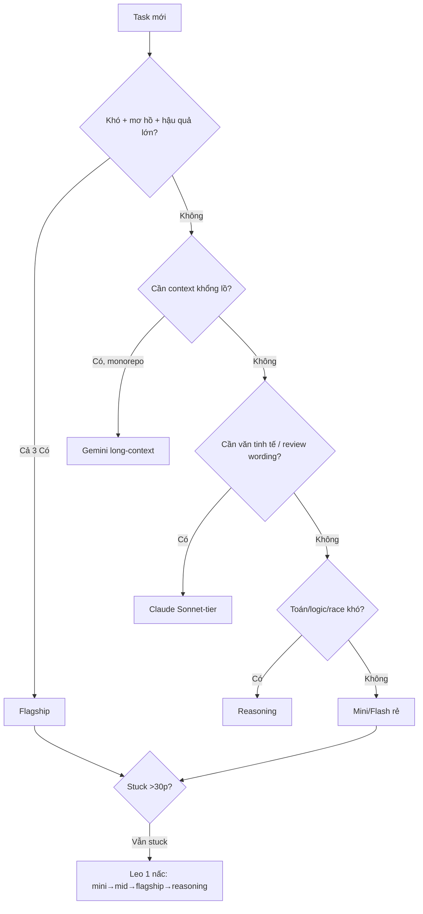

# 14 — Models: Chọn Model Đúng (GPT / Claude / Gemini / Grok Trên Copilot)

> **Bài 14 series 01.** · **Dành cho:** dev chọn model trong picker mỗi ngày + tech lead/admin muốn gate model và kiểm soát AI Credits cho team.
> **Vấn đề:** model mạnh nhất không phải lúc nào cũng là model đúng — chọn sai là đốt credits hoặc refactor 3 lần vẫn sai.
> **Đọc xong:** chọn đúng model cho từng task, hiểu cách tính AI Credits, cấu hình BYOK/policy gate model cho team, và không trả tiền model đắt cho việc model rẻ làm được.

## Mục tiêu bài học

- Phân biệt **4 nhóm model** theo vai trò (flagship, reasoning, Claude/Gemini, mini/flash) và biết nhóm nào hợp việc nào.
- Ước lượng được tiền: **1 AI credit = $0.01**, vì sao flagship × agent mode đốt nhanh.
- Cấu hình được **model picker**, **auto tier**, và (admin) **BYOK + policy gate** model cho team.
- Tự route model theo phase (**plan đắt → execute rẻ → stuck leo thang**).
- Nắm các mốc model bị gỡ để không gọi tên model đã chết.

---

## 1. Vì sao chọn model?

Mỗi task có 3 chiều cần cân: **chất lượng suy luận — tốc độ — chi phí (AI Credits)**.

- Model reasoning đắt sửa typo → tốn gấp 5–10 lần mà kết quả y hệt model rẻ.
- Model mini thiết kế kiến trúc → thiếu depth, refactor 3 lần vẫn sai — tổng credits cao hơn chạy 1 lần model mạnh đúng ngay.
- Default sẵn model đắt nhất → tuần đầu credits nổ, ba tuần sau phải hạ xuống cho cả việc khó.

```text
Nguyên tắc vàng:
Task khó, mơ hồ, hậu quả lớn → model mạnh (GPT-6.x / Claude Opus / Gemini 4).
Task rõ ràng, lặp lại, khối lượng lớn → model rẻ + nhanh (mini/flash/haiku-tier).
Không bao giờ default model đắt nhất — chỉ gọi đích danh khi cần reasoning sâu.
# Verify: billing usage sau 1 tuần — flagship <30% requests (nếu >50% là routing hỏng).
```



---

## 2. Bản đồ models trên Copilot 2026

> Danh sách model đổi theo quý — tra model picker thực tế, đừng học thuộc lòng. Bảng dưới là khung phân loại để route đúng, không phải catalog bất biến.

| Nhóm | Nôm na | Ví dụ trên picker (10/2026) | Khi nào dùng |
|---|---|---|---|
| **Flagship** | Giáo sư toàn diện — khó gì cũng nghĩ được | GPT-6.1 Sol, GPT-6 Astra, Claude Opus 5.5, Gemini 4 Argon | Plan migrate multi-file, debug stuck, agent multi-step |
| **Reasoning** | Nhà toán học trầm ngâm — chậm mà sâu | Lớp model mạnh nhất (GPT-6.x / Opus 5.x / Gemini 4 Argon) | Toán/logic khó, query N+1, race condition |
| **Claude-tier** | Nhà văn tinh tế — viết hay, review khéo | Claude Sonnet 5.5, Opus 5.5, Haiku 5.5 (việc nhỏ) | Docs, PR description, review wording giữ style |
| **Gemini-tier** | Thủ thư nhớ cả thư viện — context khổng lồ | Gemini 4 Argon, 3.8 Flash | Tóm tắt monorepo, task cross-file rộng |
| **Mini/Flash-tier** | Xe ôm nhanh rẻ — việc nhỏ gọi ngay | GPT-5.6 Luna, Claude Haiku 5.5, Gemini 3.8 Flash, MAI-Code-1.1-Flash | Autocomplete, rename, CRUD, 5 chats explore song song |

```text
Roster 10/2026 (verify picker + docs.github.com/copilot/reference/ai-models/supported-models):
OpenAI:    GPT-5.3-Codex (chỉ VS Code ext, chỉ Pro+), GPT-5.6 Luna/Sol/Terra,
           GPT-6 Astra, GPT-6 Luna, GPT-6 Sol, GPT-6.1 Sol.
           HydraFusion / HydraFusion Max (preview 14/10): orchestrate đa model.
Anthropic: Claude Fable 5 / 5.1, Haiku 4.5 / 5.5 (GA 07/10), Opus 4.5/4.6/4.8
           (fast mode preview) / 5 / 5.5, Sonnet 4.5/4.6/5/5.5.
Google:    Gemini 3.1 Pro (public preview), 3.8 Flash, 4 Argon (GA 13/10, Pro+/Max/Biz/Ent).
Microsoft: MAI-Code-1-Flash, MAI-Code-1.1-Flash, Raptor mini.
Khác:      Kimi K3, Grok 4.7 (GA trong Copilot 21/09/2026).

Đã gỡ 02/10/2026: Gemini 3.5/3.6 Flash → 3.8 Flash; Kimi K2.7 Code → K3;
                  Claude Opus 4.7 → 5.5.
Sắp gỡ 19/10/2026: Gemini 3.7 Flash; GPT-5.5/5.4 → GPT-5.6 Sol;
                  GPT-5.4 mini / GPT-5 mini → GPT-5.6 Luna; Grok 4.5 → 4.7.
Sắp gỡ 16/11/2026: Claude Opus 4.8* + Opus 5 → 5.5; GPT-5.6 Terra → GPT-6.1 Sol/GPT-6 Luna
                  (*Opus 4.8 giữ cho individual annual).

Model nổi bật: GPT-6 Astra GA 04/09/2026 (autonomous coding, tự validate);
GPT-6.1 Sol GA 29/09/2026 (agentic/terminal, ít token + ít bước hơn).
GPT-5.2-Codex GA 01/2026, GPT-5.3-Codex là bản Codex hiện hành trên VS Code (Pro+ only).
# Verify: mở model picker → đối chiếu. Khác → bản bạn chạy mới hơn bảng này
# (check github.blog/changelog/label/copilot/).
```

---

## 3. Model picker + auto tier

```bash
# Đổi model (3 chỗ):
# 1. Chat view → model picker (dropdown góc dưới) → chọn mỗi chat mới.
# 2. Inline completions: model riêng (settings: github.copilot.completions model).
# 3. Coding agent (github.com assign issue): model chọn lúc tạo job.
# Verify: chat mới header hiện đúng model đã chọn.
```

```text
Auto model selection — 2 hệ thống chạy song song:
1. Sức khỏe/availability thời gian thực → tránh model đang gặp sự cố.
2. Đánh giá độ phức tạp task → route model phù hợp.
- Route theo ranh giới cache tự nhiên; không phụ thuộc ngôn ngữ lập trình.
- GA ở: Chat trên github.com, IDE hỗ trợ, Copilot CLI, cloud agent, Copilot app.
- Tôn trọng plan + policy org (allowlist, data residency, FedRAMP).

3 tier (từ 14/09/2026) — chọn hướng route trong auto selection:
- Efficiency: ưu tiên chi phí · Balance: cân bằng · Intelligence: ưu tiên chất lượng.
- CÙNG 1 pool model ở cả 3 tier — tier đổi cách route, KHÔNG đổi giá hay danh sách.
- Tiền tính theo model Auto chọn, bất kể tier. Plan trả phí giữ discount 10%.
- Đặt tier ở: VS Code, Copilot CLI, Copilot app (đang rollout).
- Free/Student: chỉ Auto, không có picker tay.
```

```text
Quy tắc đổi model tay (giữ 3 điều):
1. Đổi theo PHASE, không đổi giữa phase (mất context/cache) — mục 6.
2. Mỗi chat mới = cơ hội chọn lại (đừng để flagship đi kèm từ chat cũ sang typo mới).
3. Sau 1 tuần: dashboard model nào ngốn % (bài 13) → adjust default team.
```

```jsonc
// .vscode/settings.json — default cho team (commit; tên exact lấy từ picker hiện tại):
{
  "github.copilot.chat.model": "gpt-mini-tier",         // đặt đúng tên picker thực tế
  "github.copilot.completions.model": "gpt-mini-tier"
}
```

---

## 4. AI Credits (tiền thật)

> **Từ 01/06/2026 Copilot tính bằng AI Credits (usage-based billing) — thuật ngữ "premium requests"/multiplier là cách gọi legacy.** 1 AI credit = $0.01; chi phí 1 lượt = giá per-token của model × số token.

```text
Vì sao credits cháy nhanh hơn bạn nghĩ:
- Flagship/reasoning giá per-token cao gap nhiều lần mini-tier → cùng 1 câu hỏi
  tốn nhieu credits hon.
- Agentic = mỗi step 1 lượt gọi → agent 50 steps × flagship = credits bốc hơi.
- Code completion + next edit suggestions KHÔNG trừ credits (plan trả phí).
- Dùng auto model selection được giảm 10%.
# Verify: github.com/settings/copilot → Usage → ghi % credits đã dùng + ngày hiện tại.
```

| Plan | Giá | AI Credits kèm/tháng |
|---|---|---|
| Free | $0 | allowance nhỏ |
| Pro | $10/tháng | 1.500 (base 1.000 + flex 500) |
| Pro+ | $39/tháng | 7.000 (base 3.900 + flex 3.100) |
| Max | $100/tháng | 20.000 (base 10.000 + flex 10.000) |
| Business | $19/seat/tháng | 1.900/seat (pooled) |
| Enterprise | $39/seat/tháng | 3.900/seat (pooled) |

```text
Giữ credits sống hết tháng:
1. Default chat = tier giá rẻ. Flagship chỉ đích danh khi checklist 3✓ (mục 2).
2. Agent mode + flagship là combo đốt nhanh nhất → agent chạy tier rẻ trước, stuck mới leo.
3. Explore fan-out bằng mini (5 prompt rẻ) thay vì nhét 20 files vào 1 flagship chat.
4. Cuối tuần: dashboard AI credits by model (bài 13) → model nào > 50% thì gate.
```

## 5. BYOK + enterprise policy: gate model cho team

Dành cho admin/org owner; dev đọc để đối chiếu picker với policy.

- **BYOK (Bring Your Own Key):** Enterprise dùng Azure/OpenAI key riêng cho Copilot thay vì GitHub-hosted models — data residency + billing riêng + model allowlist công ty. Hỏi admin bạn có BYOK không trước khi assume data đi đâu. Theo surface (10/2026): Visual Studio ✓ đầy đủ; VS Code / JetBrains / Eclipse / Xcode một phần; NeoVim ✗.
- **Model gating (policy):** admin cấm/bật models theo team (interns chỉ mini+mid, seniors mới flagship; team payments cấm model X...).

```text
# Checklist admin gate model (github.com → Org/Ent Settings → Copilot → Policies):
[ ] Model allowlist: team nào × models nào (đừng all-access ngay đầu)
[ ] Flagship: bật cho seniors/leads, tắt cho interns/bot accounts
[ ] Reasoning tier: tắt default, mở theo request (đắt + chậm, ít người cần)
[ ] Review hàng tháng: dashboard by-model (bài 13) → siết/nới 1 model
[ ] BYOK (nếu có): key rotation lịch + endpoint region đúng compliance
[ ] Paid usage policy (chi vượt credit kèm theo): MẶC ĐỊNH BẬT → muốn cap thì tắt;
    user hết limit xin tăng budget, admin approve/từ chối trong settings
[ ] Managed settings: "model" (default model) + "autoTier" (tier route mặc định)
```

```text
# Verify policy có hiệu lực (máy dev, làm 1 lần):
# 1. Mở model picker → model bị cấm phải KHÔNG hiện (hiện là policy hỏng).
# 2. Hỏi admin "team tôi được dùng models nào?" → đối chiếu picker.
# Template đề xuất cho team mới (wiki):
# Default: mid-tier · Agent: mid-tier · Flagship: checklist 3✓
# Mini: autocomplete + explore · Reasoning: debug stuck > 1h mới mở
# Review quota mỗi thứ hai (15 phút — bài 13 mục 7.3).
```

---

## 6. Khi nào dùng model nào (bảng dán tường) + route theo phase

Cột "Model" là tên VAI TRÒ — tên chính thức 10/2026 xem mục 2.

| Task | Ví dụ | Model | Vì sao |
|---|---|---|---|
| Thiết kế kiến trúc, plan multi-file | Plan migrate `auth.ts` 900 dòng → 3 modules | Flagship | Quyết định đắt nhất → model mạnh |
| Debug stuck > 30 phút | `normalizeEmail` crash email có dấu, 3 cách fail | Flagship → reasoning nếu vẫn stuck | Cần depth, không cần tốc độ |
| Implement theo plan đã duyệt | Implement step 1–3 của `plan.md` | Mid-tier | Rõ ràng → vừa đủ + tiết kiệm |
| Viết test, docs, CRUD | 10 test CRUD `payments` | Mini/Mid-tier | Cơ học, khối lượng lớn |
| Explore codebase, tóm tắt | 5 chats mini, mỗi chat 1 module | Mini/Flash | Rộng + nhanh + rẻ |
| Format, rename, classify | Rename `userId` → `user_id` 20 files | Mini | Flagship làm cũng vậy mà đắt nhiều lần |
| Context khổng lồ (monorepo) | Tóm tắt cả `apps/api` 500 files | Gemini-tier | Context rộng nhất |
| Giải thích tinh tế, review wording | PR description + review comments | Claude-tier | Văn + style tốt hơn |
| Thuật toán/logic khó | Tối ưu query N+1, retry backoff | Reasoning | Thinking dài |
| Demo live cần nhanh | Demo sprint review 5 phút | Mid-tier nhanh | Reasoning chậm làm demo chết |

```text
Route theo phase (3 kịch bản dán wiki):
Kịch bản A — feature multi-file (default team):
  Chat 1 (flagship): "plan migrate auth sang session, steps + risks, KHÔNG code"
  Chat 2 mới (mid): "implement step 1–3 của plan trên" (+ paste plan)
  Stuck > 30p → chat 3 (flagship/reasoning): "đang stuck ở X, log Y, gợi ý?"
Kịch bản B — explore rẻ:
  5 chat mini song song (auth, db, api, tests, docs) → gom vào chat chính (mid) quyết định.
Kịch bản C — review quan trọng:
  Claude-tier review wording + flagship review logic (2 pass, 2 điểm mạnh khác nhau).
# Verify: chạy 1 task 3+ files theo kịch bản A, so credits với lần full-flagship.
```

| Hiểu nhầm | Sự thật |
|---|---|
| "Model mạnh nhất là tốt nhất cho mọi task" | Flagship sửa typo ra chữ y hệt mini mà tốn ×3 |
| "Tên model học thuộc 1 lần dùng mãi" | Tên đổi theo quý — copy exact từ picker, đừng gõ trí nhớ |
| "Agent + flagship từ đầu cho chắc" | Combo đốt credits nhanh nhất (50 steps × giá cao). Agent mid trước, stuck mới leo |

---

## 7. Pitfalls + bài tập

| Pitfall | Fix |
|---|---|
| Default flagship mọi chat | Default mid/mini, flagship đích danh khi đủ 3✓ |
| Ở lì flagship cả task dài | Chia phase: plan đắt + execute rẻ (mục 6) |
| Mini cho task kiến trúc | Plan flagship trước, execute mới rẻ |
| Reasoning cho chat nhanh | Reasoning chỉ debug/logic khó |
| Gõ tên model từ trí nhớ → `model not found` | Copy tên exact từ picker hiện tại (vd model đã gỡ 02/10/2026 thì picker không còn) |
| Agent + flagship từ đầu | Agent mid trước, stuck mới leo flagship/reasoning |
| Quên giá per-token × số bước agentic | Xem usage dashboard hàng tuần (bài 13) |
| Policy gate nhưng không verify | Check picker + hỏi admin đối chiếu |
| Không review credits hàng tuần | Block 15 phút thứ 2 (bài 13 mục 7.3) |

**Bài tập nhỏ:** (1) Cùng 1 task nhỏ chạy 3 chats (mini → mid → flagship) — tier nào là "đủ"? Ghi lý do vào wiki. (2) Task 3+ files: flagship plan (không code) → chat mới mid implement — so quality + credits với full-flagship. (3) Bug logic khó: mid 15 phút → stuck thì reasoning, ghi khác biệt; task monorepo: thử Gemini-tier so với mid. (4) Mở billing usage: % đã dùng, sống hết tháng không? Liệt kê picker vs policy team — lệch chỗ nào báo admin.

---

## 8. So sánh với Claude Code + link chéo

| Việc | Copilot | Claude Code |
|---|---|---|
| Chọn model | Picker đa nhà (GPT / Claude / Gemini / Grok) ngay trong Chat | Gắn với model Anthropic |
| Auto chọn model | Auto selection + 3 tier (efficiency/balance/intelligence) | Không có tương đương trực tiếp (10/2026) |
| Gate model cho team | Org/Enterprise policy allowlist | Phụ thuộc Anthropic provider |
| BYOK / data residency | BYOK (Azure/OpenAI key riêng) cho Enterprise | Phụ thuộc provider |
| Kiểm chứng chi phí | Billing/usage dashboard (AI Credits, theo model) | Bạn tự quản theo provider/plan |

> Copilot có "model picker đa nhà trong 1 tài khoản" + auto tier; Claude Code nhất quán 1 nhà. Phần "chọn model" là điểm phải học lại nhiều nhất khi đổi công cụ.

**Link chéo:** Bài 04 (model picker đổi ở đâu) · Bài 06 (agent nào × model nào, fan-out mini) · Bài 07 (gate models + content exclusion cho org) · Bài 10 (Ask/Edit/Agent + approval trước khi agent đốt credits) · Bài 12 (pin model trong pipeline) · Bài 13 (dashboard by-model, vòng lặp 15 phút/tuần) · Bài 15 (model policy là tầng 5) · Bài 16 (tools ngoài có tuân thủ model policy không).

> **Chốt bài 14:** model đúng không phải model mạnh nhất mà là model *đủ* cho task — plan bằng flagship, thi công bằng tier giữa, việc cơ học bằng mini, và để dashboard nói thay bạn rằng credits còn sống hết tháng.
