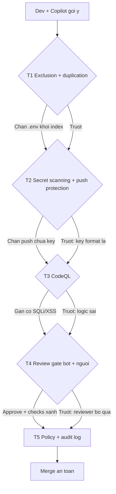

# 15 — Security Stack 5 Tầng Cho Copilot (Defense-in-Depth, Không Tin 1 Lớp Nào)

> **Bài 15 series 01.** · **Dành cho:** dev đã dùng Copilot (tự verify từng tầng) + admin/org owner (rà policy).
> **Vấn đề:** 1 lớp bảo mật luôn có lỗ — exclusion sai 1 path là secret lọt vào index, alert bị dismiss không ai biết.
> **Đọc xong:** dựng + verify được 5 tầng phòng thủ (content exclusion → secret scanning → CodeQL → review gate → policy/audit), chỉ ra được tầng nào team đang yếu và vá thế nào.

## Mục tiêu bài học

- Hiểu **defense-in-depth**: vì sao 1 lớp luôn có lỗ và 5 tầng chồng nhau mới đỡ được.
- Dựng **tầng 1** (content exclusion + duplication detection) và tự verify nó sống.
- Bật + xử lý đúng **tầng 2 + 3** (secret scanning/push protection, CodeQL) — không bypass.
- Gắn **tầng 4** (review gate máy + người) và biết nó tốn bao nhiêu AI Credits.
- Chốt **tầng 5** (policy as code + audit log) và chỉ ra tầng yếu nhất bằng evidence.

---

## 1. Vì sao 5 tầng?

**1 câu:** 1 lớp bảo mật luôn có lỗ — defense-in-depth là xếp 5 lớp chồng nhau, lớp này trượt thì lớp sau đỡ. **Nôm na:** nhà 5 ổ khóa — trộm phá được cổng thì kẹt cửa, phá cửa thì kẹt két, phá két thì camera + bảo vệ vẫn thấy.

```text
Không stack:  Copilot đọc .env → gợi ý key vào code → push lên GitHub → lộ 6 tháng mới biết
Có stack:     T1 chặn .env khỏi index → trượt? T2 push protection chặn push →
              trượt? T3 CodeQL gắn flag → trượt? T4 reviewer thấy → trượt? T5 audit truy ra
# Quy tắc: không tin bất kỳ 1 tầng nào. Mỗi incident phải trả lời
# "tầng nào trượt + tầng nào đỡ + vá tầng trượt thế nào".
```

## 2. Bản đồ 5 tầng

| Tầng | Chặn gì | Ở đâu | Ai sở hữu |
|---|---|---|---|
| **1. Exclusion + duplication** | Copilot đọc file nhạy cảm; gợi ý copy code có license | Copilot settings (org/repo — Business/Enterprise) | Admin + team lead |
| **2. Secret scanning + push protection** | Key/token lọt vào repo | GitHub Advanced Security | Admin bật, dev fix alert |
| **3. Code scanning (CodeQL)** | SQLi, XSS, path traversal... | PR checks + `github/codeql` | Team fix, CI chặn |
| **4. Copilot code review gate** | Bug/logic mà máy + mắt người sót | PR review + required checks | Reviewer + maintainer |
| **5. Policy + audit** | Ai đổi 4 tầng trên, ai dùng gì | Org/enterprise policy + audit log (180 ngày) | Admin |



---

## 3. Tầng 1 — Exclusion + duplication detection

```text
# Checklist admin (github.com → Org Settings → Copilot → Content exclusion).
# Lưu ý plan: content exclusion là tính năng Copilot Business/Enterprise;
# cấp cha truyền xuống cấp con (repo kế thừa từ org); cần automate → REST API.
[ ] **/.env* (mọi biến thể: .env.local, .env.prod...)
[ ] **/secrets/**, **/*.pem, **/*.key, **/*credentials*
[ ] **/migrations/*seed* (data thật), dumps/*.sql
[ ] vendor/, dist/, *.min.js (nhiễu, loại cho sạch index)
```

```bash
# Verify exclusion sống (dev làm 1 lần, 2 phút):
# Chat: "@workspace tìm chuỗi STRIPE_KEY trong repo?" → phải "không thấy / excluded".
git check-ignore -v .env .env.prod secrets/ 2>/dev/null
# → phải ignored (exclusion + gitignore song kiêm, thiếu 1 là hở 1 đường).
git status --porcelain | grep -E "env|pem|key|secrets" || echo "sạch: không file nhạy cảm staged"
```

```text
# Duplication detection (Org Settings → Copilot → Policies → Suggestions matching public code):
# - Block (khuyến nghị team closed-source): chặn gợi ý trùng public code
# - Allow: cho phép + gắn cảnh báo nguồn (team open-source ok)
# Mặc định 2026: Copilot Business = Blocked (mở phải legal đồng ý, đổi trong Privacy).
# Khi bị block: đừng copy tay lách — đọc reference URL, viết lại theo style repo,
# ghi "# adapted from <url> (MIT)" nếu giữ ý tưởng.
```

---

## 4. Tầng 2 — Secret scanning + push protection

```text
# Bật (github.com → Org/Repo Settings → Code security — 5 phút):
[ ] Secret scanning: quét quá khứ + tương lai, alerts về Security tab
[ ] Push protection: chặn NGAY lúc push phát hiện secret (đỡ hơn fix sau)
```

```bash
# Ca A — push bị chặn: KHÔNG bypass, fix đúng:
git diff --cached -- <file-bị-chặn>          # 1. đọc: loại secret, file, dòng
# 2. xóa secret khỏi code → chuyển sang env/secrets manager (process.env.STRIPE_KEY)
# 3. commit lại + push lại (protection pass là xong)

# Ca B — secret đã lọt (alert trong Security tab):
# 1. REVOKE key NGAY (Stripe/GitHub/AWS dashboard) — trước khi xóa code
# 2. xóa khỏi history nếu cần (BFG/filter-repo — admin), rồi push fix
# 3. đánh dấu alert resolved + ghi lý do (audit cần, mục 7)
```

```bash
# Phòng bệnh local: pre-commit hook khung (.git/hooks/pre-commit, chmod +x):
git diff --cached --name-only | xargs grep -n -i -E "sk-live|ghp_|AKIA|xoxb-|-----BEGIN .*PRIVATE KEY" && {
  echo "BLOCKED: nghi secret staged — doi sang env truoc khi commit"; exit 1; }
```

---

## 5. Tầng 3 — Code scanning + CodeQL

```text
# Bật default setup (5 phút, hiệu quả/giờ cao nhất):
# Repo Settings → Code security → Code scanning → Set up → Default setup
#   → chọn query suite Extended (team payments/auth) hoặc Default → Create.
# PR sau tự có check "CodeQL". Verify: mở 1 PR → check CodeQL hiện và chạy.
```

```yaml
# Nâng cao — variant custom khi default chưa đủ (khung):
# .github/workflows/codeql.yml — codeql-action init + analyze
#   languages: ['javascript-typescript', 'python']
#   on: [pull_request, push (main), schedule: weekly]
```

```text
# Fix alert đúng cách (paste alert message vào chat):
"CodeQL báo <dán alert: vd 'SQL query built from user input'> tại file X dòng Y.
 Giải thích lỗ hổng 3 dòng, sửa bằng parameterized query, giữ behavior cũ,
 không đổi signature hàm public."
# Quy tắc: fix ROOT (validate/escape/parameterize), không suppress cho qua.
# Dismiss chỉ khi false positive CHỨNG MINH được + ghi lý do + reviewer đồng ý.
# Severity high/critical: fix trước khi merge, không "để sprint sau".
```

## 6. Tầng 4 — Copilot code review gate

```text
# LỚP MÁY — Copilot code review:
# - Bật: Repo Settings → Copilot code review → auto review mỗi PR.
# - Đọc review như junior nhiệt tình: đúng ~70%, bịa ~30% → verify từng comment.
# LỚP NGƯỜI — required reviewers + checks (Repo Settings → Branch protection):
[ ] Require pull request review (≥1 approve; team payments/auth ≥2)
[ ] Require status checks: CodeQL + tests + secret scanning đều pass
[ ] Dismiss stale approvals khi push mới (tránh approve bản cũ, merge bản mới)
```

**Kinh tế của review gate (AI Credits — usage-based billing từ 01/06/2026):**

- **1 AI credit = $0.01.** Mỗi review tốn **AI credits + GitHub Actions minutes** (Actions tính riêng).
- **Effort:** `Lite` ($0.05–$1 credit) — nhắm đúng, nhanh; `Balanced` ($0.25–$5 credit) — reasoning cao hơn, hợp logic phức tạp + security.
- **`Balanced` là mặc định từ 28/09/2026.** Chọn `Lite` tường minh vẫn được giữ.
- Review mặc định kiểu **`Comment`** — không tính phê duyệt bắt buộc.
- Tự động review cấu hình được 3 mốc: lần đầu Copilot được gán vào PR, mỗi push mới, cả draft PR.
- Plan: Pro/Pro+/Max/Business/Enterprise (Free chỉ "Review selection" trong VS Code).
- Gọi từ CI: REST + GraphQL API (GA 02/10/2026).
- Repo-level: **"Allow Copilot to use MCP tools when reviewing PRs" bật sẵn mặc định** — tắt nếu team không muốn tool chạy lúc review.

```text
# Prompt review sâu cho PR nhạy cảm (copy-paste):
# 1. Bảo mật (payments/auth): "Review theo góc bảo mật: input validation, auth checks,
#    secrets handling, SQL/NoSQL injection, XSS, IDOR. Mỗi finding: severity + file:dòng + fix."
# 2. Logic (mọi PR multi-file): "Review logic: edge cases thiếu? error paths nuốt lỗi?
#    Behavior change không có trong PR description?"
# 3. Đối chiếu Copilot review: "Comments này đúng/sai/false-positive? Đúng thì sửa,
#    sai ghi lý do bác."
```

---

## 7. Tầng 5 — Policy + audit (khóa cửa)

### 7.1. Policy checklist (admin, rà hàng quý)

```text
# github.com → Org/Enterprise Settings → Copilot + Code security:
[ ] Content exclusion còn đúng paths? (repo mới có được cover?)
[ ] Model allowlist còn hợp lý? (bài 14 — flagship ai được dùng)
[ ] Duplication detection: Block hay Allow? (đúng ý legal chưa?)
[ ] Push protection + secret scanning: ON cho MỌI repo (không sót repo mới)
[ ] CodeQL: default setup cho MỌI repo (repo nào bỏ măn tinh → tech debt ticket)
[ ] Branch protection main: reviews + checks bắt buộc
[ ] managed-settings.json còn đúng? (deny > ask > allow; MCP allow/deny; sandbox)
[ ] Network allowlist + OTEL endpoint còn đúng?
```

### 7.2. Audit log + managed settings

```bash
# Audit log (giữ 180 ngày, KHÔNG chứa prompt/session data của client):
# action:copilot         → umbrella: plan/settings/policy/license + agent activity
# action:copilot_policy  → ai đổi exclusion/model policy
# action:secret_scanning → ai dismiss alert (dismiss bừa = red flag)
# action:code_scanning   → ai dismiss CodeQL
gh api /orgs/<ORG>/audit-log --paginate -f per_page=100 \
  -f phrase="action:copilot_policy OR action:secret_scanning" \
  --jq '.[] | [.actor, .action, .created_at] | @tsv' > /tmp/sec-audit.tsv
# → pivot: ai dismiss nhiều nhất? policy đổi lúc nửa đêm? (hỏi 1 câu là ra chuyện)
```

```jsonc
// managed-settings.json — chốt quyền (áp cho CLI, VS Code, Copilot app, cloud agent, JetBrains).
// Chi tiết bảng key: bài 07 mục 4.3.
{
  "permissions": {
    "deny": ["shell_exec", "git_push_force"],
    "ask": ["mcp_tool_call"],
    "allow": ["file_read"],
    "disableBypassPermissionsMode": true   // chặn bypass/YOLO mode
  },
  "allowedMcpServers": ["github", "playwright"],
  "deniedMcpServers": ["random-blog-mcp"]  // deny THẮNG allow; [] rỗng = lockdown
}
// - Thứ tự thắng: deny > ask > allow. Ask không thỏa bằng bypass/YOLO hay approval đã lưu.
// - Lệnh chưa khớp rule nào → mặc định HỎI LẠI.
// - Allowlist hiệu lực = GIAO (intersection) của mọi nguồn cấu hình.
// Verify: gọi 1 tool thuộc deny → phải báo "blocked by policy".
```

```text
# Network allowlist (thiếu domain là Copilot kẹt giữa chừng):
- https://*.githubcopilot.com/*                    (mọi plan)
- https://*.individual.githubcopilot.com           (cá nhân)
- https://*.business.githubcopilot.com             (Business)
- https://*.enterprise.githubcopilot.com           (Enterprise)
- https://github.com/login/*  +  https://collector.github.com/*
- https://copilot-telemetry.githubusercontent.com/telemetry
- https://default.exp-tas.com  +  https://origin-tracker.githubusercontent.com
- https://*.SUBDOMAIN.ghe.com                      (data residency GHE.com)
```

```text
# Vòng lặp quý (calendar block 30 phút):
# 1. Audit dismiss: secret/CodeQL dismiss nào thiếu lý do? (10 phút)
# 2. Exclusion drift: repo mới/thư mục mới chưa cover? (10 phút)
# 3. Vá 1 tầng yếu nhất (10 phút — ghi team log, cùng nhịp bài 13 mục 7.3)
```

---

## 8. Walkthrough verify 20 phút + pitfalls

```bash
# Phút 0–5 (T1): git status --porcelain | grep -E "env|pem|key|secrets" || echo "sạch"
#   Chat: "@workspace tìm STRIPE_KEY?" → phải không thấy.
# Phút 5–10 (T2 — thử lửa an toàn):
echo 'STRIPE_KEY=sk-live-FAKEKEY123' > fake-test.env
git add fake-test.env && git commit -m "test push protection" || echo "chặn là ĐÚNG"
git reset HEAD fake-test.env; rm fake-test.env
#   → bị chặn = tầng 2 sống. Không chặn → báo admin kiểm tra config.
# Phút 10–15 (T3+T4): mở 1 PR nhỏ → CodeQL check chạy? Copilot review comment?
# Phút 15–20 (T5): audit log filter action:copilot_policy → ai đổi lần cuối, khi nào?
# Ghi team log 1 dòng: "5 tầng: T1 ok / T2 ok / T3 _ / T4 _ / T5 _".
```

| Pitfall | Fix |
|---|---|
| Exclude cả `src/` nhầm → retrieve rỗng, team tắt luôn exclusion | Paths tối thiểu, verify bằng câu hỏi `.env` |
| Bypass push protection cho nhanh | Không bypass — revoke + xoá history tốn gấp 10 lần |
| Dismiss secret/CodeQL bừa | Dismiss cần lý do + reviewer đồng ý, rà quý |
| Tin Copilot review 100% (đúng ~70%, bịa ~30%) | Đối chiếu từng comment, sai ghi lý do bác |
| CodeQL default rồi quên | Schedule weekly + ticket debt, high/critical fix trước merge |
| Repo mới không cover policy | Checklist new-repo: 5 tầng ON trước commit đầu |
| Audit log không ai đọc | Rà quý 30 phút + vòng 15 phút/tuần (bài 13) |
| Tưởng audit log chứa prompt | Prompt phải tự gắn hook log riêng; audit giữ 180 ngày |
| Firewall chặn thiếu domain Copilot | Dùng network allowlist chuẩn, không mở wildcard |

**Bài tập nhỏ:** (1) Verify exclusion + pre-commit hook; thử lửa push protection bằng fake key; hỏi admin duplication mode team. (2) Mở Security tab liệt kê alerts theo severity; fix 1 alert bằng prompt mẫu; dùng mẫu 3 phân loại comment Copilot review. (3) Audit log 3 filters; viết new-repo checklist 5 tầng cho team; đặt calendar rà quý + owner từng tầng.

---

## 9. So sánh với Claude Code + link chéo

| Việc | Copilot | Claude Code |
|---|---|---|
| Content exclusion | Business/Enterprise, chặn trước khi index | Không có cấp org — giới hạn bằng quyền + ignore |
| Secret scanning/push protection | GitHub Advanced Security (chặn lúc push) | Tự dựng pre-commit hook + CI |
| Code scanning | CodeQL gắn sẵn PR checks | SAST riêng trong CI |
| Review gate | Copilot review + required reviewers | Tự review hoặc dựng CI |
| Policy as code | `managed-settings.json` + audit log | `.claude/settings.json` permissions |

> Copilot mạnh ở hệ sinh thái GitHub (Advanced Security + CodeQL + audit log) nên 5 tầng gắn liền nhau; Claude Code phải tự dựng bằng quyền, hook và CI.

**Link chéo:** Bài 03 (quy ước secrets vào instructions) · Bài 07 (bảng key managed-settings.json chi tiết) · Bài 08 (allowedMcpServers/deniedMcpServers, network allowlist) · Bài 10 (approval ask/deny cho terminal/MCP) · Bài 12 (CodeQL + secret scan làm required checks) · Bài 13 (dashboard theo dõi blocks) · Bài 14 (model allowlist) · Bài 16 (validate tool trước khi cài — "tầng 0").

> **Chốt bài 15:** không có tầng nào đủ mạnh để tin một mình — 5 tầng chỉ đáng giá khi mỗi tầng có người sở hữu, được verify bằng hành động thật, và mỗi sự cố đều trả lời được "tầng nào trượt, tầng nào đỡ".
