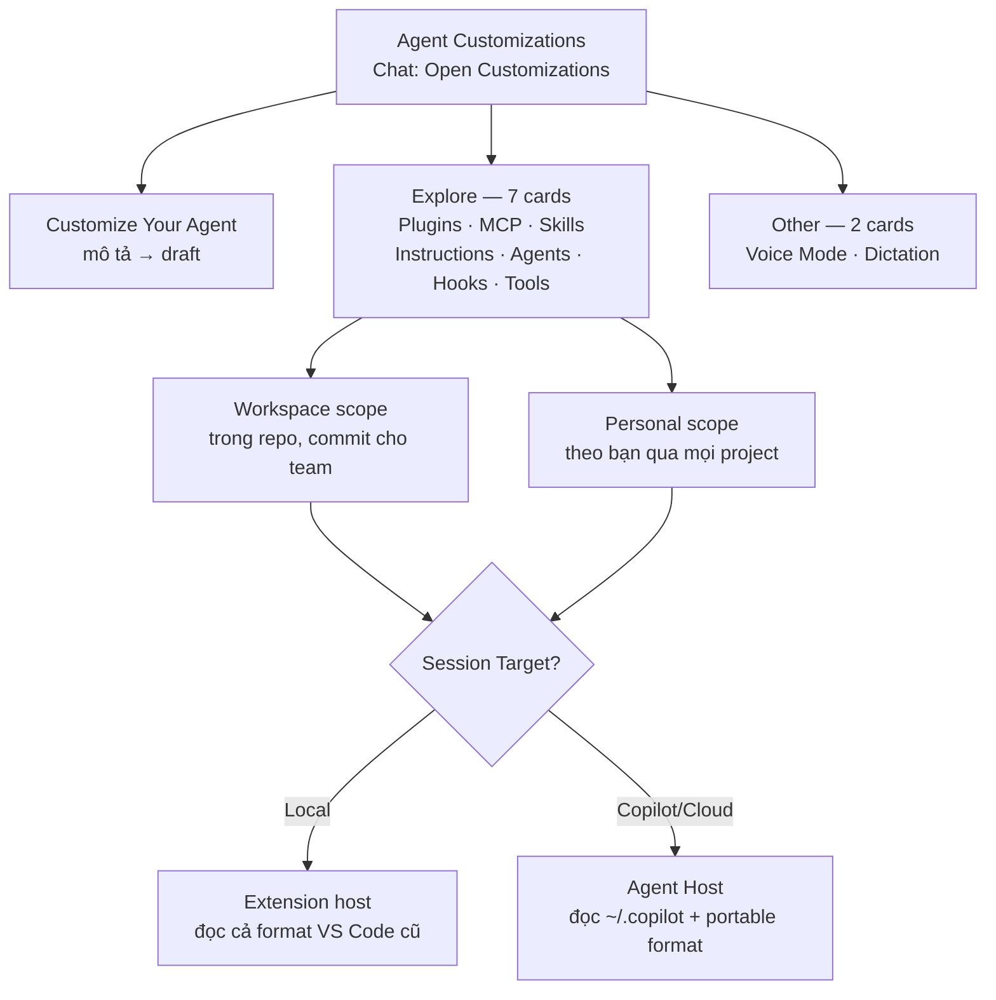

# 17 — Agent Customizations Hub (Customize + 7 cards + Voice/Dictation)

> **Dành cho:** dev/team muốn agent "hiểu nhà mình" thay vì trả lời chung chung — gom mọi tuỳ biến vào 1 màn hình (Bài 17 của series).
> **Vấn đề:** instructions/skills/agents/MCP/hooks nằm rải rác mỗi nơi một file, không biết cái nào đè cái nào, cài plugin lạ thì agent có quyền chạy code trên máy.
> **Đọc xong:** mở đúng hub (`Chat: Open Customizations`), dùng `Customize Your Agent` để draft, quản trị 7 cards Explore + 2 cards Voice/Dictation, phân biệt workspace (team) vs personal (theo bạn), và dựng governance plugin cho team.

## Mục tiêu bài học

- Mở đúng **màn hình Agent Customizations** và nhận ra nó hiển thị theo harness đang chọn.
- Dùng ô `Customize Your Agent` để draft instructions/skills/agents, rồi tự kiểm chứng trước khi lưu.
- Phân biệt **7 cards Explore** (Plugins, MCP Servers, Skills, Instructions, Agents, Hooks, Tools) và **2 cards Other** (Voice, Dictation).
- Chọn đúng thành phần khi gặp một nhu cầu cụ thể (tra bảng quyết định).
- Biết đường migrate prompt files → skills và cách kiểm chứng customization có "ngấm" không.

---

## 1. Vì sao cần 1 hub?

**Nôm na:** Hub là **bảng điện tổng** của agent — thay vì đi mò từng ổ cắm (instructions, skills, MCP, hooks rải khắp repo), bạn đứng 1 chỗ bật/tắt, xem cái nào đang cấp điện.

Vấn đề hub giải quyết:

- Customizations nằm rải rác: `.github/`, `.claude/`, `~/.copilot/`, VS Code profile — không biết agent đang đọc cái nào.
- Mỗi harness (Local/Copilot/Cloud — bài 10) đọc **định dạng + vị trí khác nhau** — file đặt sai chỗ = agent không thấy.
- Plugin lạ có thể mang theo **hooks + MCP chạy code trên máy bạn** — cần 1 chỗ review trước khi tin.



```text
Mở hub (4 cách):
1. Chat view → icon bánh răng (Configure Chat) → chọn card.
2. Command Palette → "Chat: Open Customizations".
3. Agents window → panel Customizations.
4. Trong chat: /agents (card Agents) hoặc /hooks (card Hooks).

Luật scope theo harness (thuộc lòng):
- Editor hiện customizations của HARNESS ĐANG CHỌN — chọn sai harness → tạo nhầm format/vị trí.
- Agent Host (Copilot/Cloud) đọc user-level từ ~/.copilot (Copilot) / ~/.claude (Claude),
  KHÔNG đọc VS Code profile user data cũ.
- Local đọc cả format VS Code cũ (.vscode/mcp.json, profile storage).
- Editor có syntax highlighting + validation — tạo file trong editor thay vì viết tay ngoài.
# Verify: cùng 1 card, đổi Session Target Local ↔ Copilot → list vị trí đổi theo.
```

---

## 2. Customize Your Agent: mô tả → draft

```text
Cách chạy:
- Ô Customize Your Agent → nhập mô tả ("commit ngắn gọn, review kỹ, code có test")
  → Enter → VS Code gửi "/init <mô tả>" vào chat mới → agent hỏi làm rõ →
  draft file (agents/skills/instructions) → BẠN REVIEW → save.
- Tạo từng loại trực tiếp: /create-prompt /create-instruction /create-skill
  /create-agent /create-hook + mô tả.
- /init đơn độc: phân tích repo → sinh .github/copilot-instructions.md (hoặc AGENTS.md
  nếu đã có) ghi lại build/test/architecture/conventions.
# Verify: draft xong mở file → đúng format + vị trí của harness đang chọn.
# Quy tắc sắt: draft là bản nháp, KHÔNG phải bản chốt — model biết schema nhưng
# schema có thể cũ theo version. Đọc, sửa, validate editor, rồi mới commit.
```

---

## 3. Cần gì → dùng gì (bảng quyết định)

| Hiện tượng | Thay đổi nhỏ nhất nên thử |
|---|---|
| Agent quên yêu cầu 1 lần / thiếu 1 file | Ghi vào prompt hiện tại (đừng tạo file) |
| Lặp lại lỗi về lệnh/convention toàn project | Thêm/sửa **Instructions** |
| Lỗi chỉ ở vài file/ngôn ngữ/task | **Instructions** nhắm mục tiêu (`applyTo`/`description`) |
| Team giải thích mãi 1 quy trình nhiều bước | Tạo **Skill** |
| 1 vai trò lặp lại cần tool giới hạn | Tạo custom **Agent** |
| Agent cần chạm hệ ngoài (DB, API, issue tracker) | Thêm **MCP server** |
| Việc PHẢI chạy ở 1 điểm vòng đời, bất kể model nhớ không | Cấu hình **Hook** |
| Team muốn cài 1 bộ tuỳ biến đóng gói sẵn | Cài **Plugin** |
| Agent có quá nhiều/không đúng tool | Mở **Tools** rà soát |

**4 thành phần dễ nhầm nhất — chọn theo câu hỏi bạn đang có:**

| Thành phần | Trả lời câu hỏi | File sống ở đâu | Ví dụ |
|---|---|---|---|
| **Instructions** | Quy tắc nào phải tuân theo? (model *có thể* quên) | `.github/copilot-instructions.md`, `*.instructions.md` | "Không thêm dependency nếu chưa giải thích lý do" |
| **Skills** | Nên làm theo quy trình nào? | `.github/skills/<ten>/SKILL.md` | Checklist audit performance Vue 3 |
| **Agents** | Ai chịu trách nhiệm? | `.github/agents/<ten>.agent.md` | `security-reviewer` (chỉ đọc, cấm sửa) |
| **Hooks** | Hệ thống tự động làm gì khi có sự kiện? (tất định) | `.github/hooks/*.json` | `PostToolUse` → chạy prettier sau khi agent sửa file |

> Luật tầng: Instructions + Skills dẫn dắt model (quên được); Hooks chạy **tất định**; Agents gói instructions + tool + model thành persona; MCP/Tools bổ sung khả năng; Plugins đóng gói để phân phối. Việc bắt buộc → hook, gợi ý → instructions.

---

## 4. 7 cards Explore chi tiết

### 4.1. Plugins — hộp cơm trưa đóng sẵn

- **Agent Plugins 1.0**: chuẩn mở, portable giữa VS Code / Copilot CLI / Copilot app / SDK — thư mục có `plugin.json` + `skills/` + `mcp.json`; phần riêng Copilot ở namespace `com.github.copilot/`.
- Cài: hub → Plugins → Discover/Browse Marketplace (bật `chat.customizations.marketplace.enabled`; filter `@type:skill`, `@type:mcp`). Tắt plugin → toàn bộ skill/agent/hook/MCP của nó biến mất.
- Settings: `chat.plugins.enabled`, `chat.plugins.marketplaces` (mặc định copilot-plugins, awesome-copilot), `chat.pluginLocations`.

```text
# Caution trước khi Install:
# 1. Đọc plugin.json — trong hộp có gì (skills? MCP? hooks?).
# 2. Plugin có hooks/MCP = code chạy trên máy bạn → check publisher + source.
# 3. Marketplace lạ ≠ từng plugin an toàn — duyệt TỪNG plugin, không theo tên chợ.
# 4. Ưu tiên plugin nhỏ (1 skill rõ việc, tool hẹp) — mở rộng sau khi giải thích được.
```

### 4.2. MCP Servers — cổng giao hàng

- Thêm: hub → MCP Servers hoặc `MCP: Add Server` (guided). Prefer format portable để Agent Host đọc native.
- Vị trí: workspace `.mcp.json` (portable, root repo) — legacy `.vscode/mcp.json` (Agent Host không đọc trực tiếp, VS Code forward hộ, trừ server cần `${input:...}`); user `~/.copilot/mcp-config.json`.
- Bật/tắt không đụng file config; `chat.mcp.autostart`, `chat.mcp.discovery.enabled`.

### 4.3. Skills — công thức món khó

- Chuẩn mở (agentskills.io), portable qua VS Code / CLI / app / cloud agent / Codex (experimental): `SKILL.md` (frontmatter + body) + scripts/templates.
- Frontmatter: `description` (BẮT BUỘC, ≤1024 ký tự — viết "làm gì + khi nào dùng" để agent biết lúc nào load), `user-invocable`, `disable-model-invocation`, `context: fork` (experimental — chạy subagent riêng, giữ context chính sạch).
- Vị trí: workspace `.github/skills/<ten>/SKILL.md` (+ `.claude/skills/`, `.agents/skills/`); personal `~/.copilot/skills/`. Tên frontmatter PHẢI khớp tên thư mục.
- Gọi: agent tự load khi task khớp, hoặc `/<ten-skill>`. Skill từ plugin: KHÔNG tự thêm tiền tố namespace (plugin tự prefix, vd `/my-plugin:test-runner`).

### 4.4. Instructions — nội quy bếp

| Harness | Project (always-on) | Targeted |
|---|---|---|
| Copilot | `.github/copilot-instructions.md` hoặc `AGENTS.md` | `.github/instructions/**/*.instructions.md` |
| Claude | `CLAUDE.md` | Markdown trong `.claude/rules` |
| Codex | `AGENTS.md` | `AGENTS.md` trong subfolder |

- Personal: `~/.copilot/instructions` / `~/.claude/rules`; Local user = VS Code profile storage (cũ — nên migrate).
- Frontmatter `*.instructions.md`: `name`, `description`, `applyTo` (glob; Claude rules dùng `paths`).
- Verify: mở References trong câu trả lời → thấy file instructions được kèm? `AGENTS.md` đặt root repo (cross-agent).

### 4.5. Agents — đầu bếp chuyên món

- File `.agent.md`: frontmatter YAML + body Markdown; tham chiếu tool bằng `#tool:<ten>`.
- Frontmatter hay dùng: `description`, `name`, `argument-hint`, `tools` (built-in/MCP/extension; `server/*` = cả server), `agents` (`*` = mọi subagent, `[]` = cấm), `model` (1 model hoặc list ưu tiên), `user-invocable: false` (chỉ làm subagent), `handoffs` (nút chuyển agent, `send: true` = tự gửi), `hooks` (preview, chỉ Local).
- Subagent: agent cha gọi agent con (`chat.subagents.allowInvocationsFromSubagents` cho gọi đệ quy). Chi tiết bài 06.

### 4.6. Hooks — chuông báo cháy tự động

- Harness nào chạy thì dùng hook implementation của harness đó — file giống nhau ≠ hành vi giống nhau (events/matchers/payloads khác nhau).
- Local: workspace `.github/hooks/*.json`; user `~/.copilot/hooks/*.json`; Claude format `.claude/settings.json` (cần `chat.useClaudeHooks`, mặc định tắt); agent-scoped trong `.agent.md`.
- Events hay dùng: `PreToolUse` (chặn lệnh nguy hiểm), `PostToolUse` (lint/format sau sửa), `SessionStart`, `SubagentStart`, `PreCompact`, `Stop`, `UserPromptSubmit`.
- Tạo: `/create-hook <mô tả>` hoặc New trong card Hooks.

```text
# Verify: hook PostToolUse format → sửa 1 file → hook chạy? Bị chặn oan →
# check matcher/event name đúng schema của harness đang dùng (Local vs Copilot khác nhau).
```

### 4.7. Tools — dao thớt được phép dùng

- 3 họ: built-in (đọc/ghi, terminal, search), MCP (từ server đã cài), extension (Language Model Tools API).
- Local: tools picker trong Chat (`Configure Tools`) — chọn theo từng request. Copilot harness: card **Tools** chọn theo profile (giữ qua session).
- Tool set tái dùng: `Chat: Configure Tool Sets` → file `.jsonc` → dùng chung cho prompt/agent.
- Giới hạn **128 tools/request** — vượt thì tắt bớt hoặc bật virtual tools (`github.copilot.chat.virtualTools.threshold`).

```text
# Luật sắt: availability ≠ approval. Bật tool = cho agent THẤY, không phải cho CHẠY
# tự do — chạy hay không do permission level + approval (bài 10) quyết.
```

| Khái niệm | Trả lời | Ví dụ |
|---|---|---|
| MCP Server | Nguồn cung nhóm tool | Server `github` phơi `create_pr`, `list_issues` |
| Tool | Một hành động cụ thể | `read`, `edit`, `terminal`, `mcp__github__create_pr` |
| Permissions | Hành động nào cần phê duyệt | `deny > ask > allow`; Manual/Assisted/Allow all (bài 10) |
| Hook | Logic tất định tại sự kiện | `PreToolUse` chặn lệnh nguy hiểm |

---

## 5. 2 cards Other: Voice Mode + Dictation

| Card | Vai trò | Bật ở đâu | Ghi chú |
|---|---|---|---|
| **Voice Mode** | Hội thoại thoại 2 chiều trong chat | `agents.voice.enabled` (chỉ VS Code Local; KHÔNG có trên Business/Enterprise) | Cấu hình giọng, speed, hotword; cần mic |
| **Dictation** | Nói → chèn text vào ô prompt | `chat.dictation.enabled` | Làm sạch bằng LLM: `dictation.experimental.llmCleanup` |

- File hướng dẫn riêng (đọc cùng voice/dictation): personal `~/.copilot/voice.md`, `~/.copilot/dictation.md`; workspace `.github/voice.md`, `.github/dictation.md` — vd "tổng hợp ngắn gọn, không đọc nguyên code" cho Voice Mode.
- Dictation + LLM cleanup: model sửa lời nói thành câu lệnh có cấu trúc (rất hợp với prompt dài tiếng Việt, tên biến tiếng Anh).

> Voice/Dictation là **giao tiếp**, không phải tuỳ biến hành vi agent — muốn agent "nói kiểu gì" thì vẫn là Instructions.

---

## 6. Discover + governance team (ai được cài gì)

**Duyệt và cài:** mỗi card Explore có nút Discover/Browse — duyệt marketplace chung (`chat.customizations.marketplace.enabled`, mặc định copilot-plugins + awesome-copilot), filter `@type:skill` / `@type:mcp` / `@type:plugin`. Cài vào **personal** trước khi đề xuất cho workspace — đừng cài thẳng thứ chưa review vào repo team.

**4 lớp governance cho team:**

| Lớp | Câu hỏi | Thực thi ở đâu |
|---|---|---|
| 1. Repo chính | Bộ tuỳ biến chuẩn của repo là gì? | `.github/` (instructions, skills, agents, hooks, `.mcp.json`) — review qua PR |
| 2. Monorepo / repo con | Con repo có thêm gì không? | `chat.useCustomizationsInParentRepositories` — cho phép kế thừa customization từ repo cha (mặc định tắt) |
| 3. Cài thêm | Ai được cài plugin/MCP lạ? | Policy/managed settings: chốt danh sách marketplace + tắt marketplace lạ |
| 4. Runtime | Chạy được tới đâu? | Permission level + sandboxing (bài 10) + audit log |

> Luật sắt: mọi thứ trong `.github/` đi qua **PR review**; mọi thứ cá nhân (`~/.copilot/`) chỉ ảnh hưởng người đó. Team cần quy ước "được thêm gì vào `.github/` mà không phải hỏi" — nếu chưa có, mặc định là phải PR.

---

## 7. Migrations & verify "ngấm chưa"

```text
2 cuộc migrate đang diễn ra:
1. Prompt files → Skills: chat.customizations.promptMigration.enabled
   (mặc định TRUE) — VS Code tự đề xuất chuyển .prompt.md thành SKILL.md.
   Muốn giữ prompt files riêng → tắt setting này.
2. User data → ~/.copilot: mặc định FALSE (chưa bật đại trà) — Local user data
   vẫn sống trong VS Code profile storage; Agent Host (Copilot/Cloud) đọc ~/.copilot.
   Team dùng Copilot harness nên chủ động migrate personal instructions/skills
   sang ~/.copilot để 2 harness thấy cùng 1 bộ.

Kiểm chứng customization có "ngấm" (đừng tin là đủ — phải thấy):
1. References trong câu trả lời → file instructions/skill được kèm đúng không.
2. Diagnostics/validate của editor (mở file trong editor, không viết tay ngoài).
3. /troubleshoot trong chat khi agent "dường như" không thấy file.
4. Eval quy mô team (Waza) — customizations là hành vi, phải đo bằng test.
```

---

## 8. Hiểu nhầm thường gặp

| Hiểu nhầm | Thực tế |
|---|---|
| "Hub tạo file xong là xong" | Draft từ `Customize Your Agent` là bản nháp — phải review + validate trước khi lưu |
| "File đặt đâu agent cũng thấy" | Mỗi harness đọc vị trí/format riêng; Agent Host không đọc VS Code profile cũ |
| "Skill và instructions khác gì, chọn gì cũng được" | Instructions = quy tắc (model có thể quên); Skill = quy trình gọi được; việc tất định = hook |
| "Plugin của marketplace lạ thì an toàn theo chợ" | Plugin có hooks/MCP = code chạy trên máy — duyệt TỪNG plugin, đọc plugin.json |
| "Bật tool rồi là agent chạy được" | Availability ≠ approval — permission level (bài 10) mới quyết chạy |
| "Skill từ plugin phải thêm prefix" | Không tự thêm — plugin tự prefix (`/my-plugin:test-runner`) |
| "Voice Mode cấu hình được ở công ty" | `agents.voice.enabled` không có trên Business/Enterprise |

---

## 9. Walkthrough 20 phút + bài tập

```text
20 phút dựng hub cho 1 repo Vue 3:
1. (2') Mở hub: Command Palette → "Chat: Open Customizations". Xác nhận Session Target.
2. (5') /init → sinh .github/copilot-instructions.md → sửa: stack, lệnh build/test,
   convention đặt tên, "không thêm dependency khi chưa giải thích".
3. (5') Tạo skill .github/skills/audit-performance-vue/SKILL.md — description viết
   "làm gì + khi nào dùng" (≤1024 ký tự), body là checklist bước.
4. (3') Tạo agent .github/agents/security-reviewer.agent.md — tools hẹp (chỉ đọc),
   user-invocable: false làm subagent.
5. (3') Duyệt Plugins → cài 1 plugin nhỏ vào PERSONAL trước, đọc plugin.json.
6. (2') Verify: References trong 1 câu trả lời thấy instructions; commit .github/
   qua PR.
```

**Pitfalls:**

- ❌ Draft `/init` xong commit luôn → ✅ đọc, sửa, validate, rồi PR.
- ❌ Đặt file theo format harness khác (`.claude/rules` khi chạy Copilot harness) → ✅ đổi Session Target trước khi tạo.
- ❌ Cài plugin lạ thẳng vào workspace → ✅ personal trước, review hooks/MCP, rồi đề xuất PR.
- ❌ Nhét quy trình nhiều bước vào copilot-instructions.md → ✅ tách thành Skill để gọi được `/<ten>`.
- ❌ Tin agent "đã hiểu" mà không kiểm chứng → ✅ References + Diagnostics + `/troubleshoot` + eval.

**Bài tập:**

1. Dựng skill `deploy-checklist` cho repo của bạn; dùng 3 lần rồi thu gọn description nếu agent gọi sai lúc.
2. Tạo agent chỉ đọc (review-only) và dùng làm subagent cho 1 agent cha.
3. Viết 1 hook `PreToolUse` chặn `git push --force`; verify nó chặn được (Local).
4. Bật `chat.customizations.promptMigration.enabled`, để VS Code đề xuất migrate 1 prompt file → skill, xem diff trước khi nhận.

---

## 10. So với Claude Code + link chéo

| Tuỳ biến | Copilot (VS Code/CLI) | Claude Code |
|---|---|---|
| Ghi nhớ project | `.github/copilot-instructions.md` / `AGENTS.md` | `CLAUDE.md` |
| Instructions nhắm mục tiêu | `.github/instructions/*.instructions.md` (`applyTo`) | Markdown trong `.claude/rules` (`paths`) |
| Skills | `.github/skills/` + `~/.copilot/skills/` | `.claude/skills/` |
| Agents | `.github/agents/*.agent.md` | `.claude/agents/` |
| Hooks | `.github/hooks/*.json` (Local; Claude format qua `chat.useClaudeHooks`) | `.claude/settings.json` |
| MCP | `.mcp.json` (portable) + `~/.copilot/mcp-config.json` | `.mcp.json` + `~/.claude.json` |
| Hub quản trị | Agent Customizations (1 màn hình) | rải theo thư mục |

- `AGENTS.md` + `.mcp.json` + skills là **chuẩn mở** — một repo có thể phục vụ cả 2 harness song song; chỉ phần hooks là khác implementation sâu nhất.
- Link chéo: permissions/sandboxing → bài 10; subagents/handoffs → bài 06; MCP bảo mật validate → bài 16; chống lặp với worktrees → bài 11; CLI automation → bài 12.

> **Chốt bài:** Hub để **nhìn tổng thể** (ai đang đọc gì), `Customize Your Agent` để **tăng tốc viết**, PR review để **chốt thay đổi team**. Quy tắc → Instructions, quy trình → Skill, vai trò → Agent, sự kiện → Hook, khả năng → MCP/Tools, phân phối → Plugin. Kiểm chứng bằng References + eval, đừng tin lời agent tự báo.
