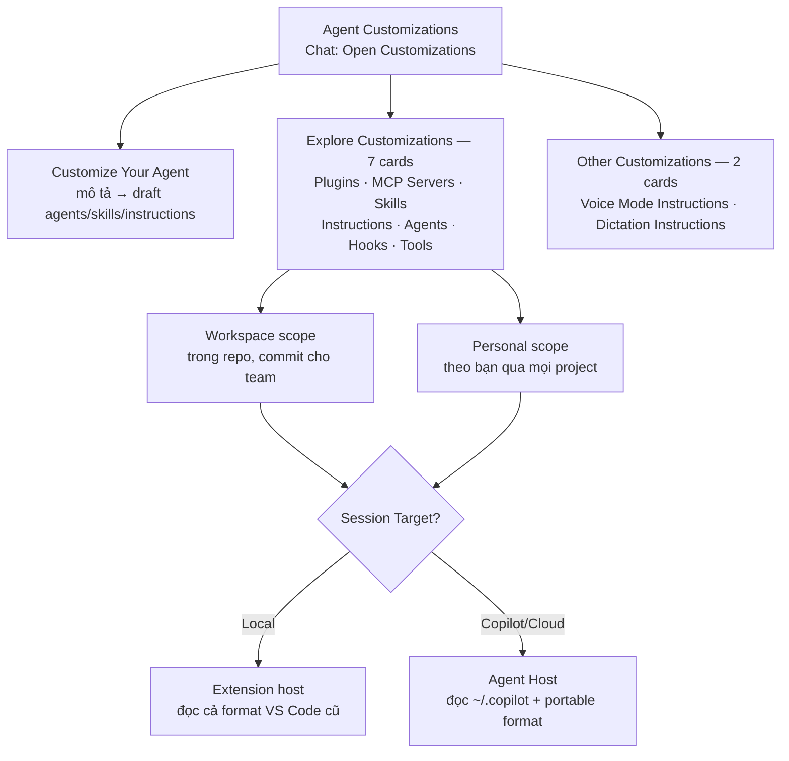

# 17 — Agent Customizations Hub (Customize + 7 cards + Voice/Dictation)

> **Dành cho:** dev/team muốn agent "hiểu nhà mình" thay vì trả lời chung chung — gom mọi tuỳ biến vào 1 màn hình (Bài 17 của series).
> **Vấn đề:** instructions/skills/agents/MCP/hooks nằm rải rác mỗi nơi một file, không biết cái nào đè cái nào, cài plugin lạ thì agent có quyền chạy code trên máy.
> **Đọc xong:** mở đúng hub (`Chat: Open Customizations`), dùng `Customize Your Agent` để draft, quản trị 7 cards Explore + 2 cards Voice/Dictation, phân biệt workspace (team) vs personal (theo bạn), và dựng governance plugin cho team.
> **Thời gian:** ~45 phút (bản mở rộng)

## Mục tiêu bài học

- Mở đúng **màn hình Agent Customizations** bằng 1 trong 4 cách, và nhận ra nó hiển thị theo harness đang chọn.
- Dùng ô `Customize Your Agent` để draft instructions/skills/agents, rồi tự kiểm chứng draft trước khi lưu.
- Phân biệt được **7 cards Explore** (Plugins, MCP Servers, Skills, Instructions, Agents, Hooks, Tools) và **2 cards Other** (Voice, Dictation).
- Chọn đúng thành phần khi gặp một nhu cầu cụ thể (tra bảng quyết định, không đoán theo tên).
- Biết đường migrate prompt files → skills và cách kiểm chứng customization có "ngấm" không.

## Mục lục

1. [Vì sao cần 1 hub? (why)](#1-vì-sao-cần-1-hub-why)
2. [Sơ đồ: hub + 3 nhóm + 2 scope](#2-sơ-đồ-hub--3-nhóm--2-scope)
3. [Mở hub ở đâu + scope theo harness](#3-mở-hub-ở-đâu--scope-theo-harness)
4. [Customize Your Agent: mô tả → draft](#4-customize-your-agent-mô-tả--draft)
5. [Cần gì → dùng gì (bảng quyết định)](#5-cần-gì--dùng-gì-bảng-quyết-định)
6. [7 cards Explore chi tiết](#6-7-cards-explore-chi-tiết)
7. [Other: Voice Mode + Dictation Instructions](#7-other-voice-mode--dictation-instructions)
8. [Discover/Marketplace + governance team](#8-discovermarketplace--governance-team)
9. [Migrations + kiểm chứng (evaluations)](#9-migrations--kiểm-chứng-evaluations)
10. [Hiểu nhầm thường gặp](#10-hiểu-nhầm-thường-gặp)
11. [Walkthrough + pitfalls + bài tập](#11-walkthrough--pitfalls--bài-tập)
12. [Link chéo](#12-link-chéo)
- [So sánh với Claude Code](#so-sánh-với-claude-code)
- [Best practices (kèm "vì sao")](#best-practices-kèm-vì-sao)

---

## 1. Vì sao cần 1 hub? (why)

Bạn không cần một màn hình mới cho đẹp — cần nó vì mọi tuỳ biến của agent đang nằm rải rác khắp repo và profile, mỗi thứ một định dạng. Hub là chỗ duy nhất cho bạn thấy tất cả cùng lúc và biết cái nào đang thực sự chạy.

**Nôm na 1 câu:** Hub là **bảng điện tổng** của agent — thay vì đi mò từng ổ cắm (file instructions, skills, MCP, hooks rải khắp repo), bạn đứng 1 chỗ bật/tắt, xem cái nào đang cấp điện cho agent.

**Analogie đời thường:** Như setup bếp ăn công ty. Mỗi đầu bếp (agent) cần biết: thực đơn chuẩn (instructions), công thức món khó (skills), ai làm món nào (agents), chợ đầu mối ở đâu (MCP), chuông báo cháy đặt chỗ nào (hooks), dao thớt được dùng loại nào (tools). Không có bảng tổng thì mỗi người tự nhớ 1 kiểu.

Vấn đề hub giải quyết:

- Customizations nằm rải rác: `.github/`, `.claude/`, `~/.copilot/`, VS Code profile — không biết agent đang đọc cái nào.
- Mỗi harness (Local/Copilot/Cloud — bài 10 mục 3.3) đọc **định dạng + vị trí khác nhau** — file đặt sai chỗ = agent không thấy.
- Plugin lạ có thể mang theo **hooks + MCP chạy code trên máy bạn** — cần 1 chỗ review trước khi tin.

```text
# Verify bạn đang ở đâu (copy-paste check 1 phút):
# Chat view → icon bánh răng (Configure Chat) → mở Agent Customizations.
# Nhìn 3 nhóm: Customize Your Agent (draft) / Explore Customizations (7 cards)
# / Other Customizations (voice + dictation). Thiếu card nào → check harness đang chọn.
```

**Vì sao quan trọng?** Không có hub, bạn sẽ không biết agent đang đọc file nào — cập nhật instructions xong mà agent vẫn làm sai vì nó đang đọc một file ở vị trí khác. Hub biến "file rải rác" thành "một danh sách có kiểm soát".

**Nếu làm sai thì sao?** Nếu bạn chỉnh từng file lẻ mà không nhìn hub, bạn tạo file đúng nội dung nhưng sai harness/vị trí, rồi kết luận "customization vô dụng". Cách tránh: luôn mở hub kiểm tra trước và sau khi thêm bất cứ thứ gì.

---

## 2. Sơ đồ: hub + 3 nhóm + 2 scope

Màn hình hub gồm 3 nhóm chính (draft, Explore, Other), và mọi card chia theo 2 scope. Nắm sơ đồ này là nắm được toàn bộ bố cục trước khi bấm gì.



```text
Scope = ai được dùng + sống ở đâu:
- Workspace: file nằm trong repo (vd .github/), commit → cả team giống nhau.
- Personal: file nằm ở user level (vd ~/.copilot/), theo bạn qua mọi project.
- KHÔNG phải loại nào cũng có đủ 2 scope — mở đúng card, chọn New (Workspace/User)
  rồi xem list vị trí được hỗ trợ cho harness đang chọn.
# Verify: cùng 1 card, đổi Session Target Local ↔ Copilot → list vị trí đổi theo.
# Kỳ vọng: hiểu "đặt sai chỗ = agent không thấy" trước khi tạo file nào.
```

**Vì sao quan trọng?** "Workspace vs personal" quyết định ai được dùng: file trong repo thì cả team giống nhau, file user-level thì chỉ theo bạn. Chọn sai scope nghĩa là bạn làm việc này cho đúng người nhưng sai tập người dùng.

**Nếu làm sai thì sao?** Nhét một quy ước cá nhân vào workspace → cả team bị áp; nhét quy ước team vào personal → đồng nghiệp không thấy gì. Cách tránh: tự hỏi "cái này chỉ đúng cho tôi hay cho cả team?" trước khi chọn New.

---

## 3. Mở hub ở đâu + scope theo harness

Cùng một màn hình, nhưng nội dung đổi theo harness đang chọn — nên mở đúng hub là bước đầu tiên, không phải chi tiết vụn.

**Nôm na:** Hub như quầy lễ tân — bạn phải **xưng danh harness trước** (Local hay Copilot) thì lễ tân mới đưa đúng chìa khóa phòng.

```text
Mở hub (4 cách — copy-paste):
1. Chat view → icon bánh răng (Configure Chat) → chọn card (Plugins/MCP/Skills/...).
2. Command Palette (Ctrl+Shift+P) → "Chat: Open Customizations".
3. Agents window → panel Customizations.
4. Trong chat: gõ /agents (mở card Agents, harness Copilot) hoặc /hooks (mở card Hooks).
   Local: /agents mở agent picker → Configure Custom Agents.
# Verify: mở hub → nhìn Session Target đang là gì. Đổi harness → nội dung card đổi theo.
```

```text
Luật scope theo harness (thuộc lòng):
- Editor hiện customizations của HARNESS ĐANG CHỌN. Chọn sai harness → tạo nhầm format/vị trí.
- Agent Host (Copilot/Cloud) đọc user-level từ ~/.copilot (Copilot) / ~/.claude (Claude),
  KHÔNG đọc VS Code profile user data cũ.
- Local đọc cả format VS Code cũ (.vscode/mcp.json, profile storage, locations settings).
- Editor có syntax highlighting + validation cho từng loại file — tạo file trong editor
  thay vì viết tay ngoài.
# Ai dùng lúc nào: trước khi tạo/sửa bất kỳ customization nào → check Session Target trước.
```

**Vì sao quan trọng?** Harness quyết định vị trí vật lý của file. Cùng là instructions, Copilot đọc `.github/` còn Claude đọc `CLAUDE.md`; đặt sai chỗ thì nội dung đúng vẫn vô hình với agent.

**Nếu làm sai thì sao?** Tạo file khi đang chọn nhầm harness → agent không thấy, bạn tưởng nội dung sai nên sửa tới sửa lui. Cách tránh: check Session Target trước khi tạo, và dùng editor có validation thay vì viết tay.

---

## 4. Customize Your Agent: mô tả → draft

Đây là cửa vào cho người chưa biết nên tạo file loại nào. Ô input dịch tiếng người của bạn thành file đúng chuẩn để bạn duyệt.

**Nôm na:** Ô input là **người phiên dịch** — bạn nói tiếng người ("muốn commit ngắn gọn, review kỹ, code có test"), nó dịch ra file đúng chuẩn (agents/skills/instructions) để bạn duyệt rồi mới lưu.

```text
Cách chạy (copy-paste):
- Nhập mô tả vào ô Customize Your Agent → Enter → VS Code gửi "/init <mô tả>"
  vào 1 chat mới (Sessions window: "Generate agent customizations").
- Agent hỏi làm rõ → draft file (agents/skills/instructions) → BẠN REVIEW → save.
- Hoặc tạo từng loại trực tiếp: /create-prompt /create-instruction /create-skill
  /create-agent /create-hook + mô tả.
- /init đơn độc: phân tích repo → sinh .github/copilot-instructions.md (hoặc AGENTS.md
  nếu đã có) ghi lại build/test/architecture/conventions.
# Verify: draft xong mở file → check đúng format + vị trí của harness đang chọn.
# Quy tắc sắt: draft là bản nháp, KHÔNG phải bản chốt — đọc, sửa, rồi mới commit.
```

```text
Ví dụ copy-paste:
- "Prefer concise commits, thorough reviews, and tested code" → draft instructions
  (commit style) + skill (review checklist) + agent (reviewer read-only).
- "/init" trong repo mới → instructions ghi sẵn lệnh build/test + kiến trúc.
- "/create-hook chạy prettier sau mỗi lần agent sửa file" → hook PostToolUse.
# Ai dùng lúc nào: người mới (không biết template nào) → dùng ô draft.
# Người quen tay → /create-* nhanh hơn.
```

> **Draft-then-review là bất biến:** model biết schema (vì nó là kẻ đọc file lúc chạy) nên draft đúng chuẩn — nhưng schema có thể cũ theo version. Luôn cho draft đi qua validator của editor + review tay trước khi commit.

**Vì sao quan trọng?** Draft tiết kiệm cho bạn việc nhớ schema, nhưng schema thay đổi theo version. Nếu bạn commit thẳng draft, một field cũ có thể làm skill/agent không load mà bạn không biết vì sao.

**Nếu làm sai thì sao?** Tin draft là bản chốt → mang file lỗi format vào repo, agent bỏ qua âm thầm. Cách tránh: luôn review + validate + sửa ít nhất vài chỗ rồi mới commit.

---

## 5. Cần gì → dùng gì (bảng quyết định)

Đứng trước 7 cards, nhiều người chọn theo tên nghe hợp. Bảng dưới cho bạn "thay đổi nhỏ nhất nên thử" — hãy luôn bắt đầu từ dòng rẻ nhất, đừng nhảy thẳng sang cài plugin.

| Hiện tượng | Thay đổi nhỏ nhất nên thử |
|---|---|
| Agent quên yêu cầu 1 lần / thiếu 1 file | Ghi vào prompt hiện tại (đừng tạo file) |
| Agent lặp lại lỗi về lệnh/convention/kiến trúc toàn project | Thêm/sửa **Instructions** |
| Lỗi chỉ ở vài file/ngôn ngữ/task | **Instructions** nhắm mục tiêu (`applyTo`/`description`) |
| Team giải thích mãi 1 quy trình nhiều bước | Tạo **Skill** |
| 1 vai trò lặp lại cần tool giới hạn | Tạo custom **Agent** |
| Agent cần chạm hệ thống ngoài (DB, API, issue tracker) | Thêm **MCP server** |
| Việc PHẢI chạy ở 1 điểm trong vòng đời, bất kể model có nhớ không | Cấu hình **Hook** |
| Team muốn cài 1 bộ tuỳ biến đóng gói sẵn | Cài **Plugin** |
| Agent có quá nhiều/không đúng tool | Mở **Tools** rà soát |

```text
Luật tầng (nhớ 1 câu):
- Instructions dẫn dắt model (model có thể quên) — Hooks chạy tất định (deterministic,
  chạy bất kể model nhớ hay không).
- "Chạy prettier sau khi sửa file" viết trong instructions = nhờ model nhớ.
  Cùng việc đó làm bằng hook = máy tự chạy. Việc bắt buộc → hook, gợi ý → instructions.
# Verify: rule nào team phàn nàn "agent hay quên" → chuyển từ instructions sang hook.
```

### 5.1. Bảng phân biệt 4 thành phần dễ nhầm nhất

Bốn cái tên Instructions / Skills / Agents / Hooks nghe na ná nhau, nên đừng chọn theo tên — chọn theo **câu hỏi bạn đang có**.

**Nôm na:** mỗi thành phần trả lời **một câu hỏi khác nhau** — chọn theo câu hỏi bạn đang có, đừng chọn theo tên nghe na ná nhau.

| Thành phần | Trả lời câu hỏi | File sống ở đâu | Ví dụ |
|---|---|---|---|
| **Instructions** | Agent phải tuân theo **quy tắc** nào? (agent *có thể* quên) | `.github/copilot-instructions.md`, `*.instructions.md` | "Không thêm dependency nếu chưa giải thích lý do" |
| **Skills** | Việc này **nên làm theo quy trình nào**? | `.github/skills/<ten>/SKILL.md` | Quy trình audit performance Vue 3 (checklist nhiều bước) |
| **Agents** | **Ai** chịu trách nhiệm cho việc này? | `.github/agents/<ten>.agent.md` | `security-reviewer` (chỉ đọc + comment, cấm sửa) |
| **Hooks** | Hệ thống **tự động làm gì** khi có sự kiện? (chạy tất định) | `.github/hooks/*.json` | `PostToolUse` → chạy `prettier` sau khi agent sửa file |

> **Mẹo phân biệt nhanh:** Instructions + Skills dẫn dắt model (model *có thể* quên); Hooks chạy **tất định** (bất kể model nhớ hay không); Agents gói instructions + tool + model thành một **persona**. Còn **MCP/Tools** bổ sung *khả năng làm việc*, **Plugins** *đóng gói* các thành phần để phân phối.

**Vì sao quan trọng?** Chọn sai thành phần là nguyên nhân số 1 của "customization không ăn": viết rule bắt buộc vào instructions (advisory) thì agent quên, còn việc gợi ý lại nhét vào hook thì cứng nhắc.

**Nếu làm sai thì sao?** Nhồi việc bắt buộc vào instructions → team phàn nàn "agent hay quên"; nhồi gợi ý vào hook → agent bị chặn oan. Cách tránh: phân loại theo câu hỏi ở bảng trên trước khi tạo file.

---

## 6. 7 cards Explore chi tiết

Mỗi card trong hub làm một việc riêng, file sống ở vị trí khác nhau (workspace/personal), và tạo/quản lý bằng công cụ khác nhau. Đọc card nào bạn cần, bỏ qua card chưa cần.

### 6.1. Plugins — gói cài 1 lần

**Nôm na:** Plugin là **hộp cơm trưa đóng sẵn** — thay vì tự nấu từng món (skill + agent + MCP + hooks), bạn nhận 1 hộp có đủ món ăn khớp nhau.

- **Agent Plugins 1.0** là chuẩn mở, portable giữa VS Code / Copilot CLI / Copilot app / SDK: thư mục có `plugin.json` (manifest) + `skills/` + `mcp.json`. Phần riêng của Copilot nằm ở namespace `com.github.copilot/` (`agents/`, `commands/`, `rules/`, `hooks/`, `hooks.json`) — client khác bỏ qua.
- Cài: hub → Plugins → Discover/Browse Marketplace (bật `chat.customizations.marketplace.enabled` để dùng Discover hợp nhất; filter `@type:skill`, `@type:mcp`). Tắt/bật: plugin tắt → toàn bộ skill/agent/hook/MCP của nó biến mất khỏi agent.
- Settings: `chat.plugins.enabled`, `chat.plugins.marketplaces` (mặc định có copilot-plugins, awesome-copilot), `chat.pluginLocations` (đăng ký plugin clone tay).

```text
# Caution (copy-paste checklist trước khi Install):
# 1. Đọc plugin.json: trong hộp có gì (skills? MCP? hooks?).
# 2. Plugin có hooks/MCP = code chạy trên máy bạn → check publisher + source.
# 3. Marketplace lạ ≠ từng plugin an toàn — duyệt từng plugin, không duyệt theo tên chợ.
# 4. Ưu tiên plugin nhỏ: 1 skill rõ việc, tool hẹp. Mở rộng sau khi team giải thích
#    được "plugin này làm gì và vì sao an toàn".
```

### 6.2. MCP Servers — cửa ra hệ thống ngoài

**Nôm na:** MCP là **cổng giao hàng** — agent ở trong bếp vẫn lấy được nguyên liệu từ chợ ngoài (DB, API, browser) qua cổng chuẩn.

- Thêm: hub → MCP Servers, hoặc `MCP: Add Server` (guided flow). Prefer format portable để Agent Host đọc native.
- Vị trí: workspace `.mcp.json` (portable, root repo) — legacy `.vscode/mcp.json` (Agent Host KHÔNG đọc trực tiếp, VS Code forward hộ, trừ server cần `${input:...}`); user `~/.copilot/mcp-config.json`.
- Bật/tắt không đụng file config (state lưu riêng). `chat.mcp.autostart` điều khiển tự start; `chat.mcp.discovery.enabled` cho phép suy ra config từ tool.

```text
# Verify: MCP add xong → gõ # trong chat → thấy tool mới? Agent Host session thì
# check Agent Host đọc được (.mcp.json hoặc ~/.copilot/mcp-config.json).
# Chi tiết kết nối ngoài: bài 08. Bảo mật/validate: bài 16.
```

### 6.3. Skills — công thức món khó

**Nôm na:** Skill là **công thức + nguyên liệu đóng gói** — agent chỉ mở ra đọc khi gặp đúng món (task khớp), thay vì học thuộc lòng mọi công thức.

- Chuẩn mở (agentskills.io), portable qua VS Code / CLI / app / cloud agent / Codex (experimental): thư mục chứa `SKILL.md` (frontmatter + body) + scripts/templates/reference kèm theo.
- Frontmatter: `description` (BẮT BUỘC, ≤1024 ký tự — viết rõ "làm gì + khi nào dùng" để agent biết lúc nào load), `user-invocable` (hiện ở menu `/`?), `disable-model-invocation` (chỉ chạy khi gọi tay?), `context: fork` (experimental — chạy trong subagent riêng, chỉ trả kết quả về, giữ context chính sạch).
- Vị trí: workspace `.github/skills/<ten>/SKILL.md` (+ `.claude/skills/`, `.agents/skills/`); personal `~/.copilot/skills/`. Tên trong frontmatter PHẢI khớp tên thư mục.
- Settings: `chat.useAgentSkills` (mặc định bật), `chat.agentSkillsLocations`, `chat.agentCustomizationSkill.enabled` (skill dạy AI cách tạo agents/instructions/prompts/skills).
- Gọi: agent tự load khi task khớp, hoặc gõ `/<ten-skill>` trong chat.

```text
# Verify: hỏi task khớp skill → mở References trong câu trả lời → thấy skill được load?
# Skill từ plugin: KHÔNG tự thêm tiền tố namespace (plugin tự prefix, vd /my-plugin:test-runner).
```

### 6.4. Instructions — thực đơn chuẩn

**Nôm na:** Instructions là **nội quy bếp** dán trên tường — agent nào vào cũng đọc: always-on (áp mọi request) hoặc file-based (áp khi khớp file/task).

- Theo harness (chọn đúng trước khi tạo):

| Harness | Project (always-on) | Targeted |
|---|---|---|
| Copilot | `.github/copilot-instructions.md` hoặc `AGENTS.md` | `.github/instructions/**/*.instructions.md` |
| Claude | `CLAUDE.md` | Markdown trong `.claude/rules` |
| Codex | `AGENTS.md` | `AGENTS.md` trong subfolder |
| Local | 1 trong 3 trên | cả 2 họ trên |

- Personal: `~/.copilot/instructions` (Copilot) / `~/.claude/rules` (Claude); Local user = VS Code profile storage (cũ — nên migrate sang `~/.copilot`).
- Frontmatter `*.instructions.md`: `name`, `description` (để agent tự load theo task), `applyTo` (glob, `**` = mọi file; Claude rules dùng `paths` thay vì `applyTo`).
- Verify: mở References trong câu trả lời → thấy file instructions được kèm? `AGENTS.md` đặt ở root repo (cross-agent, nhiều harness đọc chung).

### 6.5. Agents — đầu bếp chuyên món

**Nôm na:** Custom agent là **đầu bếp chuyên 1 món** — gom instructions + tool + model thành 1 persona (reviewer, planner...), gọi là có ngay, khỏi dặn lại từ đầu.

- File `.agent.md`: frontmatter YAML + body Markdown (nhiệm vụ, guideline, output mong đợi). Tham chiếu tool trong body bằng `#tool:<ten>` (vd `#tool:web/fetch`).
- Frontmatter hay dùng: `description` (hiện ở ô chat), `name`, `argument-hint`, `tools` (built-in/MCP/extension; `server/*` = cả server), `agents` (`*` = cho dùng mọi subagent, `[]` = cấm; kèm tool `agent`), `model` (1 model hoặc list ưu tiên), `user-invocable: false` (ẩn khỏi dropdown, chỉ làm subagent), `handoffs` (nút gợi ý chuyển agent kèm prompt, `send: true` = tự gửi), `hooks` (preview, chỉ Local).
- Dùng: Session Target đúng harness → dropdown Agent → chọn agent → prompt theo vai trò. Subagent: agent cha gọi agent con (cần bật `chat.subagents.allowInvocationsFromSubagents` cho tự gọi đệ quy).
- Chi tiết agents song song/subagent: bài 06.

### 6.6. Hooks — chuông báo cháy tự động

**Nôm na:** Hook là **chuông báo cháy + vòi phun tự động** — tới điểm hẹn trong vòng đời agent là chạy, không cần model nhớ bấm nút.

- Harness nào chạy thì dùng hook implementation của harness đó (file giống nhau ≠ hành vi giống nhau — events/matchers/payloads khác nhau):

| Session target | Chạy ở đâu | Dùng tài liệu nào |
|---|---|---|
| Local | Extension host | Local hooks (bài này) |
| Copilot/Cloud | Agent Host / hạ tầng provider | GitHub Copilot hooks reference |
| Claude/Codex | Agent Host / extension | Reference của provider đó |

- Local locations: workspace `.github/hooks/*.json`; user `~/.copilot/hooks/*.json`; Claude format `.claude/settings.json` (cần `chat.useClaudeHooks`, mặc định tắt); agent-scoped trong frontmatter `.agent.md` (cần `chat.useHooks` + workspace trusted); plugin `hooks.json`/`hooks/hooks.json` theo format.
- Events hay dùng: `PreToolUse` (chặn lệnh nguy hiểm trước khi chạy), `PostToolUse` (lint/format sau khi sửa), `SessionStart`, `SubagentStart`, `PreCompact`, `Stop`, `UserPromptSubmit`.
- Tạo: `/create-hook <mô tả>` (sinh vào `.github/hooks/`) hoặc New trong card Hooks. Đối chiếu reference của harness đích trước khi dùng.

```text
# Verify: hook PostToolUse format → sửa 1 file → hook có chạy? Bị chặn oan →
# check matcher/event name đúng schema của harness đang dùng (Local vs Copilot khác nhau).
```

### 6.7. Tools — dao thớt được phép dùng

**Nôm na:** Tools là **bộ dao trong bếp** — card này cho xem agent được cầm con nào, cất con nào đi. Cất dao ≠ khóa cửa (xem bảng dưới).

- 3 họ: built-in (đọc/ghi file, terminal, search — có sẵn), MCP (từ server đã cài), extension (từ extension qua Language Model Tools API).
- Local: tools picker trong Chat (`Configure Tools`) — chọn theo **từng request**. Gõ `#` trong chat để duyệt/gắn tool, tool set (`#edit`, `#search`), context.
- Copilot harness: card **Tools** trong hub — chọn theo **profile** (giữ qua các session). Có search, checkbox theo nhóm (mixed state khi bật 1 phần), đếm enabled/total. Nhóm Copilot (built-in của harness) là read-only.
- Tool set tái dùng: `Chat: Configure Tool Sets` → file `.jsonc` (`tools`, `description`, `icon`) → dùng chung cho prompt/agent.
- Giới hạn: tối đa **128 tools/request** — vượt thì tắt bớt tool/server trong picker, hoặc bật virtual tools (`github.copilot.chat.virtualTools.threshold`).

```text
# Luật sắt: availability ≠ approval. Bật tool = cho agent THẤY, không phải cho CHẠY
# tự do — chạy hay không do permission level + approval (bài 10 mục 5.3/5.4) quyết.
# Tool ít + đúng việc → agent chọn chuẩn hơn, ít hành động thừa, đỡ tốn context.
```

**Phân biệt MCP Server / Tool / Permissions / Hook (4 khái niệm hay gộp):**

| Khái niệm | Trả lời | Ví dụ |
|---|---|---|
| **MCP Server** | **Nguồn** cung cấp một nhóm tool/tài nguyên | Server `github` phơi ra `create_pr`, `list_issues` |
| **Tool** | **Một hành động** cụ thể agent gọi được | `read`, `edit`, `terminal`, `mcp__github__create_pr` |
| **Permissions** | Hành động nào **cần phê duyệt / bị giới hạn** | `deny > ask > allow`; Manual/Assisted/Allow all (bài 10) |
| **Hook** | Logic chạy **tất định tại một sự kiện** | `PreToolUse` chặn lệnh nguy hiểm trước khi chạy |

---

## 7. Other: Voice Mode + Dictation Instructions

Hai card cuối trong hub nghe lạ nhưng rất khác nhau: một lo cách agent NÓI với bạn, một lo cách máy HIỂU lời bạn nói. Đừng gộp chúng làm một.

**Nôm na:** 2 cards này là **phiên dịch viên nói** — một lo cách agent NÓI với bạn (voice), một lo cách máy HIỂU lời bạn nói (dictation).

| Card | File | Tác dụng |
|---|---|---|
| **Voice Mode Instructions** | User `~/.copilot/voice.md` / workspace `.github/voice.md` | Tuỳ biến hành vi + thuật ngữ của Voice Mode (đọc câu trả lời thành tiếng, nghe follow-up). Mở: `Voice: Configure Voice Mode Instructions` |
| **Dictation Instructions** | User `~/.copilot/dictation.md` / workspace `.github/dictation.md` (workspace phải trusted) | Dặn model dọn transcript: thuật ngữ ưa thích, format. Mở: `Voice: Configure Dictation Instructions`. Chỉ có tác dụng khi bật `dictation.experimental.llmCleanup` |

```text
# Điều kiện + giới hạn (copy-paste check):
# - Voice Mode: bật agents.voice.enabled → nút Voice Mode ở ô chat (Shift+Ctrl+Space).
#   handsFree (agents.voice.handsFree): nói xong tự nghe tiếp; Shift+Ctrl+M mute mic.
# - Voice Mode rollout dần + cần plan Copilot cá nhân đủ điều kiện; KHÔNG có trên
#   Business/Enterprise (org có thể tắt preview features bằng policy).
# - voice.md điều chỉnh cách NÓI của voice (backend nhận voice_instructions),
#   KHÔNG phải transcript lời bạn — đừng nhầm với dictation.md.
# - Dictation chỉ dọn transcript (chính tả/thuật ngữ/format), giữ nguyên safety rules.
```

**Vì sao quan trọng?** voice.md và dictation.md điều khiển hai nửa khác nhau của cùng một cuộc trò chuyện — nhầm chỗ thì bạn sửa cái này lại tưởng đang sửa cái kia.

**Nếu làm sai thì sao?** Viết quy ước thuật ngữ vào `voice.md` rồi thắc mắc sao transcript vẫn sai → vì phần "hiểu lời bạn" là `dictation.md`. Cách tránh: hỏi "mình đang muốn đổi cách agent nói, hay cách nó nghe?".

---

## 8. Discover/Marketplace + governance team

Plugin mạnh vì đóng gói sẵn, nhưng cũng nguy vì mang theo code. Phần này là cho cả người cài (Discover) lẫn admin (khóa lại).

**Nôm na:** Marketplace là **chợ đầu mối** — team ra chợ lấy hộp cơm (plugin) về. Admin là **ban quản lý chợ**: quyết chợ nào được họp, hộp nào được bán, dao nào được mang vào bếp.

```text
Tìm + cài (copy-paste):
1. Hub → Discover (bật chat.customizations.marketplace.enabled để có Discover hợp nhất).
2. Source menu: All hoặc nguồn cụ thể (vd GitHub Feed). Lọc @type:skill / @type:mcp.
3. Mở item → đọc publisher, source, file kèm theo, setup requirements.
4. Install → chọn đích (workspace hay user).
# Verify sau cài: skill mới hiện ở / menu? MCP mới hiện ở server list? Plugin tắt →
# toàn bộ đồ của nó biến mất?
```

```text
4 lớp governance (admin — copy-paste):
1. Marketplace trust: chat.plugins.marketplaces — chợ nào được họp (mặc định
   copilot-plugins, awesome-copilot; thêm chợ nội bộ đã review).
2. Plugin approval: enabledPlugins (chỉ bật plugin đã review) + blocklist plugin
   lạ/bỏ hoang/xin quyền quá rộng. Team override phải có owner + expiry.
3. Tool approval: MCP allowlist theo command/URL/name — ưu tiên server read-only,
   scoped, audit được (bài 10 mục 5 + bài 16).
4. Managed settings: enabledPlugins / extraKnownMarketplaces / strictKnownMarketplaces
   áp 1 lần cho VS Code + CLI + app + cloud agent (Business/Enterprise).
# Quy tắc: duyệt theo NỘI DUNG (manifest + skills + MCP + hooks), không duyệt theo tên.
# Plugin tên lành vẫn có thể mang MCP trỏ tool nhạy cảm.
```

```text
Monorepo (mở subfolder, không phải root):
- Bật chat.useCustomizationsInParentRepositories → VS Code leo từ folder đang mở
  lên tới .git root để nhặt AGENTS.md / copilot-instructions.md / instructions /
  prompts / agents / skills / hooks.
# Chỉ áp dụng khi folder mở không tự là git repo mà cha của nó có .git.
```

**Vì sao quan trọng?** Plugin tắt/bật kéo theo toàn bộ skills/agents/hooks/MCP của nó, nên quyết định cài plugin là quyết định cả một bó quyền. Duyệt theo tên chợ là cách để lọt plugin độc.

**Nếu làm sai thì sao?** Tin "marketplace uy tín nên plugin nào cũng an toàn" → một plugin mang MCP trỏ tool nhạy cảm lọt vào và chạy code trên máy bạn. Cách tránh: duyệt từng plugin theo manifest + skills + MCP + hooks.

---

## 9. Migrations + kiểm chứng (evaluations)

Đồ cũ (prompt files, profile storage, locations settings) phải chuyển sang chuẩn mới, và bạn cần cách biết customization có "ngấm" thật không.

**Nôm na:** Như chuyển nhà — đồ cũ đóng thùng đúng nhãn (migration), sang nhà mới thử bật từng công tắc xem đèn có sáng không (evaluations).

| Migration | Dùng khi | Setting |
|---|---|---|
| Prompt files → Skills | Prompt files deprecated trên Agent Host (Local còn chạy, nhưng Local sẽ bị bỏ tương lai) | `chat.customizations.promptMigration.enabled` (mặc định `true`) |
| User data (profile) → `~/.copilot`/`~/.claude` | Agent Host không đọc profile storage cũ | `chat.customizations.userDataMigration.enabled` (mặc định `false`) |
| Locations settings → vị trí chuẩn | `chat.agentFilesLocations`/`chat.instructionsFilesLocations`/… chỉ Local dùng, đã deprecated | `chat.customizations.locationsMigration.enabled` (mặc định `false`) |
| MCP servers | Gom server hợp lệ về `.mcp.json`/`~/.copilot/mcp-config.json` portable | (không setting riêng) |

```text
Kiểm chứng customization có ngấm không (copy-paste):
1. Chạy task mẫu → mở References trong câu trả lời → đúng file instructions/skill
   được kèm? (instructions + skills check được ở đây)
2. Chat view → ... → Diagnostics: xem mọi agents/prompts/instructions/skills đang
   load + lỗi. Sâu hơn: Developer: Open Agent Debug Logs.
3. Kẹt không hiểu agent: gõ /troubleshoot + mô tả → phân tích debug logs ngay trong chat.
4. File viết xong: mở bằng editor trong hub (có validation) + extension
   "Chat Customizations Evaluations: Analyze" để bắt câu mơ hồ/mâu thuẫn.
   Skill lớn: scaffold Waza eval (Download Waza Binary → Create Eval Scaffold → Run).
# Quy tắc: test 1 task đại diện trước khi tin customization cho việc thật.
```

**Vì sao quan trọng?** Prompt files deprecated trên Agent Host nghĩa là skill viết theo prompt file có thể ngừng hoạt động khi harness đổi. Migrate sớm tránh việc customization "đang chạy" bỗng dưng im lặng.

**Nếu làm sai thì sao?** Giữ prompt file cũ và không kiểm chứng → tưởng quy trình vẫn chạy, tới lúc harness bỏ hỗ trợ mới phát hiện ra. Cách tránh: migrate sang skills + test 1 task đại diện + xem Diagnostics.

---

## 10. Hiểu nhầm thường gặp

Bảng tra nhanh — gặp câu "sao nó không chịu..." thì soi ở đây trước.

| Hiểu nhầm | Sự thật |
|---|---|
| "Tạo file là xong, agent tự thấy" | Sai. Sai harness/vị trí/format = agent không thấy. Check Session Target + list vị trí của card |
| "Instructions cấm là đủ, khỏi hook" | Sai. Instructions là advisory (model quên được). Việc bắt buộc → hook (deterministic) |
| "Plugin = MCP server" | Sai. MCP là cổng tool; plugin là hộp đựng (có thể mang MCP + skills + agents + hooks) |
| "Bật tool trong card Tools là cho chạy tự do" | Sai. Availability ≠ approval — chạy hay không do permission level (bài 10) quyết |
| "Draft của Customize Your Agent chốt luôn được" | Sai. Draft là nháp — review + validate + sửa rồi mới commit |
| "Prompt files còn tốt, khỏi migrate" | Sai. Deprecated trên Agent Host — migrate sang skills sớm |
| "Đổi Session Target = đổi model" | Sai. Target đổi harness/nơi chạy; model đổi ở model picker |
| "voice.md sửa transcript lời mình" | Sai. voice.md chỉnh cách agent NÓI; transcript do dictation.md lo |
| "Marketplace nào cũng an toàn như nhau" | Sai. Duyệt từng plugin theo nội dung, không theo tên chợ |
| "Skill gắn prefix tên plugin cho chắc" | Sai. Plugin tự prefix (`/my-plugin:test-runner`) — tự prefix tay làm skill load lỗi câm |

---

## 11. Walkthrough + pitfalls + bài tập

Phần này đi 1 vòng hub từ draft tới verify trong 20 phút, chỉ ra lỗi nào hay gặp, và cho bạn bài tập tự kiểm chứng.

### 11.1. Walkthrough: từ số 0 tới agent hiểu nhà mình (20 phút)

```text
Bước 1 (3 phút): mở hub (gear icon → Chat: Open Customizations). Check Session Target
  (Local hay Copilot?) — mọi bước sau theo harness này.
Bước 2 (5 phút): ô Customize Your Agent → gõ 1 câu về team ("commit ngắn gọn tiếng Anh,
  review luôn hỏi về test, code theo kiến trúc trong README") → review draft →
  save đúng vị trí editor gợi ý.
Bước 3 (5 phút): card Instructions → verify file mới hiện + đúng scope (workspace/user).
  Hỏi agent 1 câu → mở References → file có được kèm?
Bước 4 (4 phút): card Tools → tắt 2 nhóm tool không bao giờ dùng. Hỏi lại task cũ →
  agent vẫn làm được (chứng minh tool thừa đã bị loại)?
Bước 5 (3 phút): card MCP Servers → review list server: server nào lạ/thừa → Disable.
  Ghi lại: server nào team giữ, vì sao.
# Kỳ vọng cuối: 1 instructions ngấm (References hiện) + tools gọn + MCP sạch.
```

### 11.2. Pitfalls + fix

| Pitfall | Vì sao | Fix |
|---|---|---|
| Tạo file xong agent không thấy | Sai harness/vị trí | Đổi Session Target đúng → tạo lại ở vị trí card gợi ý |
| Rule "agent hay quên" | Để rule bắt buộc trong instructions | Chuyển sang hook (Pre/PostToolUse) |
| Cài plugin xong agent có tool lạ | Không đọc manifest | Gỡ plugin → đọc kỹ plugin.json + MCP + hooks rồi cài lại |
| Skill không load | `description` chung chung / tên ≠ thư mục | Viết description "làm gì + khi nào" (≤1024 chars); tên khớp thư mục |
| Vượt 128 tools/request | Bật cả server MCP nặng | Tắt bớt trong picker hoặc bật virtual tools |
| Prompt files mất tác dụng trên Copilot | Deprecated trên Agent Host | Migrate sang skills |
| Monorepo mở subfolder mất customizations | Chỉ đọc folder đang mở | Bật `chat.useCustomizationsInParentRepositories` |
| Dictation không dọn transcript | Chưa bật cleanup | Bật `dictation.experimental.llmCleanup` + viết `dictation.md` |

**Ba pitfall ❌ SAI / ✅ ĐÚNG (nhìn là nhớ):**

**1. Việc bắt buộc lại viết vào instructions**

```text
❌ SAI: "Luôn chạy prettier sau khi sửa file" chỉ để trong instructions
        → model quên, code vào repo chưa format
✅ ĐÚNG: việc đó thành hook PostToolUse → máy tự chạy, không phụ thuộc model nhớ
```
**Bài học:** instructions là gợi ý (advisory), hook mới tất định — việc "PHẢI xảy ra" thì giao cho hook.

**2. Skill viết description chung chung**

```text
❌ SAI: description: "Hữu ích cho dự án" → agent không biết lúc nào load, skill nằm im
✅ ĐÚNG: description: "Audit performance Vue 3: checklist + khi nào dùng" (≤1024 ký tự)
```
**Bài học:** `description` là "nhãn để agent chọn đúng lúc" — viết rõ "làm gì + khi nào dùng", và đặt tên file khớp tên thư mục.

**3. Tự thêm prefix plugin cho skill**

```text
❌ SAI: đặt .github/skills/my-plugin:test-runner/SKILL.md để "cho chắc"
✅ ĐÚNG: để plugin tự prefix (gọi /my-plugin:test-runner); tên skill khớp tên thư mục
```
**Bài học:** prefix do plugin quản lý — tự thêm tay làm skill load lỗi câm mà không báo.

### 11.3. Bài tập thực hành

**Bài 1 (15 phút):** Dùng ô Customize Your Agent draft 1 instructions cho repo đang mở. Review draft, sửa ít nhất 2 chỗ, save. Verify bằng References.

**Bài 2 (15 phút):** Viết 1 skill `SKILL.md` (vd `review-checklist`: checklist review + ví dụ). Gọi bằng `/review-checklist` và để agent tự load 1 lần. Ghi khác biệt.

**Bài 3 (15 phút):** Tạo 1 hook `PostToolUse` chạy formatter sau khi agent sửa file (Local). Test: agent sửa 1 file → hook có chạy? Ghi log.

**Bài 4 (15 phút):** Review toàn bộ MCP servers + plugins đang cài. Lập bảng "giữ/bỏ" kèm lý do. Server nào write/prod → ghi kế hoạch siết (allowlist/deny).

### 11.4. Troubleshooting matrix ("customization không ăn" → tra đâu?)

```text
"Agent không làm theo ý mình?"
├─ 1. Harness đúng chưa? (hub hiện đồ của harness đang chọn — Local vs Copilot khác nhau)
├─ 2. File đúng chỗ chưa? (mở card tương ứng → đối chiếu vị trí hỗ trợ)
├─ 3. Format đúng chưa? (frontmatter name/description/applyTo? tên skill khớp thư mục?)
├─ 4. References có kèm file? (không → applyTo/description chưa khớp task)
├─ 5. Diagnostics + Agent Debug Logs nói gì? (Chat ... → Diagnostics)
├─ 6. Vẫn kẹt → /troubleshoot + mô tả, hoặc chat mới (context cũ nhiễu).
└─ 7. Nghi policy/org chặn → hỏi admin (marketplace/plugin/tool allowlist).
```

---

## 12. Link chéo

- **Bài 00 — Tổng quan:** model vs harness (tay chân) — nền khái niệm của cả bài này.
- **Bài 02 — Bề mặt:** Session Target Local/Copilot/Cloud — chọn harness trước khi mở hub.
- **Bài 03 — Instructions:** instructions sâu (advisory vs gate) — đọc khi viết nội quy.
- **Bài 05 — Prompt files:** `*.prompt.md` + `/create-prompt` — đọc trước khi migrate sang skills.
- **Bài 06 — Custom agents:** agents sâu + subagent song song — đọc khi làm đầu bếp chuyên món.
- **Bài 07 — Guardrails:** 6 lớp chặn (branch protection, push protection) — luật chặn cuối ngoài hooks.
- **Bài 08 — MCP:** kết nối công cụ ngoài sâu — đọc khi mở cổng giao hàng.
- **Bài 09 — Extensions:** extensions vs plugins — đừng nhầm hộp đồ nghề.
- **Bài 10 — Modes/Permissions:** personas, permission levels, sandbox, handoff — chạy hay không do đây quyết.
- **Bài 11 — Worktrees:** worktree cô lập — chạy Autopilot/plugin lạ trong chuồng riêng.
- **Bài 12 — SDK/CI:** Copilot harness + AHP — nền kỹ thuật của target Copilot.
- **Bài 16 — Validate:** review plugin/MCP trước khi cài — checklist an toàn.

---

## So sánh với Claude Code

Bài này đã rải sẵn vài chỗ Claude nằm cạnh Copilot (đọc `~/.claude`, `CLAUDE.md`, `.claude/rules`, `chat.useClaudeHooks`). Gom lại thành một chỗ để bạn khỏi phải nhớ rải rác — đây là bảng đối chiếu, không phải hướng dẫn dùng Claude Code:

| Việc | Copilot | Claude Code | Ghi chú |
|---|---|---|---|
| Instructions trong repo | `.github/copilot-instructions.md` hoặc `AGENTS.md`; `.github/instructions/**/*.instructions.md` (dùng `applyTo`) | `CLAUDE.md`; markdown trong `.claude/rules` (dùng `paths`) | Cùng tư tưởng "file trong repo là luật"; khác tên file/field |
| User-level customizations | `~/.copilot/` (instructions, skills, mcp-config, hooks, voice, dictation) | `~/.claude/` (rules, skills...) | Agent Host đọc cả hai; Copilot không đọc profile storage cũ của VS Code |
| Hooks | Local `.github/hooks/*.json` / `~/.copilot/hooks/*.json`; hoặc Claude format `.claude/settings.json` khi bật `chat.useClaudeHooks` | `.claude/settings.json` | Copilot đọc được Claude hooks nhưng mặc định tắt |
| Skills | `SKILL.md` (agentskills.io), `.github/skills/` + `.claude/skills/` | Cùng chuẩn skills tương thích | File giống nhau, nhưng events/matchers của hook thì khác theo harness |
| Agents/persona | `.github/agents/<ten>.agent.md` | Subagents trong `.claude/agents/` | Cùng ý tưởng persona + tool giới hạn |
| Chọn harness | Session Target: Local / Copilot / Cloud | Terminal-first, ít khái niệm "harness" | Claude Code không có tương đương trực tiếp cho `chat.useClaudeHooks`/Session Target |

> **Đọc bảng này thế nào:** phần lớn khái niệm Copilot ↔ Claude Code chuyển gần như 1-1 (instructions, skills, user-level, hooks) — chỉ khác *tên file* và *field* (`applyTo` vs `paths`). Điều cần nhớ: file giống nhau **không** nghĩa là hành vi giống nhau — hook của mỗi harness có events/matchers/payloads riêng.

---

## Best practices (kèm "vì sao")

- **Luôn check Session Target trước khi tạo bất cứ file nào.** *Vì sao?* Harness quyết định format + vị trí; chọn sai thì nội dung đúng vẫn vô hình với agent.
- **Bắt đầu từ thay đổi nhỏ nhất (bảng quyết định mục 5).** *Vì sao?* Phần lớn nhu cầu chỉ cần sửa instructions/prompt, không cần dựng skill/plugin — dựng sớm chỉ làm loãng context.
- **Việc bắt buộc → hook; việc gợi ý → instructions.** *Vì sao?* Instructions có thể bị model quên, hook chạy tất định — giao đúng tầng thì việc không bị bỏ sót.
- **`description` của skill viết "làm gì + khi nào dùng", tên khớp thư mục.** *Vì sao?* Đây là nhãn để agent quyết định load; chung chung thì skill nằm im, sai tên thì load lỗi.
- **Duyệt plugin theo nội dung (manifest + skills + MCP + hooks), không theo tên chợ.** *Vì sao?* Một plugin tên lành vẫn có thể mang MCP trỏ tool nhạy cảm.
- **Migrate prompt files sang skills sớm, và kiểm chứng.** *Vì sao?* Prompt files deprecated trên Agent Host; verify bằng References/Diagnostics để chắc skill thực sự được load.
- **Giữ tool gọn (≤128/request, càng ít càng tốt).** *Vì sao?* Tool ít mà đúng việc thì agent chọn chuẩn hơn, ít hành động thừa, đỡ tốn context.

---

> Một hub, hai scope, bảy cards — nhớ "check Session Target trước, review draft sau, và để References/Diagnostics nói thay lời khen của chính bạn". Đó là cách biến agent từ "trả lời chung chung" thành "hiểu nhà mình".
