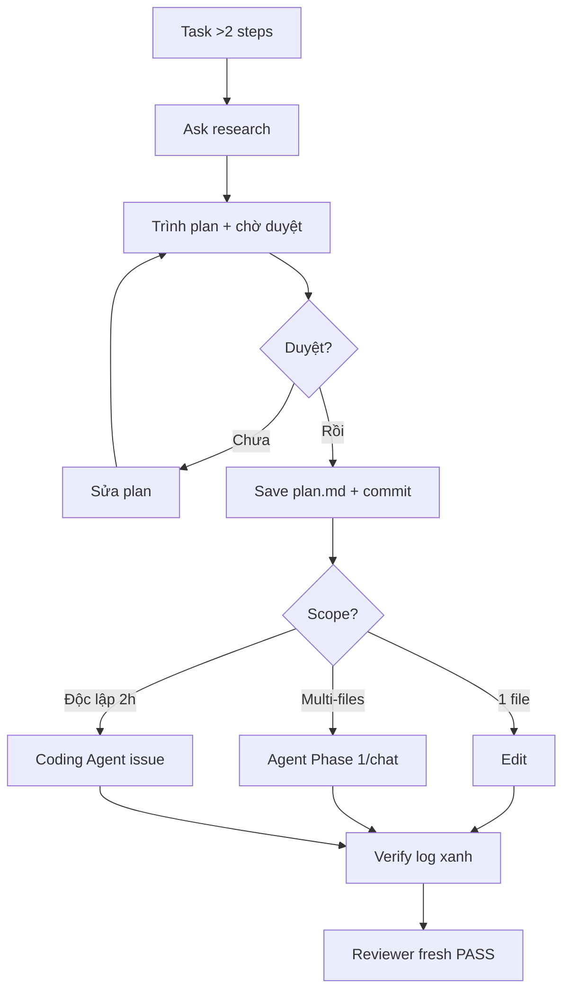

# Tips 03 — Plan-First Workflow: Ask → Edit → Agent Leo Thang

> **Dành cho:** dev đã quen gõ prompt nhưng hay giao task lớn cho Copilot mà chưa có plan.
> **Vấn đề:** task >2 steps mà nhảy thẳng vào Agent → code sai spec, test đỏ, mất cả buổi revert.
> **Đọc xong:** leo thang đúng 5 nấc Ask → Plan → Edit → Agent → Coding Agent, có `plan.md` để chat nào cũng tiếp tục được.
> **Thời gian:** ~25 phút đọc + ~65 phút làm bài tập.

## Mục tiêu bài học

- Kể được **5 nấc thang** Copilot 2026 và chọn đúng nấc cho từng cỡ task.
- Giải thích được vì sao **1 turn plan rẻ hơn 10 turn sửa sai** (đo bằng AI Credits).
- Tự viết **`plan.md` 7 mục** + prompt duyệt kiểu reviewer khó tính.
- Chạy trọn **walkthrough 60 phút** cho 1 feature thật mà không phải revert lớn.
- Nhận diện **các pitfall plan-first** và biết cách chặn trước.

## Mục lục

- [1. Vì sao phải plan-first với Copilot?](#1-vì-sao-phải-plan-first-với-copilot)
- [2. Cơ chế: 5 nấc thang Copilot 2026](#2-cơ-chế-5-nấc-thang-copilot-2026)
- [3. Nấc 1-2: Ask + Plan (không code)](#3-nấc-1-2-ask--plan-không-code)
- [4. Nấc 3-4: Edit + Agent (code có kiểm soát)](#4-nấc-3-4-edit--agent-code-có-kiểm-soát)
- [5. Nấc 5: Coding Agent giao issue (bất đồng bộ)](#5-nấc-5-coding-agent-giao-issue-bất-đồng-bộ)
- [6. Mẫu plan.md chuẩn + prompt duyệt](#6-mẫu-planmd-chuẩn--prompt-duyệt)
- [7. Walkthrough theo phút: feature payments 60 phút](#7-walkthrough-theo-phút-feature-payments-60-phút)
- [8. Bảng tra nhanh: chọn nấc nào?](#8-bảng-tra-nhanh-chọn-nấc-nào)
- [So sánh với Claude Code](#so-sánh-với-claude-code)
- [9. Pitfalls + cách fix](#9-pitfalls--cách-fix)
- [Best practices (kèm "vì sao")](#best-practices-kèm-vì-sao)
- [10. Bài tập cuối bài](#10-bài-tập-cuối-bài)
- [11. Tham khảo chéo](#11-tham-khảo-chéo)

---

## 0. Giải ngố thuật ngữ (1 câu + so sánh + ví dụ + verify)

Mỗi thuật ngữ đủ 3 lớp: **1 câu định nghĩa**, **so sánh đời thường**, **ví dụ copy-paste** — kèm 1 dòng `Verify`.

| Thuật ngữ | Hiểu nôm na (1 câu) | So sánh đời thường | Ví dụ copy-paste | Verify |
|---|---|---|---|---|
| **Plan-first** | Vẽ bản đồ trước khi xây — duyệt mới code. | Xin giấy phép xây nhà: duyệt bản vẽ rồi mới đổ bê tông. | `plan.md` có files sửa/steps/risks/verify → bạn duyệt → Agent implement. | Chưa có plan duyệt mà code là sai quy trình. |
| **Ask / Edit / Agent / Coding Agent** | 4 nấc quyền từ hỏi → sửa 1 chỗ → sửa nhiều chỗ → robot cloud tự làm. | Thuê thợ: hỏi giá (Ask) → vá áo (Edit) → sửa nhà (Agent) → giao chìa khóa (Coding Agent). | Hỏi flow → Ask; fix 1 hàm → Edit; multi-files + test → Agent; issue 2h → Coding Agent. | Task >2 steps mà nhảy thẳng Agent là đốt 10 turns. |
| **plan.md** | Tờ hợp đồng: làm gì, đụng đâu, xong kiểm sao. | Đơn thuốc: ghi rõ uống gì, mấy viên, tái khám khi nào. | `plan.md` mục 6 mẫu: mục tiêu + files + steps + KHÔNG đụng + verify. | Mọi chat implement đều đọc cùng `plan.md` đã commit. |



Giải thích: 1) Luôn bắt đầu Ask (rẻ). 2) Plan phải có verify từng phase + KHÔNG đụng. 3) Duyệt mới save + commit (để chat nào cũng đọc được). 4) 1 phase 1 chat fresh. 5) Xong thì Reviewer fresh verdict.

> ✅ **Kỳ vọng thấy gì:** sau Ask+Plan, có file `plan.md` commit với 7 mục mẫu; Agent implement dán log xanh từng phase, không code ngoài plan.

---

## 1. Vì sao phải plan-first với Copilot?

**Vì sao quan trọng?** Copilot code rất nhanh — nhanh tới mức nếu bạn đưa sai hướng, nó cũng "hoàn thành" sai hướng trong vài phút. Plan-first là cách duy nhất để bạn chặn sai hướng *trước khi* nó sinh ra 200 dòng code phải revert.

Ba nỗi đau kinh điển khi cho Copilot code ngay:

- Bạn gõ `làm feature payments giúp tôi` → Copilot code 200 dòng, sai spec, test đỏ, bạn mất 1 giờ revert.
- Bạn không biết nó sẽ sửa files nào → review diff như mò kim.
- Bạn hỏi 3 lần, mỗi lần nó đi một hướng khác nhau.

Plan-first đảo ngược thứ tự:

```text
TỆ: prompt -> code ngay -> sửa 10 turns
TỐT: prompt -> plan 1 turn -> bạn duyệt -> code theo plan -> verify
```

Lợi ích đo được:

- 1 turn plan (~1 lượt gọi model, tốn vài AI Credits) tránh 10 turns code sai (~10 lượt gọi model).
- Plan lưu ra `plan.md` → chat nào, người nào, Coding Agent nào cũng tiếp tục được.
- Bạn vẫn là người quyết định kiến trúc, Copilot chỉ implement.

> Rule: **task >2 steps hoặc >1 file → bắt buộc plan trước.**

**Nếu làm sai thì sao?** Bỏ qua plan, bạn trả giá bằng chính thứ đắt nhất: thời gian review và revert. Một prompt thiếu scope khiến diff chạm 10 file, mỗi file bạn phải tự đọc xem có đúng không — trong khi lẽ ra 1 turn plan (vài credits) đã khoanh được đúng 2 file cần sửa. Tệ hơn, chat càng dài thì Copilot càng quên đầu bài, càng sửa càng nát.

---

## 2. Cơ chế: 5 nấc thang Copilot 2026

| Nấc | Mode | Quyền | Khi dùng |
|---|---|---|---|
| 1 | Ask | Chỉ trả lời, không sửa | Hỏi, giải thích, research |
| 2 | Plan (Ask + plan file) | Trình plan, chờ duyệt | Task >2 steps |
| 3 | Edit | Sửa files bạn chỉ định | Fix 1 chỗ, task nhỏ rõ ràng |
| 4 | Agent | Tự đọc/sửa/chạy lệnh | Task vừa, multi-files |
| 5 | Coding Agent | Làm bất đồng bộ trên GitHub issue | Task độc lập, có spec rõ |

Leo thang đúng:

```text
Luôn bắt đầu thấp nhất có thể.
Ask không xong -> Plan -> Edit -> Agent -> Coding Agent.
Không nhảy từ Ask lên Coding Agent cho task chưa rõ.
```

Minh họa leo thang:

- Hỏi hàm là gì → Ask.
- Muốn thêm API mới → Plan trước.
- Plan duyệt rồi, sửa 1 file → Edit.
- Plan duyệt rồi, sửa 5 files + chạy test → Agent.
- Plan duyệt rồi, việc độc lập 2 giờ → assign Coding Agent trên issue.

> Lưu ý 2026: ngoài 5 nấc trên, VS Code/CLI còn có persona **Plan** và **Autopilot** (chọn bằng `Shift+Tab` trong CLI, dropdown trong Chat) — Autopilot tự chạy tới xong, vẫn tính AI Credits. Xem [bài 10 mục 3](../01-huong-dan-su-dung/10-modes-permissions-availability.md).

**Vì sao quan trọng?** Bạn chỉ được nâng quyền cho Copilot khi đã có plan duyệt. Nếu cho nó quyền Agent (tự sửa nhiều file) cho một task chưa rõ, bạn vừa tốn credits vừa mất kiểm soát. "Nấc" chính là "mức độ tin tưởng" bạn cấp.

**Nếu làm sai thì sao?** Nhảy thẳng lên nấc cao (Agent/Coding Agent) cho task mơ hồ → nó tạo nhánh, sửa lan, mở PR sai hướng; bạn mất thời gian dọn thay vì được giúp. Ngược lại, mãi kẹt ở Ask cho việc đáng ra nên giao Agent → bạn tự làm chậm mình.

---

## 3. Nấc 1-2: Ask + Plan (không code)

### Ask: hỏi không sợ bẩn

Ask mode không sửa code, chỉ đọc + trả lời. Dùng để hiểu trước khi làm.

**Ví dụ 1 — Ask hiểu module (copy-paste):**

```text
@workspace Chế độ Ask, chỉ đọc không sửa.
Trong src/payments/*.ts, giải thích flow refund hiện tại:
5 bullet + file:line cho mỗi bước.
Cuối cùng liệt kê 2 rủi ro nếu đổi logic quá 30 ngày.
```

**Ví dụ 2 — Ép plan mode (copy-paste):**

```text
FEATURE: Thêm POST /api/payments/refund.

Trước khi code:
1. Đọc #file:docs/payment-spec.md + #file:src/payments/refund.ts.
2. Trình plan gồm: files sẽ đọc/sửa (đường dẫn đầy đủ),
   steps theo thứ tự, risks/edge cases, cái gì KHÔNG đụng,
   cách verify từng phase (lệnh test cụ thể).
3. Chờ tôi duyệt mới implement. Không code trong message này.
Output: markdown, lưu gợi ý vào plan.md.
```

Điểm mấu chốt:

- Câu `Chờ tôi duyệt` + `Không code trong message này` là bắt buộc.
- Luôn giới hạn files đọc (2–5 files).
- Luôn đòi verify từng phase, không phải verify chung chung.

**Ví dụ 3 — Phỏng vấn khi spec mờ (copy-paste):**

```text
Spec còn mờ. Trước khi lập plan, hỏi tôi tối đa 5 câu làm rõ:
- refund quá 30 ngày có cho không?
- ai được duyệt? limit bao nhiêu?
- test nào là bắt buộc xanh?
Hỏi từng câu một, khi đủ thì mới trình plan.
```

Pattern này cực hợp cho non-coder / BA: bạn chỉ trả lời, Copilot lo cấu trúc.

---

## 4. Nấc 3-4: Edit + Agent (code có kiểm soát)

### Edit: dao mổ cho việc nhỏ

Edit mode (Inline Edit / Quick Chat Edit) chỉ sửa vùng bạn chọn. Rẻ, nhanh, ít rủi ro.

**Ví dụ 1 — Edit 1 hàm (copy-paste):**

```text
# Bôi đen hàm validate() -> Ctrl/Cmd+I -> gõ:
Fix normalizeEmail crash khi email có dấu, giữ nguyên signature.
Thêm null-check đầu hàm. Không đụng code ngoài selection.
```

**Ví dụ 2 — Edit theo plan đã duyệt (copy-paste):**

```text
# Mở chat Edit mới, gắn plan:
Đọc #file:plan.md. Chỉ làm Phase 1 (tách types, không đụng logic).
Sau khi sửa, chạy `npm test -- auth` và dán log.
Dừng sau Phase 1, không làm Phase 2.
```

### Agent: giao việc multi-files

Agent mode được phép đọc nhiều files, sửa nhiều chỗ, chạy terminal/test.

**Ví dụ 3 — Agent implement theo plan (copy-paste):**

```text
Chế độ Agent. Đọc #file:plan.md (đã duyệt).
Implement Phase 2 (thêm POST /api/payments/refund):
- Chỉ sửa files liệt kê trong plan, không thêm file ngoài.
- Sau mỗi file, chạy lint file đó.
- Cuối cùng chạy `npm test -- payments` + `npm run build`, dán cả 2 logs.
- Đỏ sau 3 lần -> dừng, báo blocker + file:line.
Ràng buộc: đừng đụng src/generated/, đừng commit.
```

Quy tắc an toàn cho Agent:

- Luôn gắn `plan.md` đã duyệt.
- Luôn giới hạn phase (1 phase / 1 chat).
- Luôn dặn dừng sau N lần đỏ.
- Xem gate verify ở [Tips 04](./04-verification-done-that.md).

---

## 5. Nấc 5: Coding Agent giao issue (bất đồng bộ)

Khi plan đã rõ, việc độc lập, bạn có thể assign cho Copilot Coding Agent trên GitHub.

**Ví dụ 1 — Viết issue để giao (copy-paste):**

```markdown
## Mục tiêu
Thêm POST /api/payments/refund theo docs/payment-spec.md section 3.

## Scope
- Chỉ sửa src/payments/refund.ts + test liên quan.
- Không đụng src/generated/, không đổi schema.

## Plan đã duyệt
Xem plan.md trong branch `plan/refund` (paste link).

## Done
- [ ] `npm test -- payments` xanh (paste log vào PR)
- [ ] `npm run lint` 0 error
- [ ] PR chỉ chạm src/payments/** (kèm git diff --stat)
```

Assign: Issue → Assignees → Copilot → nó tự tạo branch + PR draft.

**Ví dụ 2 — Prompt giao việc trong github.com chat (copy-paste):**

```text
@copilot Implement issue #123 theo plan trong mô tả.
Chỉ sửa trong src/payments/. Mở PR draft, dán log test xanh vào mô tả PR.
Nếu test đỏ sau 3 lần, dừng và comment blocker vào issue.
```

**Ví dụ 3 — Khi nào KHÔNG giao Coding Agent:**

```text
KHÔNG giao khi:
- Spec còn mờ, chưa có plan duyệt.
- Task đụng nhiều team, cần họp.
- Task <15 phút tự làm nhanh hơn (dùng Edit là xong).
```

> Lưu ý 2026: ngoài Coding Agent trên github.com, bạn có thể chạy agent trong terminal bằng 2 CLI: `gh copilot` (gợi ý/explain) và binary `copilot` (agent interactive/plan/autopilot, `/permissions`, `/sandbox`). Xem [Tips 11](./11-nang-cao-cli-web-coding-agent.md).

Chi tiết CLI + web + mobile xem [Tips 11](./11-nang-cao-cli-web-coding-agent.md).

---

## 6. Mẫu plan.md chuẩn + prompt duyệt

### Mẫu plan.md copy-paste

```markdown
# Plan: POST /api/payments/refund

## 1. Mục tiêu (1 câu)
Thêm API refund theo spec section 3, giữ public API cũ.

## 2. Files đọc (tối đa 5)
- docs/payment-spec.md
- src/payments/refund.ts
- src/payments/__tests__/refund.test.ts

## 3. Files sửa
| File | Việc | Verify |
|---|---|---|
| src/payments/refund.ts | thêm issueRefund() | npm test -- payments |
| src/payments/__tests__/refund.test.ts | thêm 2 cases >30 ngày | npm test -- payments |

## 4. Steps
1. Phase 1: tách types (không đụng logic) -> test xanh.
2. Phase 2: thêm API + tests -> test + build xanh.
3. Phase 3: review + docs.

## 5. Risks / Edge cases
- Refund quá 30 ngày: reject hay duyệt tay?
- Idempotency khi retry 2 lần?

## 6. KHÔNG đụng
- src/generated/, DB schema, main branch.

## 7. Verify từng phase
- Phase 1: `npm test -- auth`
- Phase 2: `npm test -- payments` + `npm run build`
```

### Prompt duyệt plan (copy-paste)

```text
Review plan trong #file:plan.md như reviewer khó tính:
- Thiếu file nào? Thừa file nào?
- Step nào chưa có verify cụ thể?
- Risk nào chưa có cách xử lý?
Trả về 3 gaps ưu tiên + gợi ý sửa 1 dòng mỗi cái.
Tôi duyệt xong mới cho implement.
```

Sau khi duyệt:

```text
Plan đã duyệt. Save plan.md, commit `docs: approve refund plan`.
Từ giờ mọi chat implement chỉ đọc plan.md này, không tự sáng tạo ngoài.
```

---

## 7. Walkthrough theo phút: feature payments 60 phút

**Bối cảnh:** thêm POST /api/payments/refund, repo Node + TS.

| Phút | Nấc | Việc + prompt (copy-paste) |
|---|---|---|
| 0–10 | Ask | `"@workspace Chỉ trong src/payments/*.ts: flow refund hiện tại 5 bullet + file:line. Không sửa."` → ghi findings ra plan.md |
| 10–25 | Plan | `"Đọc docs/payment-spec.md + refund.ts. Trình plan files sửa/steps/risks/KHÔNG đụng/verify. Chờ duyệt, không code."` |
| 25–30 | Duyệt | Bạn đọc plan, hỏi 2 câu rủi ro, sửa scope, commit plan.md |
| 30–45 | Edit/Agent | Mở chat mới: `"Đọc plan.md, chỉ làm Phase 1. Chạy npm test -- payments, dán log, dừng."` |
| 45–55 | Agent | Chat mới: `"Đọc plan.md, làm Phase 2. Chạy test + build, dán 2 logs."` |
| 55–60 | Review | Chat Reviewer fresh: `"Review diff vs plan.md, [SEVERITY] file:line, verdict PASS/NEEDS-FIX."` |

Tổng: 5 chats gọn, 1 plan duyệt, 0 lần revert lớn.

Nếu giao Coding Agent: phút 30 bạn assign issue kèm plan.md link, 2 giờ sau kiểm tra PR draft.

---

## 8. Bảng tra nhanh: chọn nấc nào?

| Dấu hiệu task | So sánh nôm na | Ví dụ | Nấc đúng | Prompt mẫu 1 dòng |
|---|---|---|---|---|
| Hỏi, giải thích, research | Mới nghe ngóng, chưa làm. | Flow refund trong `payments/*.ts`? | Ask | `@workspace giải thích flow X, 5 bullet, không sửa` |
| Task >2 steps / >1 file | Việc lớn, phải vẽ bản đồ. | Thêm `POST /refund` đụng 3 files. | Plan trước | `Trình plan + chờ duyệt, không code` |
| Fix 1 hàm, rõ ràng | Vá 1 lỗ nhỏ. | Fix `normalizeEmail` crash dấu. | Edit | `Bôi đen -> fix trong selection, giữ signature` |
| Multi-files + chạy test | Sửa cả nhà + nghiệm thu. | Refactor auth 5 files + test. | Agent + plan duyệt | `Đọc plan.md, làm Phase N, dán log` |
| Việc độc lập, spec rõ, 1–2 giờ | Giao khoán đi vắng. | Issue rate-limit có criteria. | Coding Agent | `Assign issue #X, mở PR draft + log xanh` |

### Before / After — prompt dở vs tốt

**Before (nhảy thẳng Agent):**
```text
làm feature payments giúp tôi
```
> Kết quả: code 200 dòng sai spec, test đỏ, mất 1h revert. Không plan, không scope, không verify.

**After (plan-first):**
```text
FEATURE: Thêm POST /api/payments/refund.
Trước khi code: 1) Đọc #file:docs/payment-spec.md + #file:src/payments/refund.ts.
2) Trình plan: files sửa, steps, risks, KHÔNG đụng, verify từng phase.
3) Chờ duyệt mới implement. Không code message này.
```
> Kết quả: 1 turn plan duyệt → 2 chats implement xanh từng phase → Reviewer PASS. Tổng 60 phút, 0 revert lớn. Verify: `plan.md` commit + 2 logs xanh.
> ✅ **Kỳ vọng thấy gì:** After có plan 7 mục + commit; Before có code ngay + đỏ.

| Dấu hiệu | Nấc | Prompt |
|---|---|---|
| Spec mờ | Ask phỏng vấn | `Hỏi tôi tối đa 5 câu rồi mới plan` |
| Muốn thử 2 hướng | 2 chats Plan song song | Mỗi chat 1 phương án, so pros/cons |

> Quy tắc ngón tay: **chưa có plan duyệt thì chưa cho code. Chưa rõ thì hỏi. Rõ rồi mới leo nấc.**

---

## So sánh với Claude Code

Cả hai đều có tư tưởng "vẽ bản đồ trước khi code", nhưng cách thể hiện khác nhau. Bảng này để bạn chuyển thói quen qua lại mà không bỡ ngỡ:

| Việc | Copilot | Claude Code | Ghi chú |
|---|---|---|---|
| Duyệt plan trước khi code | Có **nấc Plan** (Ask + plan file) và persona **Plan/Autopilot** | Có **plan mode** (bật/tắt trong phiên) và mặc định agentic | Cùng ý tưởng; Copilot leo nấc từng bước, Claude Code agentic sẵn |
| Nơi lưu plan để chat sau đọc lại | `plan.md` commit trong repo | Không có định dạng plan riêng — bạn tự lưu file tương tự | Cả hai đều dựa vào file trong repo, không có "bộ nhớ plan" tự động |
| Leo thang theo quyền | Ask → Edit → Agent → Coding Agent, chọn bằng dropdown/persona | Bắt đầu ở mức agentic; giới hạn bằng permission prompt & allowed tools | Copilot "tăng dần", Claude Code "khoanh vùng cho phép" |
| Giao việc bất đồng bộ | **Coding Agent** trên github.com: assign issue → PR draft | Chạy async qua **GitHub Actions**/môi trường cloud, không phải mô hình "assign issue cho bot" y hệt | Mô hình async khác nhau — chi tiết xem [Tips 11](./11-nang-cao-cli-web-coding-agent.md) |
| Cấu hình "luật" repo | `.github/copilot-instructions.md` | `CLAUDE.md` | Cùng tư tưởng: file trong repo là luật |

> **Đọc bảng này thế nào:** nếu quen Claude Code, bạn đã có sẵn phản xạ "plan trước, code sau". Sang Copilot chỉ cần nhớ thêm: nó có *nấc thang* thay vì agentic liền, và plan nên nằm ở `plan.md` commit được.

---

## 9. Pitfalls + cách fix

| Pitfall | Triệu chứng | Fix |
|---|---|---|
| Nhảy thẳng vào Agent cho task lớn | Code 200 dòng sai spec | Bắt buộc Ask → Plan → duyệt mới Agent |
| Plan chung chung không verify | Implement xong không biết done chưa | Mỗi phase 1 lệnh test/build cụ thể |
| Plan không ghi KHÔNG đụng | Sửa lan sang file cấm | Mọi plan đều có mục KHÔNG đụng |
| 1 chat làm cả 3 phases | Chat phình, phase sau hỏng phase trước | 1 phase 1 chat fresh, đều đọc plan.md |
| Duyệt plan qua loa | Agent đi sai vẫn xanh test | Dùng prompt duyệt reviewer khó tính mục 6 |
| Giao Coding Agent khi spec mờ | PR draft sai hướng, mất 2 giờ | Chỉ giao khi có plan duyệt + done checklist |
| Không save plan.md | Chat mới quên hết | Save + commit plan.md ngay sau duyệt |
| Edit cho task multi-files | Sửa chỗ này quên chỗ kia | Edit chỉ cho 1 vùng, multi-files dùng Agent |
| Quên dặn dừng khi đỏ | Agent vá 10 lần càng hỏng | Luôn dặn đỏ sau 3 lần → dừng + báo blocker |

### Ba pitfall ❌ SAI / ✅ ĐÚNG (nhìn là nhớ)

**1. Nhảy thẳng Agent cho task lớn**

```text
❌ SAI: "làm feature payments giúp tôi"  -> code 200 dòng sai spec, test đỏ
✅ ĐÚNG: "Trình plan files sửa/steps/risks/KHÔNG đụng/verify. Chờ tôi duyệt mới code."
```
**Bài học:** task >2 steps thì duyệt plan trước — 1 turn plan rẻ hơn 10 turn sửa sai.

**2. Plan có steps nhưng không có verify**

```text
❌ SAI: "Plan: thêm API refund"  -> implement xong vẫn không biết đúng hay sai
✅ ĐÚNG: "Phase 2 verify: npm test -- payments + npm run build"  -> mỗi phase 1 lệnh cụ thể
```
**Bài học:** plan không có verify thì chữ "xong" vô nghĩa — bạn không có gì để tin.

**3. Plan chỉ sống trong 1 chat**

```text
❌ SAI: plan nằm trong history chat cũ, mở chat mới là quên sạch
✅ ĐÚNG: save plan.md + commit `docs: approve refund plan`, mọi chat đọc #file:plan.md
```
**Bài học:** plan phải sống ngoài chat — để chat nào, Coding Agent nào cũng đọc được cùng một bản.

---

## Best practices (kèm "vì sao")

- **Task >2 steps hoặc >1 file → ép Plan trước khi cho code.** *Vì sao?* Đây là ngưỡng mà đoán sai hướng sẽ tốn hơn nhiều so với 1 turn plan.
- **Luôn có câu `Chờ tôi duyệt mới code` trong prompt plan.** *Vì sao?* Không có nó, Copilot tiện tay code luôn — bạn mất luôn cơ hội duyệt.
- **Mỗi phase phải có 1 lệnh verify cụ thể.** *Vì sao?* "Xong" không đo được; `npm test -- payments` thì đo được.
- **1 phase = 1 chat fresh.** *Vì sao?* Chat dài làm loãng luật và agent quên đầu bài (xem [Tips 01](./01-context-hygiene.md)).
- **Duyệt plan bằng reviewer khó tính, đừng tự khen.** *Vì sao?* Người viết plan khó thấy lỗ hổng của chính mình; prompt adversarial mục 6 ép lộ 3 gaps.
- **Save + commit `plan.md` ngay sau khi duyệt.** *Vì sao?* Plan là hợp đồng giữa các chat; không lưu thì chat sau tự sáng tạo lại từ đầu.
- **Luôn dặn "đỏ sau 3 lần thì dừng".** *Vì sao?* Không có giới hạn, agent vá mù tới lúc hỏng nặng hơn cả bug gốc.

---

## 10. Bài tập cuối bài

**Bài 1 (15 phút — phân loại nấc):**

1. Liệt kê 5 tasks tuần này của bạn.
2. Gắn mỗi task 1 nấc (Ask / Plan / Edit / Agent / Coding Agent) + lý do 1 dòng.
3. Task nào bạn từng làm sai nấc? Viết lại prompt đúng nấc.

**Bài 2 (30 phút — plan-first thật):**

1. Lấy 1 feature thật >2 steps, chạy đúng flow: Ask 10p → Plan 15p → duyệt 5p.
2. Save plan.md theo mẫu mục 6, commit.
3. Implement Phase 1 bằng chat Edit fresh, dán log xanh.

**Bài 3 (20 phút — giao Coding Agent thử):**

1. Viết 1 issue theo mẫu mục 5 (mục tiêu + scope + done checklist).
2. Assign Copilot, quan sát branch + PR draft nó tạo.
3. Review PR như reviewer: plan khớp không? log xanh không? Comment 1 finding.

> Đạt: sau 2 tuần, 100% task >2 steps của bạn có plan.md duyệt trước khi code.

---

## 11. Tham khảo chéo

- Bài tips liên quan:
  - [Tips 01](./01-context-hygiene.md) — 1 task 1 chat sạch
  - [Tips 02](./02-prompt-engineering.md) — 6 mẫu prompt + prompt files
  - [Tips 04](./04-verification-done-that.md) — định nghĩa done + review gate
  - [Tips 05](./05-parallel-agents.md) — song song hóa sau khi có plan
  - [Tips 11](./11-nang-cao-cli-web-coding-agent.md) — Coding Agent + 2 CLI + web

> **Chốt Tips 03:** _vẽ bản đồ trước khi đổ bê tông — chưa có plan duyệt thì chưa cho Copilot viết dòng code nào._
