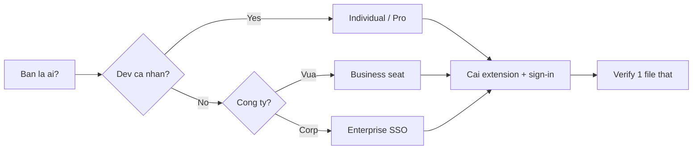

# FAQ 01 — Tài Khoản, Pricing & Cài Đặt

> **Dành cho:** dev cần chọn plan, xin seat, bật trial hoặc cài lại Copilot cho sạch — người mới lẫn người đã dùng.
> **Vấn đề:** "dùng GitHub Copilot 2026 thì cần tài khoản gì, tốn bao nhiêu, cài sao cho sạch" — trả lời theo 10 câu hỏi deep-dive.
> **Đọc xong:** tự chọn plan, xin seat, bật trial, cài sạch trong ~10 phút. **Thời gian:** ~10 phút đọc.

10 câu hỏi dưới đây cùng xoay quanh một câu lớn: **"dùng GitHub Copilot 2026 thì cần tài khoản gì, tốn bao nhiêu, cài sao cho sạch"**. Mỗi câu đều có giải thích + lệnh copy-paste + ví dụ, kèm phần "Khi nào áp dụng" để bạn biết lúc nào nên mở lại đọc.

> **Nếu làm sai thì sao?** Chọn sai plan thì hoặc trả thừa tiền, hoặc cạn Credits giữa tháng; cài trùng extension thì suggestions chết mà không rõ lý do; login nhầm account thì policy org "không ăn" và bill đi sai chỗ. Ba lỗi này gần như bao trùm toàn bộ các ca "Copilot của em không chạy".

## Mục tiêu bài học

- Chọn đúng plan (Free / Pro / Pro+ / Max / Business / Enterprise) và biết mình thuộc nhóm nào.
- Phân biệt seat, trial và quyền admin — không còn bối rối khi org mua hộ.
- Cài sạch đúng 1 extension chính chủ mỗi IDE + CLI, và biết cách đổi account cho đúng.
- Tự xử 3 lỗi cài đặt kinh điển: extension đè nhau, IDE quá cũ, thiếu `gh`.

## Sơ đồ tư duy nhanh (đọc 30 giây)

Bạn thuộc nhóm người nào thì đi thẳng vào plan và đường cài tương ứng, không cần đọc cả bài.



## Bảng tổng hợp: chọn đường vào nhanh

Bạn là ai → cần plan nào, cài thế nào, việc đầu tiên phải làm là gì. Tra bảng này trước khi đọc chi tiết.

| Bạn là ai | Plan cần | Cài thế nào | Việc đầu tiên |
|---|---|---|---|
| Dev cá nhân | Free ($0) hoặc Pro ($10/tháng) | Extension VS Code / JetBrains / Neovim | Mở IDE → sign-in GitHub → check status bar |
| Dev Pro xài nhiều model mạnh | Pro+ ($39/tháng) hoặc Max ($100/tháng) | Extension + Copilot CLI | `gh copilot --help` test CLI |
| Dev công ty | Business ($19/user/tháng) seat do admin cấp | Extension, policy theo org | Xin admin assign seat, check policy |
| Team enterprise / compliance nặng | Enterprise ($39/user/tháng) | SSO/SAML + org policy + audit | Đọc SSO doc nội bộ, verify audit log |
| Muốn thử trước khi mua | Trial (Business 30 ngày / plan Free giới hạn) | Như plan tương ứng | Bật trial → set reminder trước ngày hết hạn |
| Repo mới tinh | Bất kỳ plan trên | Mở repo → copy `templates/` của tutorial này | Verify suggestions chạy trên 1 file thật |

---

## 1. Các plan Individual / Pro / Business / Enterprise khác nhau gì?

> **Hỏi ngắn gọn:** _Các plan Individual / Pro / Business / Enterprise khác nhau gì?_

**Trả lời 1 câu:** GitHub chia plan thành nhóm cá nhân Free / Pro / Pro+ / Max và nhóm tổ chức Business / Enterprise, tất cả đều dùng chung đơn vị thanh toán là AI Credits (1 credit = $0.01).

**Giải thích chi tiết + ví dụ:** Từ 01/06/2026 GitHub chuyển sang **usage-based billing** (tính tiền theo usage) — plan "Individual" cũ giờ gồm Free / Pro / Pro+ / Max. Giá tham khảo 10/2026 (check `github.com/features/copilot` trước khi chốt):

- **1 AI credit = $0.01 USD.** Chi phí mỗi lượt = giá mỗi token của model × số token, quy đổi ra credits.
- **Free ($0):** allowance credits (số cụ thể GitHub chưa công bố — cần verify), chỉ auto model selection, inline suggestions giới hạn 2.000 completions/tháng.
- **Student/Teacher ($0):** Free cho sinh viên/giáo viên, cần xác thực email trường.
- **Pro ($10/tháng):** 1.000 base + 500 flex = **1.500 credits**. Hợp dev cá nhân, side-project.
- **Pro+ ($39/tháng):** 3.900 + 3.100 = **7.000 credits**. Ưu tiên model mới, dùng coding agent thoải mái hơn.
- **Max ($100/tháng):** 10.000 + 10.000 = **20.000 credits**. Hợp dev dùng Copilot như pair-programmer full-time.
- **Business ($19/user/tháng):** 1.900 credits/seat/tháng, Credits **pooled cả org** (không chia cứng từng ghế). Thêm org management, policy control (content exclusion, model allowlist), audit cơ bản, IP indemnity (cần verify). Seat do admin assign. Hợp công ty vừa.
- **Enterprise ($39/user/tháng):** 3.900 credits/seat/tháng, pooled. Thêm SSO/SAML bắt buộc, audit logs đầy đủ, data residency / ZDR tương đương, review & approve coding-agent PR, SLA. Hợp corp, bank, gov.

| Tiêu chí | Free | Pro | Pro+ | Max | Business | Enterprise |
|---|---|---|---|---|---|---|
| Giá | $0 | $10/tháng | $39/tháng | $100/tháng | $19/user/tháng | $39/user/tháng |
| Credits/tháng | allowance (chưa công bố) | 1.500 (1.000 + 500) | 7.000 (3.900 + 3.100) | 20.000 (10.000 + 10.000) | 1.900/seat (pooled) | 3.900/seat (pooled) |
| Credits gộp cả org? | Không | Không | Không | Không | Có | Có |
| Ai quản | Bạn | Bạn | Bạn | Bạn | Admin org | Admin org |
| Điểm thêm | Auto model; 2.000 completions/tháng | — | Ưu tiên model mới | Pair-programmer full-time | Policy + audit cơ bản | SSO/SAML, audit đầy đủ, SLA |
| Khi nào dùng | Thử nhẹ | Side-project | Xài nhiều model mạnh | Dùng hàng ngày như pair-programmer | Công ty vừa | Corp, bank, gov |

Quy tắc tính tiền cần nhớ:

- **Code completions và next edit suggestions KHÔNG trừ AI Credits** — không giới hạn trên mọi plan trả phí.
- Plan trả phí dùng **auto model selection được giảm 10%** (Copilot Chat, CLI, Copilot app, cloud agent).
- Hết credits base + flex → dùng tiếp tính vào **additional usage budget** (spend cap cấu hình được). **Paid usage policy bật mặc định** — admin phải chủ động tắt để cắt chi tiêu.
- Hitting limit có thể xin owner/billing manager nâng budget (áp dụng Business/Enterprise dùng usage-based billing; GA 9/2026).
- Code review tốn thêm **GitHub Actions minutes** (không nằm trong ước tính credits).

Điểm mấu chốt: **Free/Pro/Pro+/Max = tự trả, tự quản; Business/Enterprise = admin quản, policy đè lên setting cá nhân.**

### Làm thế nào (steps copy-paste)

Chạy trong terminal để biết mình đang ở plan nào (cần `gh` đã login):

```bash
# Xem plan hiện tại của account (cần gh CLI đã login)
gh api user --jq '{login, plan: .plan.name}'
gh api /user/copilot_seat_details --jq . 2>/dev/null || echo "Chua co seat hoac API chua mo"
# Verify: kết quả cho thấy login + tên plan, không phải 404
```

**Ví dụ cụ thể:** bạn trả Pro nhưng công ty mua Business. Khi join org, seat Business đè lên — policy org (VD chặn `*.pem`) thắng setting cá nhân của bạn.

> **Khi nào áp dụng:** luôn xác định plan NGAY từ đầu vì nó khóa hạn mức Credits (câu 2), policy (bài 05), và quyền riêng tư (bài 09).

> **Nếu vẫn lỗi thì...** (không thấy plan, không rõ mình thuộc gói nào): (1) chạy lại `gh auth status` xem có đúng account không, (2) mở `github.com/settings/copilot` để đối chiếu plan thật thay vì đoán theo email, (3) nếu là org thì hỏi admin seat đã gán chưa, (4) vẫn mù mờ thì mở issue kèm ảnh chụp trang settings — xem "Vẫn lỗi thì sao?" cuối file.
---

## 2. Trial hoạt động thế nào, hết trial thì sao?

> **Hỏi ngắn gọn:** _Trial hoạt động thế nào, hết trial thì sao?_

**Trả lời 1 câu:** Plan Free cho dùng thử không cần thẻ với giới hạn rõ ràng (2.000 completions/tháng), còn Business trial 30 ngày là full tính năng cho cả org và hết hạn thì tự chuyển sang trả phí nếu không hủy.

**Giải thích chi tiết + ví dụ:** GitHub cho 2 loại dùng thử:

- **Plan Free:** completions + chat giới hạn (2.000 completions/tháng; giới hạn chat hàng tháng trước đây là 50 tin — cần verify), không cần thẻ, hết hạn mức thì chờ chu kỳ mới.
- **Business trial (30 ngày):** full tính năng Business cho cả org, cần admin bật, hết 30 ngày tự chuyển sang trả phí nếu không hủy.

Hết trial: Free → suggestions dừng, chat báo hạn mức; Business trial → org bị downgrade, seat mất, coding agent PR dở dang vẫn giữ nhưng không tạo mới được.

### Làm thế nào (steps copy-paste)

Không có lệnh CLI xem trial — phải vào web và tự đặt mốc thời gian:

```bash
# Không có lệnh CLI xem trial; check trên web:
# https://github.com/settings/copilot -> xem "Trial ends on ..."
# Đặt reminder trước 3 ngày để quyết định mua/hủy
# Verify: trang hiện "Trial ends on" + ngày cụ thể trước mắt bạn
```

**Ví dụ cụ thể:** admin bật Business trial ngày 1/10 → set reminder 27/10 review: giữ thì add billing, không thì `Settings → Billing → Cancel trial` + export audit log trước khi mất.

> **Khi nào áp dụng:** trước khi onboarding team >5 người — luôn trial Business trước, đừng mua blind.

> **Nếu vẫn lỗi thì...** (trial không bật được, hoặc hết hạn bất ngờ): (1) xác nhận bạn là admin/owner org — dev thường không tự bật được trial, (2) kiểm tra org chưa từng dùng trial trước đó, (3) đọc kỹ "Trial ends on" trước khi nói "tự nhiên mất", (4) hỏi owner/billing manager hoặc mở ticket — xem "Vẫn lỗi thì sao?" cuối file.
---

## 3. Seat là gì, admin assign / thu hồi seat thế nào?

> **Hỏi ngắn gọn:** _Seat là gì, admin assign / thu hồi seat thế nào?_

**Trả lời 1 câu:** Seat là 1 ghế Copilot gắn với 1 GitHub user trong org, admin cấp ở `Org → Settings → Copilot → Access`, hết seat thì người kế tiếp báo "No seat available".

**Giải thích chi tiết + ví dụ:** Seat = 1 ghế Copilot gắn với 1 GitHub user trong org. Org mua N seats → admin assign cho N người. Hết seat → người thứ N+1 thấy "No seat available" dù đã join org.

Admin quản seat ở `Org → Settings → Copilot → Access`. Có 2 chế độ: allow all members (tốn seat theo headcount) hoặc selected teams/users (tiết kiệm).

Credits của org được **pooled ở mức billing entity** — không chia cứng từng seat, nên seat nào xài nhiều vẫn lấy chung hạn mức tổ chức.

### Làm thế nào (steps copy-paste)

Dành cho admin org (cần org owner + `gh` CLI):

```bash
# Admin: xem ai đang giữ seat (cần org owner + gh CLI)
gh api orgs/<ORG>/copilot/billing/seats --jq '.seats[] | {login: .assignee.login, plan}'
# Verify: mỗi dòng ra login của 1 dev + plan (Business/Enterprise)

# Admin: assign seat cho 1 team (via web UI hoặc API)
gh api -X POST orgs/<ORG>/copilot/billing/selected_teams \
  -f selected_teams='["team-slug"]'
# Verify: chạy lệnh trên, response không lỗi + dev trong team thấy copilot chạy
```

**Ví dụ cụ thể:** org 50 dev nhưng chỉ mua 20 seats → tạo team `copilot-pilot` 20 người, assign seat cho team đó, còn lại chờ đợt 2.

> **Khi nào áp dụng:** khi có dev báo "Copilot đòi mua dù đã join org" — 90% là chưa được assign seat.

> **Nếu vẫn lỗi thì...** (đã join org mà vẫn "No seat available"): (1) nhờ admin chạy lại lệnh liệt kê seats xem tên bạn có trong đó không, (2) kiểm tra bạn thuộc đúng team được assign (allow-all vs selected teams), (3) nếu tên có mà vẫn không chạy, sign-out → sign-in lại trong IDE, (4) hết seat thật thì phải chờ mua thêm — xem "Vẫn lỗi thì sao?" cuối file.
---

## 4. Cài đặt thế nào cho sạch: VS Code / JetBrains / Neovim / CLI?

> **Hỏi ngắn gọn:** _Cài đặt thế nào cho sạch: VS Code / JetBrains / Neovim / CLI?_

**Trả lời 1 câu:** Mỗi IDE chỉ giữ đúng 1 extension Copilot chính chủ, cài theo thứ tự VS Code → JetBrains → Neovim → CLI là sạch.

**Giải thích chi tiết + ví dụ:** Chỉ giữ **1 extension Copilot + 1 Copilot Chat** mỗi IDE, đừng cài thêm fork "copilot-plus-plus" trôi nổi. Thứ tự khuyên dùng:

- **VS Code:** extension `GitHub Copilot` + `GitHub Copilot Chat` (chính chủ, update theo VS Code release).
- **JetBrains:** plugin `GitHub Copilot` từ Marketplace, login qua browser.
- **Neovim:** `github/copilot.vim` hoặc `zbirenbaum/copilot.lua`, auth bằng `:Copilot auth`.
- **CLI:** `gh extension install github/gh-copilot` → dùng `gh copilot suggest` / `gh copilot explain`. Bản CLI độc lập 2026 là binary `copilot` (có `copilot init`, slash command `/mcp`, `/usage`) — xem [bài 10](10-ci-sdk-review-web.md).

| Bề mặt | Cài gì | Cách auth | Khi nào dùng |
|---|---|---|---|
| VS Code | `GitHub.copilot` + `GitHub.copilot-chat` | Command Palette → Sign in to GitHub | IDE chính, dùng hàng ngày |
| JetBrains | Plugin `GitHub Copilot` (Marketplace) | Login qua browser | Team dùng IntelliJ/PyCharm |
| Neovim | `github/copilot.vim` hoặc `zbirenbaum/copilot.lua` | `:Copilot auth` | Dev terminal-first |
| CLI | `gh extension install github/gh-copilot` (hoặc binary `copilot`) | `gh auth login` / `copilot init` | Thao tác terminal, script |

### Làm thế nào (steps copy-paste)

Máy mới thì cài theo đúng thứ tự này để tránh cài chồng:

```bash
# VS Code CLI: cài extension chính chủ
code --install-extension GitHub.copilot
code --install-extension GitHub.copilot-chat
# Verify: code --list-extensions | grep -i copilot ra đúng 2 dòng

# GitHub CLI + copilot extension
gh extension install github/gh-copilot
gh copilot --help
# Verify: ra giúp đỡ của gh copilot, không phải "command not found"

# Neovim (copilot.vim): trong nvim
# :Copilot setup  -> mở browser auth -> :Copilot status
# Verify: :Copilot status hiện "Authenticated as <login>"
```

**Ví dụ cụ thể:** máy mới → cài VS Code extensions + `gh` + `gh-copilot` là đủ 95% nhu cầu (IDE + terminal).

> **Khi nào áp dụng:** máy mới, hoặc khi suggestions chập chờn do cài 2 plugin đè nhau.

> **Nếu vẫn lỗi thì...** (cài xong mà suggestions không hiện): (1) kiểm tra `code --list-extensions | grep -i copilot` có đúng 2 dòng chính chủ, (2) reload cửa sổ IDE, (3) với Neovim chạy `:Copilot status` xem đã auth chưa, (4) gỡ hết bản lạ rồi cài lại — xem câu 7 và "Vẫn lỗi thì sao?" cuối file.
---

## 5. Sign-in / sign-out / đổi account (cá nhân ↔ công ty) thế nào?

> **Hỏi ngắn gọn:** _Sign-in / sign-out / đổi account (cá nhân ↔ công ty) thế nào?_

**Trả lời 1 câu:** Copilot dùng đúng GitHub account đang login trong IDE, đổi bằng sign-out → sign-in lại (VS Code), `gh auth login/logout` (CLI) hoặc Remove/Add account (JetBrains).

**Giải thích chi tiết + ví dụ:** Copilot auth gắn với GitHub account đang login trong IDE. Lỗi kinh điển: máy công ty login nhầm account cá nhân → policy org không áp dụng, bill sai chỗ.

- **VS Code:** `Ctrl+Shift+P → "Sign out of GitHub"` rồi sign-in lại account đúng.
- **gh CLI:** `gh auth login` / `gh auth logout`, check bằng `gh auth status`.
- **JetBrains:** `Settings → GitHub → Remove account → Add lại`.

| Bề mặt | Đổi account thế nào | Kiểm tra bằng | Khi nào dùng |
|---|---|---|---|
| VS Code | `Ctrl+Shift+P → "Sign out of GitHub"` rồi sign-in lại | Status bar Copilot | Máy công ty login nhầm account |
| gh CLI | `gh auth login` / `gh auth logout` (hoặc `gh auth switch --user <login>`) | `gh auth status` | Đổi account cho terminal/CLI |
| JetBrains | `Settings → GitHub → Remove account → Add lại` | Plugin hiện account mới | Đổi account trong IntelliJ/PyCharm |

### Làm thế nào (steps copy-paste)

Kiểm tra trước, rồi mới đổi — tránh logout nhầm account đang cần:

```bash
# Kiểm tra account đang dùng cho gh + copilot
gh auth status
gh api user --jq .login
# Verify: login hiện là account bạn MƯỢC muốn dùng (khác thì cần đổi)

# Đổi account: logout rồi login lại
gh auth logout
gh auth login --web -h github.com
# Verify: gh api user --jq .login ra login mới sau khi login xong
```

**Ví dụ cụ thể:** freelancer có 2 account (cá nhân + client). Dùng `gh auth switch --user <login>` hoặc 2 VS Code profile riêng để khỏi lẫn seat/bill.

> **Khi nào áp dụng:** đầu mỗi máy mới, mỗi khi bill sai, và khi policy org "không ăn" (thường do sai account).

> **Nếu vẫn lỗi thì...** (đổi account rồi mà Copilot vẫn như cũ): (1) thoát hẳn IDE rồi mở lại, vì extension đôi khi giữ token cũ, (2) chạy `gh auth status` xác nhận đúng account active, (3) xóa credential GitHub cũ trong OS keychain nếu vẫn dính, (4) báo admin xác nhận seat nằm ở account mới — xem "Vẫn lỗi thì sao?" cuối file.
---

## 6. Policy của org đè lên setting cá nhân ra sao?

> **Hỏi ngắn gọn:** _Policy của org đè lên setting cá nhân ra sao?_

**Trả lời 1 câu:** Với Business/Enterprise, policy org luôn thắng setting cá nhân — bạn bật trong IDE cũng bị ép tắt.

**Giải thích chi tiết + ví dụ:** Với Business/Enterprise, admin set policy ở org level: model nào được dùng, có cho phép `*` exclusion, coding agent có chạy không... Policy org **luôn thắng** setting cá nhân — bạn bật trong IDE cũng bị ép tắt.

Triệu chứng: setting tự revert sau restart, model picker thiếu model, chat báo "disabled by your administrator".

### Làm thế nào (steps copy-paste)

Dev không tự xem được policy từ client — phải hỏi admin hoặc vào web:

```bash
# Không có lệnh xem policy từ client; check trên web:
# https://github.com/organizations/<ORG>/settings/copilot -> Policies tab
# Dev: nếu nghi bị policy đè, hỏi admin chụp màn hình Policies tab
# Verify: Policies tab có list rule + toggle, không có "all members" bị tắt
```

**Ví dụ cụ thể:** bạn bật "Allow all models" nhưng picker chỉ hiện GPT, thiếu Claude — vì admin set model allowlist. Fix duy nhất: nhờ admin mở thêm.

> **Khi nào áp dụng:** mọi trường hợp "em bật rồi mà không có tác dụng" trong org Business/Enterprise. Chi tiết xem [bài 05](05-policies-guardrails-faq.md).

> **Nếu vẫn lỗi thì...** (setting cứ tự tắt, không rõ ai chặn): (1) so sánh setting của bạn với ảnh chụp Policies tab của admin, (2) xác nhận bạn đang login đúng account trong org, (3) thử trên một máy khác để loại trừ lỗi local, (4) nhờ admin đổi policy thay vì cố lách — xem "Vẫn lỗi thì sao?" cuối file.
---

## 7. Lỗi cài đặt kinh điển: extension xung đột, version cũ, PATH thiếu `gh`?

> **Hỏi ngắn gọn:** _Lỗi cài đặt kinh điển: extension xung đột, version cũ, PATH thiếu `gh`?_

**Trả lời 1 câu:** 3 lỗi top là 2 plugin Copilot đè nhau, IDE quá cũ và máy chưa cài `gh` — gỡ bản lạ, update IDE, cài `gh` là chạy lại.

**Giải thích chi tiết + ví dụ:** 3 lỗi gặp nhiều nhất:

1. **2 plugin Copilot đè nhau** (cũ `copilot` + fork) → gỡ hết, giữ 1 bản chính chủ.
2. **IDE quá cũ** → Copilot Chat yêu cầu VS Code ≥ bản N; update IDE trước.
3. **CLI thiếu `gh`** → `gh copilot` báo `command not found`; cài `gh` rồi mới add extension.

### Làm thế nào (steps copy-paste)

Dò đúng lỗi trước khi sửa — 3 lệnh dưới cho bạn biết đang vướng cái nào:

```bash
# VS Code: liệt kê extension copilot đang cài
code --list-extensions | grep -i copilot
# Verify: nên ra đúng 2 dòng (GitHub.copilot + GitHub.copilot-chat), thêm = conflict

# Gỡ bản lạ, giữ chính chủ
code --uninstall-extension <ten-la>
code --install-extension GitHub.copilot GitHub.copilot-chat

# Kiểm tra gh + copilot extension
gh --version && gh extension list | grep copilot
# Verify: gh --version ra số, extension list có "github/gh-copilot"
```

**Ví dụ cụ thể:** `code --list-extensions | grep -i copilot` ra 3 dòng (1 chính chủ + 2 fork) → gỡ 2 fork, reload IDE, suggestions chạy lại ngay.

> **Khi nào áp dụng:** khi suggestions/chat đột nhiên chết sau update IDE hoặc sau khi vọc extension.

> **Nếu vẫn lỗi thì...** (gỡ xong vẫn không chạy): (1) update VS Code lên bản mới nhất rồi reload, (2) nếu là CLI, xác nhận `gh` cài trước khi add extension `gh-copilot`, (3) xem `Output → GitHub Copilot` tìm dòng lỗi cụ thể, (4) gỡ sạch rồi cài lại từ đầu — xem "Vẫn lỗi thì sao?" cuối file.
---

## 8. Bắt đầu repo mới: 5 việc setup đầu repo là gì?

> **Hỏi ngắn gọn:** _Bắt đầu repo mới: 5 việc setup đầu repo là gì?_

**Trả lời 1 câu:** 5 việc là verify suggestions chạy, copy file instructions chính, thêm instructions theo stack, thêm MCP nếu cần data ngoài repo, và thêm content exclusion cho path nhạy cảm.

**Giải thích chi tiết + ví dụ:** Thứ tự chuẩn cho repo vừa clone / vừa tạo (làm 1 lần, hưởng cả dự án):

1. Mở repo trong IDE, verify Copilot suggestions chạy (gõ 1 hàm đơn giản).
2. Copy `.github/copilot-instructions.md` từ `templates/` (bài này bước 9).
3. Thêm `.github/instructions/*.instructions.md` theo stack (backend/frontend...).
4. Thêm `.vscode/mcp.json` nếu cần data ngoài repo (DB, docs...).
5. Thêm `.vscode/settings.json` với content exclusion cho path nhạy cảm.

### Làm thế nào (steps copy-paste)

Làm lần lượt 5 việc, mỗi việc verify một lần để biết dừng ở đâu nếu hỏng:

```bash
cd ~/code/my-repo && code .

# Trong IDE: gõ thử 1 hàm để verify suggestions
# def add(a, b):  -> chờ gợi ý xám -> Tab để nhận
# Verify: suggestions hiện + nhận Tab thành code thật

# Copy khung templates (đứng ở root repo đích)
cp -r /path/to/tutorial-copilot/templates/.github ./
cp -r /path/to/tutorial-copilot/templates/.vscode ./
# Verify: ls .github/ .vscode/ thấy đủ file, không thiếu
```

**Ví dụ repo trống:** chưa có code để Copilot học pattern → `copilot-instructions.md` càng quan trọng (khai stack + conventions ngay từ đầu).

> **Khi nào áp dụng:** mọi repo chưa từng dùng Copilot. Team thì commit `.github/` + `.vscode/` để người sau khỏi setup lại.

> **Nếu vẫn lỗi thì...** (setup xong mà Copilot vẫn đoán sai repo): (1) verify bước 1 — nếu suggestions không chạy thì lỗi ở đâu đó khác (quay lại câu 4, 7), (2) mở `copilot-instructions.md` xác nhận đã sửa theo stack thật, (3) kiểm tra file nằm đúng `.github/` ở root repo, (4) thử hỏi Copilot "tóm tắt README + package.json" để xem nó đọc đúng chưa — xem "Vẫn lỗi thì sao?" cuối file.
---

## 9. Project mới tinh thì copy `templates/` thế nào?

> **Hỏi ngắn gọn:** _Project mới tinh thì copy `templates/` thế nào?_

**Trả lời 1 câu:** Repo trống vẫn copy được full khung `templates/`, chỉ cần sửa khoảng 20% cho khớp stack thật vì Copilot đọc instructions tĩnh chứ không quét dự án.

**Giải thích chi tiết + ví dụ:** Không như tool quét codebase, Copilot đọc instructions tĩnh — repo trống vẫn setup được full khung, chỉ cần sửa 20% cho khớp stack thật.

### Làm thế nào (steps copy-paste)

Copy khung rồi sửa ngay những chỗ dễ sai nhất, đừng để nguyên template:

```bash
ls /path/to/tutorial-copilot/templates/
cp /path/to/tutorial-copilot/templates/.github/copilot-instructions.md ./.github/copilot-instructions.md
# Mở file, sửa: stack, lệnh test/lint/build, cấu trúc thư mục, quy ước branch
# Verify: grep "npm test" trong file → nếu repo bạn dùng pnpm, sửa dòng đó
```

**Ví dụ cụ thể:** template ghi `npm test`; bạn dùng `pnpm` → sửa ngay dòng đó. Sai 1 dòng này, Copilot gợi ý sai lệnh cả tháng.

> **Khi nào áp dụng:** `git init` vừa xong, chưa có file nào. Sau khi code lên hình, bổ sung instructions theo path.

> **Nếu vẫn lỗi thì...** (Copilot gợi ý sai lệnh/stack): (1) `grep` lại các lệnh test/lint/build trong file xem còn sót ví dụ của template không, (2) so cấu trúc thư mục thật với phần mô tả trong instructions, (3) bổ sung `.github/instructions/*.instructions.md` khi repo đã có code, (4) hỏi Copilot "repo này test bằng lệnh nào" để lộ chỗ sai — xem "Vẫn lỗi thì sao?" cuối file.
---

## 10. Báo lỗi / nhờ hỗ trợ từ GitHub thế nào?

> **Hỏi ngắn gọn:** _Báo lỗi / nhờ hỗ trợ từ GitHub thế nào?_

**Trả lời 1 câu:** Báo qua GitHub Discussions hoặc Support ticket (Business/Enterprise), kèm plan + IDE version + log thì mới xử lý nhanh.

**Giải thích chi tiết + ví dụ:** Kênh chính: `github.com/community` Discussions (Copilot category) hoặc Support ticket (Business/Enterprise). Report tốt = kèm 3 thứ: plan + IDE version + log.

### Làm thế nào (steps copy-paste)

Thu thập đủ bằng chứng trước khi gửi, đừng bắt người ta hỏi lại:

```bash
# Thu thập info trước khi báo lỗi
gh --version
code --version
code --list-extensions | grep -i copilot
# VS Code: Output panel -> chọn "GitHub Copilot" -> copy đoạn lỗi
# + ghi rõ: plan (Individual/Business), file log: https://github.com/settings/copilot
# Verify: đủ 3 dòng version + đoạn log → paste vào issue
```

**Ví dụ report chuẩn:**

```text
Tiêu đề: No suggestions in Python files after VS Code 1.9x update (Business seat)
Mô tả: suggestions dừng từ hôm update, JS vẫn có, Python không.
Kèm: extension versions + Output log đoạn lỗi + đã thử reload/re-login.
```

> **Khi nào áp dụng:** khi đã đi hết thứ tự debug ([bài 08](08-loi-thuong-gap-troubleshooting.md)) mà vẫn lỗi.

> **Nếu vẫn lỗi thì...** (gửi report mà không ai phản hồi): (1) đảm bảo report có đủ plan + version + log thay vì chỉ "nó không chạy", (2) với Business/Enterprise dùng Support ticket thay vì Discussions, (3) thử tái hiện trên repo tối giản để dễ khoanh vùng, (4) bổ sung ảnh chụp/nơi tái hiện rồi cập nhật issue — xem "Vẫn lỗi thì sao?" cuối file.
---

## So sánh với Claude Code

Cả hai đều xoay quanh chuyện "trả tiền cho AI viết code", nhưng hệ billing và cách cấp quyền khác nhau. Biết bảng này để bạn không so số trực tiếp giữa hai nhà:

| Việc | GitHub Copilot | Claude Code | Ghi chú |
|---|---|---|---|
| Nhà cung cấp & gói | GitHub: Free / Pro / Pro+ / Max / Business / Enterprise | Anthropic: dùng quota Claude Pro/Max hoặc API key | Hai hệ billing tách biệt, không dùng chung |
| Đơn vị đo chi phí | AI Credits (1 credit = $0.01), tính theo token | Tính theo token qua subscription/API Anthropic | Cách quy đổi khác nhau, đừng so con số trực tiếp |
| Bậc dùng thử | Có plan Free (2.000 completions/tháng) | Claude Code cần subscription Anthropic hoặc API key | Người mới thử Copilot Free dễ hơn |
| Seat theo tổ chức | Business/Enterprise gán seat, Credits pooled cả org | Quản lý theo team/enterprise phía Anthropic | Cùng ý tưởng "admin cấp quyền", khác UI |
| Cài đặt đa bề mặt | VS Code / JetBrains / Neovim / CLI / web | Chủ yếu CLI + một số IDE extension | Copilot phủ nhiều bề mặt hơn |
| Đổi model | Đổi ngay trong Chat (GPT / Claude / Gemini) | Gắn với model Anthropic (Claude) | Copilot cho chọn "bộ não"; Claude Code nhất quán 1 nhà |

> **Đọc bảng này thế nào:** phần "cài sạch, đúng account, commit config vào repo" áp dụng y hệt cho cả hai — chỉ khác tên nhà cung cấp và nơi quản seat. Phần bạn không thể chuyển thẳng 1-1 là **đơn vị billing**: credits của Copilot và quota/API của Anthropic không quy đổi cho nhau, nên đừng lấy số credits so với số token.

## Best practices (kèm "vì sao")

- **Xác định plan trước khi viết dòng code đầu tiên.** *Vì sao?* Plan khóa hạn mức Credits, policy và quyền riêng tư — biết sai từ đầu đỡ phải debug ngược.
- **Giữ đúng 1 extension Copilot chính chủ mỗi IDE.** *Vì sao?* Hai bản đè nhau là nguyên nhân số 1 của suggestions chập chờn.
- **Chọn plan theo mức dùng thật, không theo "cho oai".** *Vì sao?* Pro+/Max chỉ đáng khi bạn thực sự dùng agent và model mạnh mỗi ngày.
- **Team thì trial Business 30 ngày trước khi mua.** *Vì sao?* Onboarding tốn thời gian — dùng thử để kiểm policy/SSO thay vì mua mù.
- **Luôn set reminder trước ngày trial hết hạn.** *Vì sao?* Business trial tự chuyển sang trả phí nếu bạn không chủ động hủy.
- **Commit `.github/` + `.vscode/` cho cả team.** *Vì sao?* Người sau clone về là có ngay instructions/exclusion, không setup lại từ đầu.
- **Kiểm account đang login trước khi báo lỗi.** *Vì sao?* Sai account giải thích phần lớn ca "policy không ăn / bill sai chỗ".

---

## Vẫn lỗi thì sao? (thứ tự debug chuẩn)

Đã thử mọi cách ở trên mà vẫn kẹt thì chạy đúng 5 bước này, **không nhảy cóc** — bước trước xác nhận xong mới sang bước sau.

1. `gh auth status` — đúng account chưa, seat còn không.
2. `code --list-extensions | grep -i copilot` — chỉ còn bản chính chủ.
3. Update IDE + extension lên bản mới nhất.
4. Sign-out → sign-in lại GitHub trong IDE.
5. Check `github.com/settings/copilot` — hạn mức/seat/policy có đỏ gì không.

```bash
gh auth status && gh --version && code --list-extensions | grep -i copilot
# Verify: auth OK + version hiện tại + chỉ đúng 2 extension copilot
```

---

## Tham khảo chéo

Cần đào sâu thêm chủ đề trong file này thì đi tiếp theo các hướng sau.

- Bài tiếp theo: [02-model-context-premium.md](02-model-context-premium.md) (chọn model + giữ context), [bài 08](08-loi-thuong-gap-troubleshooting.md) (bảng lỗi full).
- Policy chi tiết: [bài 05](05-policies-guardrails-faq.md). Bảo mật: [bài 09](09-bao-mat-quyen-rieng-tu.md).
- Templates copy ngay: [../templates/README.md](../templates/README.md).

> **Chốt bài:** Tài khoản là gốc — plan đúng, một extension sạch, một account đúng. Xong ba việc đó thì phần lớn lỗi "Copilot không chạy" biến mất trước cả khi bạn kịp mở Chat.
