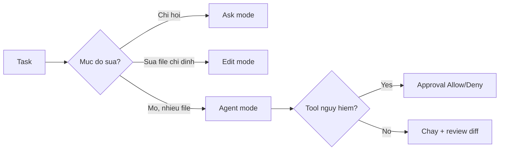

# FAQ 03 — Modes & Permissions

> **Dành cho:** dev dùng Copilot Agent/Edit muốn không bị "chặt chém" bởi approval, hiểu đúng chế độ, chọn permission level cho đúng việc.
> **Vấn đề:** "Ask/Edit/Agent khác gì, sao Copilot cứ hỏi approve, content exclusion là gì" — 12 câu hỏi, mỗi câu có giải thích + lệnh copy-paste + ví dụ + khi nào áp dụng.
> **Đọc xong:** phân biệt được 3 mode + UI mới (Interactive/Plan/Autopilot, Manual/Assisted/Allow all, Session Target Copilot/Local/Cloud), hết bị approval chặn, biết exclusion. **Thời gian:** ~15 phút đọc.

12 câu dưới đây gỡ đúng một mớ bối rối: **"Ask/Edit/Agent khác gì, sao Copilot cứ hỏi approve, content exclusion là gì"**. Mỗi câu gồm giải thích + lệnh copy-paste + ví dụ + lúc nào nên áp dụng.

> **Nếu làm sai thì sao?** Bật Agent cho việc Ask làm được thì vừa tốn Credits vừa tăng rủi ro; allow-always cho lệnh phá hoại thì một lần `rm -rf` là đủ để mất cả buổi; còn attach nhầm secret vào chat thì nội dung đó đã rời khỏi máy bạn. Ba cái bẫy này lặp lại ở gần như mọi câu hỏi phía dưới.

## Mục tiêu bài học

- Phân biệt **3 mode** theo *quyền hành động* (không phải theo độ thông minh) và chọn mode yếu nhất đủ làm việc.
- Hiểu **approval** và **permission level** để hết bị chặn giữa chừng mà vẫn an toàn.
- Biết **content exclusion** 2 mức và vì sao mức org thắng mức cá nhân.
- Đọc được **UI 2026** (persona + permission) và **Session Target** mà không nhầm với model picker.

## Sơ đồ tư duy nhanh (đọc 30 giây)

Một task đến → chọn mode nào, approval xử ra sao, làm sao không bị kẹt giữa chừng.



## Bảng tổng hợp: chọn mode nhanh

Task của bạn thuộc loại nào, chọn mode nào, và Copilot được phép làm gì trong mode đó.

| Mode | Copilot được làm gì | Khi nào dùng |
|---|---|---|
| Ask (hỏi đáp) | Chỉ trả lời, đọc file bạn cho phép | Hỏi, giải thích, lên plan |
| Edit (chỉnh sửa) | Sửa file trong scope bạn chỉ định | Sửa 1 vài file cụ thể |
| Agent (tự hành động) | Đọc + sửa nhiều file + chạy lệnh (có approval) | Task multi-file, refactor, feature |

> **UI mới (2026):** agent chia 3 persona **Interactive / Plan / Autopilot** (≈ Agent+ask / Plan-first / Agent+Allow all) và picker **Permissions: Manual / Assisted / Allow all**. Ánh xạ + cách bọc an toàn: [bài 10 mục 3.2, 5.3, 5.4](../01-huong-dan-su-dung/10-modes-permissions-availability.md) và Q11 bên dưới.

---

## 1. Ask / Edit / Agent khác nhau gì?

> **Hỏi ngắn gọn:** _Ask / Edit / Agent khác nhau gì?_

**Trả lời 1 câu:** Ask là cố vấn chỉ nói, Edit là thợ sửa đúng file bạn chọn, Agent là cộng sự tự tìm file + chạy lệnh, và luôn dùng mode yếu nhất làm được việc.

**Giải thích chi tiết + ví dụ:** 3 mode là 3 mức "quyền hành động" tăng dần:

- **Ask:** Copilot là cố vấn — đọc code bạn attach, trả lời chữ. Không sửa file, không chạy lệnh. An toàn tuyệt đối.
- **Edit:** Copilot là thợ sửa — sửa trực tiếp file trong working set (file bạn mở/attach). Thường không chạy lệnh build/test trừ khi bạn bảo.
- **Agent:** Copilot là cộng sự — tự tìm file, sửa nhiều file, chạy terminal (lint/test/build), tạo file mới. Mỗi hành động nhạy cảm hiện **approval prompt** để bạn duyệt.

### Làm thế nào (steps copy-paste)

Đổi mode ngay trước khi gõ prompt — thao tác trong IDE, không có lệnh CLI:

```bash
# Đổi mode trong VS Code: dropdown cạnh nút Send trong Chat view
# Ask -> Edit -> Agent (chọn trước khi gõ prompt)
# Verify: sau đổi, chat hiện đúng label mode mới + icon tương ứng
# Phím tắt mở chat: Ctrl+Alt+I (VS Code), tùy IDE
```

**Ví dụ cụ thể:** hỏi "hàm này làm gì" → Ask. Sửa 1 hàm → Edit + attach file. Refactor auth 5 file + chạy test → Agent.

> **Khi nào áp dụng:** luôn chọn mode YẾU NHẤT làm được việc — đừng bật Agent cho việc Ask làm được (tốn quota + rủi ro).

> **Nếu vẫn lỗi thì...** (chọn đúng mode mà không thấy khác biệt): (1) xác nhận label mode đã đổi trước khi gửi prompt, (2) kiểm tra prompt có hợp mode không — Ask sẽ không sửa file dù bạn yêu cầu, (3) nếu cần sửa nhiều file mà Edit không lan tới, nâng lên Agent, (4) reload IDE nếu dropdown không phản hồi — xem "Vẫn lỗi thì sao?" cuối file.
---

## 2. Tool approval là gì, sao Copilot cứ hỏi "Allow" hoài?

> **Hỏi ngắn gọn:** _Tool approval là gì, sao Copilot cứ hỏi "Allow" hoài?_

**Trả lời 1 câu:** Approval là Copilot xin phép trước khi chạy tool nhạy cảm (terminal, mạng, MCP) — bạn chọn Allow once, Allow for workspace, hoặc Deny.

**Giải thích chi tiết + ví dụ:** Approval = Copilot xin phép trước khi làm việc nhạy cảm: chạy lệnh terminal, sửa file ngoài scope, truy cập mạng/MCP... Bạn có 3 lựa chọn: **Allow once** (1 lần), **Allow for session/workspace** (nhớ), **Deny** (cấm).

Hỏi hoài thường do: task agent rộng (nhiều tool calls), hoặc bạn chưa bật "allow for workspace" cho lệnh an toàn (VD `npm test`).

| Lựa chọn | Nghĩa | Có nhớ cho lần sau? | Khi nào dùng |
|---|---|---|---|
| Allow once | Cho chạy đúng 1 lần | Không | Lệnh hiếm gặp, chưa chắc an toàn |
| Allow for session/workspace | Nhớ cho phiên/workspace | Có | Lệnh an toàn lặp lại (`npm test`, `git diff`) |
| Deny | Cấm chạy | Có | Lệnh nguy hiểm (`rm -rf`, `git push --force`) |

### Làm thế nào (steps copy-paste)

Duyệt nhanh cho lệnh an toàn, giữ chốt tay cho lệnh nguy hiểm:

```bash
# Trong approval prompt: chọn "Allow for workspace" cho lệnh an toàn:
# npm test, npm run lint, git status, git diff
# Verify: lần chạy kế tiếp không hiện approval nữa
# KHÔNG bao giờ "allow always" cho: rm -rf, git push, kubectl delete, drop table
```

**Ví dụ cụ thể:** agent chạy `npm test` lần nào cũng hỏi → Allow for workspace 1 lần → các lần sau tự chạy.

> **Khi nào áp dụng:** đầu mỗi task agent — duyệt nhanh lệnh an toàn, giữ phê duyệt tay cho lệnh nguy hiểm.

> **Nếu vẫn lỗi thì...** (duyệt rồi mà vẫn hỏi mãi): (1) kiểm tra bạn chọn "Allow for workspace" chứ không phải "Allow once", (2) mở workspace mới thì bộ nhớ approval reset — duyệt lại, (3) nếu chỉ một lệnh bị hỏi hoài, thử thêm nó vào prompt đầu task như allowlist, (4) xem permission level hiện tại (Q11) có đang chặn không — xem "Vẫn lỗi thì sao?" cuối file.
---

## 3. Content exclusion là gì, cấu hình ở đâu?

> **Hỏi ngắn gọn:** _Content exclusion là gì, cấu hình ở đâu?_

**Trả lời 1 câu:** Content exclusion là danh sách path Copilot không được đọc, có 2 mức: cá nhân (`.vscode/settings.json`) và org (admin), và mức org thắng mức cá nhân.

**Giải thích chi tiết + ví dụ:** Content exclusion = danh sách path Copilot **không được đọc/không gợi ý** (VD `*.pem`, `secrets/`, `contracts/`). Có 2 mức:

- **Cá nhân/IDE:** `settings.json` → `github.copilot.chat.exclude` hoặc content exclusion trong extension settings.
- **Org (admin, Business/Enterprise):** `Org Settings → Copilot → Content exclusion` — áp cho mọi member, thắng setting cá nhân.

### Làm thế nào (steps copy-paste)

Khai báo exclusion ở cấp repo trước, rồi admin bổ sung ở cấp org nếu cần:

```json
// .vscode/settings.json (mẫu repo, xem templates/)
{
  "github.copilot.chat.exclude": ["**/*.pem", "**/secrets/**", "**/.env*"]
}
```

```bash
# Admin org (web UI): Org Settings -> Copilot -> Content exclusion -> Add path
# VD: **/legal/**, **/*.key, **/credentials.json
# Verify: sau khi add, chat hỏi "#file secrets/stripe.key" -> copilot không trả được nội dung
```

**Ví dụ cụ thể:** repo có `secrets/stripe.key` → thêm vào exclusion cả 2 mức (repo settings + org policy) để Copilot không bao giờ đọc.

> **Khi nào áp dụng:** ngay khi repo có secret/key/hợp đồng — exclusion trước, code sau. Chi tiết [bài 09](09-bao-mat-quyen-rieng-tu.md).

> **Nếu vẫn lỗi thì...** (Copilot vẫn đọc được file đáng lẽ bị chặn): (1) kiểm tra pattern có khớp đúng path thật không, (2) nhớ mức org thắng mức cá nhân — nếu org cho phép thì setting riêng vô hiệu, (3) file đã nằm trong git thì exclusion không cứu được, phải xử lý ở tầng secret, (4) hỏi admin xác nhận rule đã lưu — xem "Vẫn lỗi thì sao?" cuối file.
---

## 4. Agent sửa nhầm file thì xử lý sao (undo / checkpoint)?

> **Hỏi ngắn gọn:** _Agent sửa nhầm file thì xử lý sao (undo / checkpoint)?_

**Trả lời 1 câu:** 3 lớp: undo trong chat, git checkout/stash, và checkpoint session — dùng theo thứ tự, cứ 1 file sai thì chưa cần đến lớp cuối.

**Giải thích chi tiết + ví dụ:** 3 lớp cứu hộ theo thứ tự:

1. **Undo trong chat:** Edit mode hiện diff → nút Undo/Discard để hoàn tác từng change.
2. **Git:** `git diff` xem, `git checkout -- <file>` hoàn tác file, `git stash` giữ lại tạm.
3. **Checkpoint/session restore:** Agent mode có timeline — quay về checkpoint trước khi nó sửa sai.

### Làm thế nào (steps copy-paste)

Kiểm tra agent đã đụng gì trước khi hoàn tác — đừng undo mù:

```bash
# Xem agent đã sửa gì
git status --short
git diff --stat
# Verify: chỉ ra file bạn mước, file khác = agent sửa lan

# Hoàn tác 1 file bị sửa nhầm
git checkout -- src/wrong-file.ts
# Verify: git diff --stat không còn file đó

# Hoàn tác tất cả (cẩn thận: mất cả change đúng)
git stash -u
```

**Ví dụ cụ thể:** agent sửa nhầm `migrations/` → `git checkout -- db/migrations/` → thu hẹp prompt → chạy lại chỉ trong `src/`.

> **Khi nào áp dụng:** sau mỗi task agent — `git diff --stat` trước khi commit là thói quen bắt buộc.

> **Nếu vẫn lỗi thì...** (undo xong vẫn còn dấu vết lạ): (1) `git status --short` xem còn file nào chưa xử, (2) kiểm tra file mới tạo mà bạn chưa biết — phải xóa tay, (3) nếu đã commit rồi thì dùng `git revert` thay vì checkout, (4) mở chat mới và dặn rõ file không được đụng trước khi chạy lại — xem "Vẫn lỗi thì sao?" cuối file.
---

## 5. Cho agent chạy lệnh terminal an toàn thế nào?

> **Hỏi ngắn gọn:** _Cho agent chạy lệnh terminal an toàn thế nào?_

**Trả lời 1 câu:** Allowlist lệnh đọc + test, blocklist lệnh phá hoại, và ghi ranh giới ngay câu prompt mở đầu.

**Giải thích chi tiết + ví dụ:** Nguyên tắc: **allowlist lệnh đọc + test, blocklist lệnh phá hoại.**

- Luôn cho phép: `git status/diff/log`, `npm test`, `npm run lint`, `ls`, `cat`.
- Cân nhắc từng lần: `npm install`, `git commit`, `docker build`.
- Không bao giờ auto-allow: `rm -rf`, `git push --force`, `kubectl delete`, `drop/drop table`, `chmod 777`.

### Làm thế nào (steps copy-paste)

Dặn ranh giới ngay trong prompt đầu task để bớt phải approve về sau:

```bash
# Dặn agent ngay trong prompt đầu task:
# "Chỉ được chạy: npm test, npm run lint, git status, git diff.
#  Không chạy git push, rm, hay lệnh mạng khi chưa hỏi tôi."
# Verify: agent tự dừng khi muốn chạy lệnh ngoài danh sách + hỏi bạn
```

**Ví dụ cụ thể:** prompt chuẩn mở đầu task agent: `"Refactor X trong src/auth/. Chỉ chạy npm test + git diff. Không commit, không push."`

> **Khi nào áp dụng:** mọi task agent — 1 dòng giới hạn lệnh trong prompt đầu tiết kiệm 10 lần approve sau.

> **Nếu vẫn lỗi thì...** (agent vẫn chạy lệnh ngoài danh sách): (1) dừng ngay và đọc log xem lệnh nào lọt, (2) bổ sung lệnh đó vào blocklist trong prompt, (3) kiểm tra permission level có đang "Allow all" không, (4) siết lại bằng `Deny` cho lệnh nguy hiểm — xem "Vẫn lỗi thì sao?" cuối file.
---

## 6. Edit mode sửa lan sang file khác — chặn thế nào?

> **Hỏi ngắn gọn:** _Edit mode sửa lan sang file khác — chặn thế nào?_

**Trả lời 1 câu:** Edit mode chỉ sửa file bạn attach — lan ra ngoài là do bạn attach folder hoặc prompt chung chung, fix bằng cách ghi rõ file được/không được đụng.

**Giải thích chi tiết + ví dụ:** Edit mode sửa trong **working set** = file đang mở + file attach. Nó lan ra ngoài khi: bạn attach cả folder, hoặc prompt viết chung chung ("refactor auth" mà attach cả `src/`).

Chặn bằng: attach đúng file cần sửa, nêu rõ file được/không được đụng trong prompt.

### Làm thế nào (steps copy-paste)

Viết prompt Edit theo mẫu "chỉ file này, không đụng file kia":

```bash
# Prompt Edit chuẩn (chỉ rõ phạm vi):
# "Chỉ sửa src/auth/login.ts (hàm login):
#  - chuyển sang async/await
#  - KHÔNG đụng session.ts, types.ts, tests"
# Verify: git diff --stat chỉ ra 1 file, không có file nào khác
```

**Ví dụ cụ thể:** muốn sửa 1 hàm mà Copilot sửa thêm 3 file → Undo → attach lại đúng 1 file → prompt ghi rõ "chỉ file này".

> **Khi nào áp dụng:** mỗi khi dùng Edit — scope hẹp = diff gọn = review nhanh.

> **Nếu vẫn lỗi thì...** (đã ghi rõ file mà vẫn lan): (1) kiểm tra working set có dính folder nào không, (2) đóng các tab file không liên quan trước khi gọi Edit, (3) Undo rồi thử lại với `#selection` đúng đoạn, (4) nếu vẫn lan, chuyển sang sửa tay cho chắc — xem "Vẫn lỗi thì sao?" cuối file.
---

## 7. Ask mode đọc được gì, có sợ lộ file nhạy cảm không?

> **Hỏi ngắn gọn:** _Ask mode đọc được gì, có sợ lộ file nhạy cảm không?_

**Trả lời 1 câu:** Ask chỉ đọc file bạn attach + instructions, không tự quét repo — nhưng `#file` secret vào chat là nội dung đó lên server.

**Giải thích chi tiết + ví dụ:** Ask chỉ đọc: file bạn attach (`#file`, `#selection`, working set) + instructions. Nó KHÔNG tự quét cả repo. Nhưng nếu bạn attach nhầm file secret, nội dung đó vào context chat (gửi lên server model).

Vì vậy: đừng bao giờ `#file` secret vào chat, dù là Ask.

### Làm thế nào (steps copy-paste)

Check nhanh 3 giây trước khi attach — file này có đang bị git track không:

```bash
# Trước khi attach file vào chat, check nhanh:
git check-ignore secrets/stripe.key && echo "IGNORED" || echo "COI CHUNG: file nay dang track!"
# Verify: ra IGNORED thì an toàn; ra "COI CHUNG" thì file track trong git — 2 lớp rủi ro
# File secret track trong git + attach vào chat = 2 lớp rủi ro
```

**Ví dụ cụ thể:** debug lỗi Stripe → paste **đoạn code gọi API** (đã xóa key) thay vì `#file:secrets/stripe.ts` nguyên file.

> **Khi nào áp dụng:** mỗi lần attach file — 3 giây check tên file có chứa `secret/key/token/pem` không.

> **Nếu vẫn lỗi thì...** (lỡ attach secret rồi): (1) coi như secret đã lộ và **xoay key ngay**, (2) xóa secret khỏi chat, (3) thêm path đó vào content exclusion (Q3) để lần sau bị chặn, (4) rà lại git history xem file đã commit chưa — xem [bài 09](09-bao-mat-quyen-rieng-tu.md).
---

## 8. Permissions của MCP tools quản lý thế nào?

> **Hỏi ngắn gọn:** _Permissions của MCP tools quản lý thế nào?_

**Trả lời 1 câu:** Tool MCP cũng xin approval khi gọi lần đầu — bạn chọn allow once/workspace, hoặc tắt hẳn server trong `mcp.json`.

**Giải thích chi tiết + ví dụ:** MCP server cung cấp tools ngoài (query DB, tạo ticket...) cho Copilot. Mỗi tool MCP khi agent gọi lần đầu đều hiện approval. Bạn có thể: allow once, allow workspace, hoặc tắt hẳn server trong `mcp.json` (xóa entry hoặc `disabled: true`).

Tool MCP nguy hiểm (VD `db.exec("DROP...")`, `github.merge_pr`) → không bao giờ allow always.

### Làm thế nào (steps copy-paste)

Tắt tạm server nguy hiểm bằng cách trỏ nó về chỗ vô hại, rồi mở lại khi cần:

```json
// .vscode/mcp.json: tắt tạm 1 server nguy hiểm
{
  "servers": {
    "postgres-prod": { "command": "echo", "args": ["disabled - dung replicas"] }
  }
}
// Verify: reload IDE -> list MCP tools không còn server đó
// Thực tế: xóa entry hoặc đổi env pointing sang read-replica
```

**Ví dụ cụ thể:** MCP postgres trỏ prod → đổi connection string sang **read-replica** (xem `templates/.vscode/mcp.json`), agent query thoải mái không sợ ghi nhầm.

> **Khi nào áp dụng:** khi thêm MCP server mới — luôn trỏ read-only/replica trước, mở write sau. Chi tiết [bài 04](04-mcp-faq.md).

> **Nếu vẫn lỗi thì...** (tool MCP không xin approval hoặc tự chạy): (1) kiểm tra permission level có đang "Allow all" không, (2) rà lại đã từng bấm allow-workspace cho tool đó chưa, (3) mở `mcp.json` xác nhận connection trỏ đúng replica, (4) tắt hẳn server nếu không tin — xem [bài 04](04-mcp-faq.md) và "Vẫn lỗi thì sao?" cuối file.
---

## 9. Team thống nhất permissions baseline thế nào?

> **Hỏi ngắn gọn:** _Team thống nhất permissions baseline thế nào?_

**Trả lời 1 câu:** Baseline team = 3 file trong repo (settings.json, copilot-instructions.md, org policy) — commit 1 lần, mọi dev hưởng từ phút 1.

**Giải thích chi tiết + ví dụ:** Team nên có 1 baseline chung, đặt trong repo để mọi người giống nhau:

1. `.vscode/settings.json` — exclusion paths chuẩn team.
2. `.github/copilot-instructions.md` — dòng "agent chỉ chạy lệnh X, không làm Y".
3. Org policy (admin) — model allowlist, coding agent bật/tắt.

### Làm thế nào (steps copy-paste)

Ghi baseline vào instructions bằng một khối markdown ngắn, dễ review:

```markdown
<!-- Đoạn mẫu trong .github/copilot-instructions.md -->
## Permissions baseline (team)
- Agent được chạy: npm test, npm run lint, git status/diff.
- Agent KHÔNG: commit, push, sửa db/migrations, gọi API prod.
- File cấm đọc: **/*.pem, secrets/**, .env*.
```

**Ví dụ cụ thể:** member mới clone repo → mở IDE → settings + instructions tự áp → permissions giống cả team từ phút 1.

> **Khi nào áp dụng:** khi team >3 người dùng Copilot — baseline trong repo đỡ cãi nhau về "sao máy em nó tự push".

> **Nếu vẫn lỗi thì...** (máy một người vẫn khác cả team): (1) xác nhận họ đã pull bản `settings.json` + instructions mới nhất, (2) kiểm tra không có settings cá nhân ghi đè, (3) với org, nhớ policy có thể đè lên baseline, (4) ghi rõ baseline vào review checklist của PR — xem "Vẫn lỗi thì sao?" cuối file.
---

## 10. Khi nào KHÔNG nên dùng Agent mode?

> **Hỏi ngắn gọn:** _Khi nào KHÔNG nên dùng Agent mode?_

**Trả lời 1 câu:** 5 lúc: hotfix prod, migration DB, code legal, repo không có test, quota đỏ — nên dùng Ask/Edit hoặc làm tay.

**Giải thích chi tiết + ví dụ:** 5 trường hợp nên tránh Agent, dùng Ask/Edit hoặc làm tay:

1. **Sửa hotfix prod gấp** — agent chậm + khó kiểm soát, làm tay nhanh hơn.
2. **Migration DB / infra** — 1 lệnh sai mất data; review tay từng dòng.
3. **Code legal/compliance** — cần người chịu trách nhiệm, không ủy thác.
4. **Repo chưa có test** — agent không có lưới an toàn, dễ "sửa xong hỏng ngầm".
5. **Quota đỏ cuối tháng** — agent đốt premium nhanh nhất.

### Làm thế nào (steps copy-paste)

Chạy checklist 3 tick trước khi bật Agent — thiếu 1 tick thì đổi cách làm:

```bash
# Checklist trước khi bật Agent:
# [ ] Có test chạy được? (npm test xanh)
# [ ] Git sạch? (git status --short trống để dễ diff)
# [ ] Scope <10 file?
# Verify: đủ 3 tick thì bật Agent; thiếu 1 -> dùng Edit hoặc làm tay
# Thiếu 1 trong 3 -> dùng Edit/tay thay vì Agent
```

**Ví dụ cụ thể:** hotfix thanh toán lỗi giữa đêm → Edit 1 file + chạy test tay, đừng bật agent quét cả repo.

> **Khi nào áp dụng:** trước nút bật Agent — 10 giây checklist tránh 1 giờ dọn hậu quả.

> **Nếu vẫn lỗi thì...** (đã bật Agent rồi mới nhận ra không nên): (1) Cancel ngay, (2) `git diff --stat` xem nó đụng những đâu, (3) `git checkout` hoàn tác file ngoài ý muốn, (4) lần sau chuyển sang Edit cho phạm vi hẹp — xem "Vẫn lỗi thì sao?" cuối file.
---

## 11. UI mới: Interactive/Plan/Autopilot + Manual/Assisted/Allow all khác gì?

> **Hỏi ngắn gọn:** _UI mới có Interactive/Plan/Autopilot với Manual/Assisted/Allow all — khác gì Ask/Edit/Agent và allow/ask/deny cũ?_

**Trả lời 1 câu:** UI mới chỉ đặt tên lại 2 nhóm: persona (agent tự chủ tới đâu) và permission level (tự duyệt tool tới đâu) — không thay đổi hành vi thực tế.

**Giải thích chi tiết + ví dụ:** 2 picker khác nhau trong khung Chat:

- **Persona (dropdown agent):** **Interactive** (dừng hỏi mỗi thay đổi) — **Plan** (chỉ lập kế hoạch, không sửa code) — **Autopilot** (tự chạy tới xong, tự trả lời câu hỏi làm rõ). Tương đương: Interactive ≈ Agent + `ask`; Autopilot ≈ Agent + `Allow all`.
- **Permission level (picker Permissions):** **Manual permissions** (mặc định, hỏi theo cấu hình) — **Assisted permissions** (Experimental: LLM judge chấm rủi ro từng tool call) — **Allow all** (tự duyệt hết). Manual vẫn tôn trọng bộ `allow/ask/deny`; Assisted và Allow all thì override.

| Nhóm | Lựa chọn | Tương đương cũ | Hành vi | Khi nào dùng |
|---|---|---|---|---|
| Persona | Interactive | Agent + `ask` | Dừng hỏi mỗi thay đổi | Mặc định an toàn, code có kiểm soát |
| Persona | Plan | Plan-first | Chỉ lập kế hoạch, không sửa code | Task lớn cần duyệt kế hoạch trước |
| Persona | Autopilot | Agent + `Allow all` | Tự chạy tới xong, tự trả lời câu hỏi | Worktree riêng + sandbox bật |
| Permission | Manual | Bộ `allow/ask/deny` | Hỏi theo cấu hình | Mặc định |
| Permission | Assisted (Experimental) | — | LLM judge chấm rủi ro từng tool call | Muốn tự duyệt nhưng vẫn chấm rủi ro |
| Permission | Allow all | — | Tự duyệt hết | Chỉ khi đã bật sandbox + git sạch |

### Làm thế nào (steps copy-paste)

Chỉnh persona/permission ở cả VS Code và CLI, và bọc an toàn trước khi dùng chế độ tự duyệt:

```bash
# VS Code: dropdown agent (Interactive/Plan/Autopilot) + picker Permissions (Manual/Assisted/Allow all)
# CLI: Shift+Tab xoay standard → plan → autopilot
copilot --mode=plan            # bắt đầu ở Plan
/permissions assisted          # đổi permission level (default|assisted|allow-all|show)
# Verify: CLI hiện mode + permission level hiện tại bằng /permissions show
```

```jsonc
// Bọc an toàn trước khi dùng Autopilot / Allow all:
{
  "chat.agent.sandbox.enabled": "on",                 // nhốt terminal, lệnh trong chuồng auto-approve
  "chat.editing.autoAcceptDelay": 0                   // tắt auto-accept edit khi review kỹ
}
```

**Ví dụ cụ thể:** task dài refactor 8 file → chọn **Plan** để duyệt kế hoạch, rồi chuyển **Interactive** để code có kiểm soát. Chỉ dùng **Autopilot** trong worktree riêng + sandbox bật.

> **Khi nào áp dụng:** Plan cho task mở/lớn; Interactive là mặc định an toàn; Autopilot/Allow all chỉ khi đã bật sandbox + git sạch. Chi tiết [bài 10 mục 3.2, 5.3, 5.4](../01-huong-dan-su-dung/10-modes-permissions-availability.md).

> **Nếu vẫn lỗi thì...** (đổi persona/permission mà hành vi không đổi): (1) kiểm tra picker thật sự đã áp (CLI: `/permissions show`), (2) nhớ Autopilot chỉ hợp lý khi sandbox bật + worktree riêng, (3) xác nhận org policy không ghi đè lựa chọn, (4) quay về Interactive để có kiểm soát — xem "Vẫn lỗi thì sao?" cuối file.
---

## 12. Session Target (Copilot/Local/Cloud) và harness là gì?

> **Hỏi ngắn gọn:** _Session Target Copilot/Local/Cloud khác gì model picker?_

**Trả lời 1 câu:** Model là "não" (ai suy nghĩ); Session Target là "harness + nơi chạy" (ai thực thi tool và chạy ở đâu) — chọn target không đổi model, chỉ đổi nơi chạy.

**Giải thích chi tiết + ví dụ:** 4 target hay gặp:

- **Local** — chạy trong extension host VS Code, làm trên workspace hiện tại; dùng tool built-in/extension + model cấu hình trong VS Code (gồm BYOK). Chỉ trong cửa sổ VS Code.
- **Copilot** — chạy trên **Agent Host** (Copilot SDK), chạy nền, nhiều session song song, mở lại từ cửa sổ/browser khác. Vì ở Agent Host nên **Autopilot là agent mode**.
- **Cloud** — chạy trên hạ tầng remote, làm 1 GitHub repo rồi mở PR; KHÔNG thấy tool/context local.
- **Claude / Codex** — harness của provider (nếu cài).

Handoff đổi target giữa phiên và mang theo context (chỉ khởi tạo được từ session Local). Trong session Copilot gõ `/delegate` để đẩy sang Cloud.

| Target | Chạy ở đâu | Thấy tool/context local? | Nhiều session song song? | Khi nào dùng |
|---|---|---|---|---|
| Local | Extension host VS Code | Có | Không (trong cửa sổ VS Code) | Việc tay cần sửa + chạy test trong editor |
| Copilot | Agent Host (Copilot SDK), chạy nền | — | Có | Muốn background/nhiều phiên song song |
| Cloud | Hạ tầng remote, làm 1 repo → PR | Không | — | Giao hẳn task để nhận PR |
| Claude / Codex | Harness của provider (nếu cài) | Tùy harness | Tùy | Khi cài harness provider |

### Làm thế nào (steps copy-paste)

Đổi target ở đáy khung Chat, và handoff sang Cloud khi muốn nhận PR:

```bash
# VS Code: đáy khung Chat → Session Target → chọn Local / Copilot / Cloud / Claude / Codex
# Verify: label target đổi + list tools khả dụng đổi theo target
# Copilot session → /delegate để đẩy task sang Cloud (mở PR)
```

**Ví dụ cụ thể:** việc tay cần sửa + chạy test trong editor → **Local**. Muốn chạy nền nhiều task song song → **Copilot**. Task gọn giao hẳn để nhận PR → **Cloud**.

> **Khi nào áp dụng:** mặc định Local; Copilot khi muốn background/nhiều phiên; Cloud khi giao hẳn. Chi tiết [bài 10 mục 3.3](../01-huong-dan-su-dung/10-modes-permissions-availability.md).

> **Nếu vẫn lỗi thì...** (task không chạy đúng target): (1) đối chiếu target với loại việc — Cloud không thấy tool/context local nên đừng giao việc cần file local, (2) handoff chỉ khởi tạo được từ session Local, (3) trong session Copilot dùng `/delegate` để chuyển sang Cloud, (4) mở lại session ở cửa sổ/browser khác nếu là target Copilot — xem "Vẫn lỗi thì sao?" cuối file.
---

## So sánh với Claude Code

Cả hai đều cho agent "làm hộ", nhưng khác cách leo thang quyền và cách chặn vùng cấm:

| Việc | GitHub Copilot | Claude Code | Ghi chú |
|---|---|---|---|
| Mức tự chủ | Ask / Edit / Agent + persona Interactive/Plan/Autopilot | Mặc định là agent, có plan mode | Copilot leo thang từng bước; Claude agentic mặc định |
| Duyệt hành động nhạy cảm | Approval Allow once/workspace/Deny + Permissions Manual/Assisted/Allow all | Có permission mode, hỏi trước hành động nhạy cảm | Cùng tư tưởng: việc nguy hiểm phải xin phép |
| Chặn đọc file nhạy cảm | Content exclusion 2 mức (IDE + org) | Không có tương đương org-level trực tiếp — kiểm tra tài liệu Anthropic | Không bịa: cơ chế khác nhau, đừng giả định giống nhau |
| Lập kế hoạch trước khi code | Persona Plan | Plan mode | Gần như tương đương |
| Chạy nền / giao PR | Session Target Copilot (nền) và Cloud (mở PR) | Chạy trong terminal/CI tùy setup | Khác cơ chế triển khai |

> **Đọc bảng này thế nào:** tư tưởng cốt lõi — "mode yếu nhất làm được việc", "duyệt trước việc nguy hiểm", "lập plan trước khi sửa" — chuyển sang Claude Code gần như 1-1. Riêng **content exclusion cấp org** là thứ Copilot có mà Claude Code không có tương đương trực tiếp, nên đừng giả định hai bên chặn file giống nhau.

## Best practices (kèm "vì sao")

- **Chọn mode yếu nhất làm được việc.** *Vì sao?* Đỡ tốn Credits và ít rủi ro; Agent là mức đắt và nguy hiểm nhất.
- **Allow for workspace cho lệnh an toàn lặp lại, Deny cho lệnh phá hoại.** *Vì sao?* Bớt bị approval chặn mà vẫn giữ chốt an toàn ở chỗ thật sự nguy.
- **Khóa scope trong prompt: file được/không được đụng + lệnh được chạy.** *Vì sao?* Diff gọn hơn và giảm số vòng approve.
- **`git diff --stat` sau mỗi task agent.** *Vì sao?* Phát hiện ngay agent sửa lan trước khi commit.
- **Chạy checklist trước khi bật Agent (test xanh, git sạch, scope <10 file).** *Vì sao?* Không có lưới an toàn thì "sửa xong hỏng ngầm" rất khó thấy.
- **Cấu hình content exclusion trước khi commit secret.** *Vì sao?* Exclusion là lớp phòng thủ, không thay được `.gitignore` + secret manager.
- **Commit baseline permissions vào repo.** *Vì sao?* Mọi dev giống nhau từ phút 1, khỏi cãi "sao máy em nó tự push".

---

## Vẫn lỗi thì sao? (thứ tự debug chuẩn)

Copilot "bướng" về permission/mode thì chạy đúng 5 bước này theo thứ tự.

1. Check đang ở mode nào (Ask/Edit/Agent) — đúng mode chưa.
2. Xem approval history: có Deny nhầm lệnh cần thiết không.
3. Check org policy có đè setting không (hỏi admin).
4. Check content exclusion có chặn file bạn cần không.
5. Vẫn kẹt → chat mới + prompt ghi rõ phạm vi file + lệnh được chạy.

```bash
# Xác nhận nhanh trước khi kết luận — chỉ tốn vài giây:
git status --short          # có file nào agent đã đụng không
# VS Code: xem mode + Permissions + Session Target ở khung Chat
# Verify: biết chắc mode/target/permission hiện tại trước khi đổi thứ khác
```

---

## Tham khảo chéo

Kẹt đúng chỗ nào thì đọc tiếp bài đó, đừng đọc tràn.

- MCP tools approval: [bài 04](04-mcp-faq.md). Prompt/instructions scope: [bài 06](06-prompts-agents-instructions.md).
- Agent workflows: [bài 07](07-custom-agents-coding-agent-workflows.md). Bảo mật exclusion: [bài 09](09-bao-mat-quyen-rieng-tu.md).
- Templates: [../templates/README.md](../templates/README.md).

> **Chốt bài:** Thứ tự an toàn luôn giống nhau — chọn mode yếu nhất đủ việc, khóa scope bằng prompt, để lệnh an toàn tự chạy còn lệnh phá hoại phải hỏi tay. Làm đúng ba điều đó thì approval hết phiền mà bạn vẫn không bao giờ bị agent "vượt mặt".
