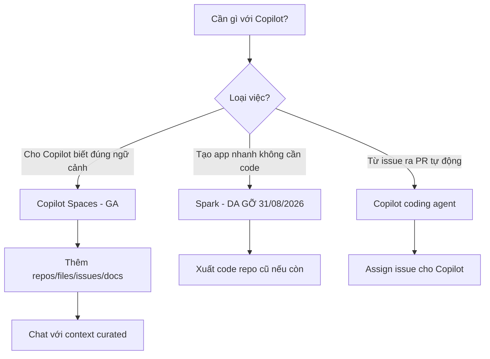

# FAQ 11 — Copilot Spaces, Spark & Workspace

> **Dành cho:** người nghe nói về "Spaces / Spark / Workspace" nhưng không chắc tính năng nào còn sống, tính năng nào đã chết — và bản thân mình nên dùng cái gì hôm nay.
> **Vấn đề:** ba cái tên này dễ nhầm vì đều là sản phẩm Copilot nằm ngoài (hoặc xung quanh) Chat: một cái đang GA, một cái đã gỡ 08/2026, một cái đã biến mất từ 2025. Docs cũ hay blog 2024 sẽ dẫn bạn vào ngõ cụt.
> **Đọc xong:** nói đúng từng tính năng là gì, trạng thái 10/2026, truy cập ở đâu, và khi cần workflow "issue → PR" hay "vibe-code app" thì đi đường nào. **Thời gian:** ~10 phút đọc.

Trạng thái nhanh (verify 2026-10-28 với github.blog/changelog + docs.github.com/copilot):

| Tính năng | Trạng thái 10/2026 | Vị trí |
|---|---|---|
| **Copilot Spaces** | ✅ **GA** (24/09/2025) + Spaces API GA (18/05/2026) | github.com → Copilot → Spaces |
| **Copilot Spark** | ⚰️ **Đã gỡ** (đóng cửa 31/08/2026) | Không còn — app đã deploy vẫn chạy |
| **Copilot Workspace** | ⚰️ **Sunset 2025** — hấp thụ vào Copilot coding agent | Không còn dạng riêng — dùng coding agent |

> **Nếu làm sai thì sao?** Đọc blog 2024 rồi đi tìm Copilot Workspace là mất thời gian vô ích (nó đã biến thành coding agent); tưởng Spark còn sống để tạo app mới sẽ bị chặn ngay từ đầu; còn bỏ qua Spaces nghĩa là mỗi lần hỏi Copilot bạn lại phải dán lại context thủ công — đúng việc Spaces sinh ra để xoá bỏ.

## Mục tiêu bài học

- Phân biệt Spaces / Spark / Workspace: cái nào là "bộ nhớ context", cái nào là "máy tạo app", cái nào là "issue → PR".
- Biết trạng thái chính xác từng tính năng tại 10/2026 (nguồn changelog, không phải tin đồn).
- Tạo và dùng được một Space trong ~5 phút, biết cách chia sẻ cho đồng nghiệp.
- Khi cần thay thế cho Spark hoặc Workspace, biết đi đường nào (coding agent, export repo).

## Sơ đồ tư duy nhanh (đọc 30 giây)



---

## 1. Copilot Spaces là gì?

> **Hỏi ngắn gọn:** _Copilot Spaces là gì?_

**Trả lời 1 câu:** Spaces là "thư mục ngữ cảnh" trên github.com — bạn gom repos, files, issues, PRs, docs và custom instructions vào một nơi để Copilot trả lời dựa trên đúng bộ context đó, thay vì mỗi lần hỏi lại phải dán link.

**Giải thích chi tiết + ví dụ:** Spaces **GA ngày 24/09/2025** (github.blog changelog) và thay thế Knowledge Bases cũ (sunset 11/2025). Một Space là container gồm:

- **Nguồn context:** repos, file/folder cụ thể, issues, PRs, file docs (Markdown) — nguồn từ GitHub được đồng bộ tự động khi repo thay đổi.
- **Custom instructions:** chỉ dẫn riêng cho Space (vd "trả lời theo chuẩn API của team").
- **Chia sẻ:** Space cá nhân có thể để private, chia sẻ cho user cụ thể, hoặc **public** (link xem-only, cập nhật 01/12/2025); Space tổ chức chia sẻ theo vai trò admin/editor/viewer.
- **Lối vào từ code viewer:** đang xem file trên github.com có thể thêm thẳng file đó vào Space.

Ví dụ đời thường: Spaces giống việc bạn chuẩn bị một "hồ sơ dự án" trước cuộc họp — Copilot không phải đoán bạn đang nói về repo nào, nó mở đúng hồ sơ đó ra trả lời.

| Có Spaces | Không có Spaces |
|---|---|
| Copilot đọc bộ context bạn chọn sẵn | Tự dán link/file mỗi lần hỏi |
| Chia sẻ cho cả team (org-owned) | Context nằm trong chat history từng người |
| Nguồn GitHub tự cập nhật | Copy-paste dễ lỗi thời |

### Làm thế nào (steps copy-paste)

```text
1. github.com → bấm Copilot (góc trên bên phải) → chọn tab "Spaces"
2. "Create new space" → đặt tên (VD: "Dự án billing")
3. Thêm nguồn: repo, file/folder, issues, PRs, file markdown
4. (Tuỳ chọn) Thêm custom instructions: "Trả lời theo chuẩn REST của team"
5. Đặt câu hỏi trong khung chat của Space
Verify: câu trả lời cite đúng file/repo bạn đã thêm
```

> **Khi nào áp dụng:** onboarding người mới, hỏi về một subsystem cụ thể, chuẩn hoá câu trả lời theo docs nội bộ.

> **Nếu vẫn lỗi thì...** (không thấy Spaces): (1) xác nhận tài khoản có Copilot license — Spaces mở cho **mọi plan có Copilot, kể cả Free**; (2) Space org có thể bị admin đặt "No access" với member; (3) thử link thẳng `github.com/copilot/spaces`.

---

## 2. Copilot Spark là gì, giờ còn không?

> **Hỏi ngắn gọn:** _Copilot Spark là gì, giờ còn không?_

**Trả lời 1 câu:** Spark là công cụ "vibe coding" tạo micro-app từ mô tả tự nhiên, nhưng đã bị **deprecate**: từ 04/08/2026 không nhận user/app mới, và **đóng cửa hoàn toàn 31/08/2026** — tại 10/2026 không còn cách tạo app Spark mới.

**Giải thích chi tiết + ví dụ:** GitHub Spark cho phép mô tả app bằng lời → nhận app full-stack chạy được, deploy luôn. Lịch sử cuối (verify github.blog/changelog/2026-08-04):

- **04/08/2026:** Spark ngừng nhận user mới, ngừng tạo app mới.
- **30/07/2026:** GitHub Models (service chạy hàm `llm()` của Spark) retired → mọi app gọi `llm()` mất luôn tính năng AI.
- **31/08/2026:** Spark đóng cửa; hạn chót export code app cũ qua workbench → `…` → **Create repository**.

App **đã deploy** trước đó vẫn tiếp tục chạy sau khi Spark biến mất; chỉ việc chỉnh sửa trong workbench là không còn.

### Làm thế nào (steps copy-paste)

Nếu bạn còn app Spark chưa export (sau 31/08/2026 đường export chính thức đã đóng — dùng các cách cứu dữ liệu còn lại):

```bash
# 1. App đã deploy vẫn chạy: giữ nguyên, không cần làm gì
# 2. App dùng llm(): đã hỏng từ 30/07/2026 (GitHub Models retired)
#    → tự nối provider AI riêng cho app
# 3. Cần code nguồn mà chưa kịp export: fork/rebuild từ app public
#    hoặc dựng lại bằng coding agent + Spaces (xem câu 9)
# Verify: mở app đã deploy -> vẫn hoạt động phần không phụ thuộc llm()
```

> **Khi nào áp dụng:** mọi lúc bạn thấy bài hướng dẫn Spark trên mạng — chúng mô tả sản phẩm đã chết.

> **Nếu vẫn lỗi thì...** (app Spark chớp nhoáng hỏng phần AI): hàm `llm()` không còn backend nào cả; thay bằng gọi trực tiếp provider (VD API của Anthropic/OpenAI/xAI) từ app bạn đã export.

---

## 3. Copilot Workspace đâu rồi?

> **Hỏi ngắn gọn:** _Copilot Workspace đâu rồi, sao không tìm thấy?_

**Trả lời 1 câu:** Copilot Workspace (preview "từ issue → PR" của 2024) đã **sunset trong 2025** và kiến trúc của nó bị **hấp thụ vào Copilot coding agent** — hôm nay bạn làm workflow đó bằng cách assign issue cho Copilot, không còn sản phẩm riêng tên Workspace.

**Giải thích chi tiết + ví dụ:** Workspace từng là technical preview làm điểm trung gian: bạn chỉ issue, nó lập kế hoạch (spec → plan), sửa code rồi mở PR — tất cả trong một màn hình riêng. Khi coding agent trưởng thành (chạy trên GitHub Actions, tự mở draft PR, review bằng Mobile), GitHub giữ hướng đi agentic đó trong **coding agent** và dừng sản phẩm standalone. Không có changelog "sập" riêng — nó tan vào coding agent.

| Workspace cũ (đã chết) | Coding agent hôm nay |
|---|---|
| Màn hình riêng, preview | GA cho mọi subscriber trả phí |
| Issue → spec → plan → PR trong một UI | Assign issue → chạy trên GitHub Actions → draft PR |
| Chỉnh tay trong workbench | Sửa tiếp bằng comment trên PR, duyệt từ GitHub Mobile |

### Làm thế nào (steps copy-paste)

```bash
# Workflow "issue → PR" hôm nay:
# 1. Mở issue trên repo -> gán assignee là Copilot (nút Assign)
# 2. Coding agent tạo branch + draft PR + log tiến trình trong tab Sessions
# Verify: PR mới xuất hiện với author là Copilot, comment để bảo nó sửa tiếp
# CLI thay thế: copilot (Copilot CLI) chạy agent trực tiếp trong terminal
```

> **Nếu vẫn lỗi thì...** (không thấy nút assign Copilot): (1) repo thuộc org có policy tắt coding agent — nhờ admin bật; (2) plan cá nhân Free không có coding agent đầy đủ; (3) dùng Copilot CLI local làm thay thế.

---

## 4. Truy cập Spaces ở đâu, ai dùng được?

> **Hỏi ngắn gọn:** _Truy cập Spaces ở đâu, ai dùng được?_

**Trả lời 1 câu:** Spaces nằm trên github.com (Copilot → tab Spaces), mở cho **mọi tài khoản có Copilot license kể cả Free**, và quản lý bằng UI hoặc **Spaces API** (GA 18/05/2026).

**Giải thích chi tiết + ví dụ:** Ba lối vào thực tế:

- **Web (chính):** github.com → Copilot → Spaces. Tạo, sửa, thêm nguồn, chat ngay tại đó.
- **Code viewer:** đang xem file bất kỳ trên github.com → nút "Add to space" để thêm file vào Space hiện có.
- **API:** tạo/đọc/sửa/xoá Space bằng REST — hữu ích khi org cần dựng hàng chục Spaces theo team thay vì click tay.

Phân quyền theo chủ sở hữu:

| Chủ sở hữu | Ai thấy / ai sửa |
|---|---|
| Cá nhân | Private, chia sẻ user cụ thể, hoặc public link (view-only) |
| Tổ chức | Member thấy theo vai trò: admin / editor / viewer, hoặc "No access" ẩn hẳn |

### Làm thế nào (steps copy-paste)

```bash
# Kiểm tra nhanh mình có Spaces không (web):
# github.com -> Copilot -> Spaces (nếu không thấy tab, check license)
# Verify qua API (cần token có scope copilot):
curl -s -H "Authorization: Bearer <TOKEN>" \
  https://api.github.com/copilot/spaces | head -20
# Lỗi 403/404 -> license hoặc org policy chặn (xem phần "Nếu vẫn lỗi")
```

> **Khi nào áp dụng:** lần đầu tìm Spaces; hoặc admin muốn quản lý Spaces quy mô lớn qua API thay vì click từng cái.

> **Nếu vẫn lỗi thì...** (API trả lỗi): (1) token thiếu scope/permission cần thiết — tạo lại PAT với đúng quyền; (2) org chặn Spaces qua policy; (3) Space thuộc user khác — bạn cần được share với vai trò viewer trở lên.

---

## 5. Ba tính năng khác nhau thế nào? (bảng so sánh)

> **Hỏi ngắn gọn:** _Spaces, Spark, Workspace khác nhau thế nào?_

**Trả lời 1 câu:** Spaces = **bộ nhớ context** cho chat (còn sống, GA); Spark = **máy tạo micro-app** (đã gỡ 31/08/2026); Workspace = **workflow issue → PR** standalone (đã hấp thụ vào coding agent) — chỉ còn Spaces là sản phẩm hiện hữu.

**Giải thích chi tiết + ví dụ:** Bảng quyết định nhanh — tìm đúng hàng theo việc bạn cần làm:

| Tiêu chí | Copilot Spaces | Copilot Spark | Copilot Workspace |
|---|---|---|---|
| Bản chất | Container ngữ cảnh cho Copilot Chat | Generator micro-app từ mô tả | Issue → spec → PR preview |
| Trạng thái 10/2026 | ✅ GA (24/09/2025) + API GA (18/05/2026) | ⚰️ Đóng cửa 31/08/2026 | ⚰️ Sunset 2025 → coding agent |
| Truy cập | github.com → Copilot → Spaces | Không còn (app cũ vẫn chạy) | Không còn (dùng coding agent) |
| Plan | Mọi plan có Copilot, kể cả Free | Từng giới hạn preview | Từng giới hạn preview |
| Thay thế hôm nay | — (chính nó là hiện tại) | Dựng app bằng coding agent/CLI | Assign issue cho Copilot |
| Kịch bản điển hình | Onboarding, hỏi subsystem, chuẩn docs | Prototype app nhỏ không cần dev | Tự động hoá fix issue ra PR |

**Ví dụ cụ thể:** team muốn Copilot trả lời đúng chuẩn API nội bộ → **Spaces**. Muốn thử ý tưởng app nhỏ trong một buổi chiều → hồi trước là Spark, giờ là coding agent/CLI + một repo trống. Có đống issue backlog muốn Copilot tự fix → **coding agent** (đứa thừa kế Workspace).

> **Nếu vẫn lỗi thì...** (vẫn rối ba khái niệm): nhớ 1 dòng — "Spaces cho Copilot biết **đọc gì**, coding agent **làm** việc thay bạn, Spark/Workspace là **di tích** lịch sử."

---

## 6. Tạo một Space hữu ích trong 5 phút?

> **Hỏi ngắn gọn:** _Tạo một Space hữu ích trong 5 phút thì làm thế nào?_

**Trả lời 1 câu:** Tạo Space, thêm 1 repo + vài file/issues liên quan đúng nhiệm vụ, viết 2-3 dòng custom instructions — chất lượng câu trả lời đến từ việc chọn nguồn hẹp, không phải thêm càng nhiều càng tốt.

**Giải thích chi tiết + ví dụ:** Sai lầm phổ biến là ném cả org vào một Space: context loãng, câu trả lời lan man, tốn token. Space tốt = một nhiệm vụ, ít nguồn, instructions ngắn:

```text
VD Space "Fix bug payment":
- Repo: acme/payments (thư mục src/ + tests/)
- Issues: 3 issue bug đang mở
- Docs: file api-conventions.md
- Instructions: "Ưu tiên giải pháp không đổi schema; trả lời kèm file+line."
```

| Nguồn thêm vào Space | Khi nào nên thêm |
|---|---|
| Repo / thư mục | Luôn — code là ngữ cảnh chính |
| Issues/PRs | Khi làm việc theo bug/feature cụ thể |
| File docs (md) | Khi team có chuẩn riêng cần Copilot bám theo |
| Custom instructions | Khi muốn định hình "giọng" và ràng buộc câu trả lời |

### Làm thế nào (steps copy-paste)

```text
1. github.com -> Copilot -> Spaces -> "Create new space"
2. Đặt tên theo nhiệm vụ: "Fix bug payment" (không đặt "Test 1")
3. Add sources: chọn repo -> tích thư mục cụ thể (đừng cả repo nếu lớn)
4. Add items: dán URL issue/PR/file md liên quan
5. Instructions (2-3 dòng): ràng buộc + format mong muốn
6. Chat thử 1 câu thật của nhiệm vụ
Verify: câu trả lời không hỏi lại "bạn đang nói repo nào?"
```

> **Khi nào áp dụng:** mỗi nhiệm vụ lớn/dài ngày — tạo Space trước khi bắt đầu chat.

> **Nếu vẫn lỗi thì...** (câu trả lời vẫn lan man): (1) nguồn quá rộng — thu hẹp thư mục; (2) thiếu instructions — thêm 2-3 dòng ràng buộc; (3) nguồn GitHub cần thời gian đồng bộ lần đầu — chờ vài phút rồi hỏi lại.

---

## 7. Quản lý Spaces bằng code (Spaces API)?

> **Hỏi ngắn gọn:** _Có cách nào quản lý Spaces bằng code không?_

**Trả lời 1 câu:** Có — **Spaces API GA ngày 18/05/2026**: tạo, đọc, sửa, xoá Space và quản lý collaborators/nguồn qua REST, dành cho org cần quản lý hàng loạt thay vì click UI.

**Giải thích chi tiết + ví dụ:** API giúp các việc UI làm chậm:

- Sinh 1 Space cho mỗi repo mới khi team onboarding (script chạy sau `gh repo create`).
- Dọn dẹp định kỳ: xoá Space không còn ai dùng.
- Đồng bộ collaborators theo bảng nhân sự nội bộ.

Toàn bộ thao tác CRUD đều có: create, get, update, delete Space; quản lý collaborators và resources (nguồn context) trong Space.

### Làm thế nào (steps copy-paste)

```bash
# Tạo Space bằng API (token cần quyền Copilot thích hợp)
curl -s -X POST \
  -H "Authorization: Bearer <TOKEN>" \
  -H "Accept: application/vnd.github+json" \
  https://api.github.com/copilot/spaces \
  -d '{"title":"Dự án billing","description":"Context cho team billing"}'

# Liệt kê Spaces hiện có
curl -s -H "Authorization: Bearer <TOKEN>" \
  https://api.github.com/copilot/spaces

# Verify: GET vừa tạo trả về đúng title/description
# Chi tiết đầy đủ: docs.github.com -> REST API -> Copilot -> Spaces
```

> **Khi nào áp dụng:** org quản lý nhiều Spaces; muốn Space sinh tự động theo quy trình nội bộ.

> **Nếu vẫn lỗi thì...** (401/403): (1) token sai scope hoặc là fine-grained PAT chưa được cấp quyền Copilot; (2) tài khoản không có Copilot license; (3) endpoint lỗi 404 — kiểm tra lại docs vì API đã GA 18/05/2026, bản preview cũ có schema khác.

---

## 8. Muốn "vibe coding" tạo app như Spark, giờ dùng gì?

> **Hỏi ngắn gọn:** _Từng dùng Spark để tạo app nhanh, giờ thay bằng gì?_

**Trả lời 1 câu:** Dùng **Copilot coding agent** (assign issue → nhận PR) hoặc **Copilot CLI** (agent trực tiếp trong terminal) trên một repo mới — cùng trải nghiệm "mô tả → có code", nhưng code nằm trong repo của bạn, không bị khoá trong nền tảng.

**Giải thích chi tiết + ví dụ:** Spark có một thứ coding agent không thay được hoàn toàn: deploy ngay không cần dev ops. Nhưng đổi lại, đường coding agent cho bạn:

| Nhu cầu | Đường đi hôm nay |
|---|---|
| Prototype UI nhỏ | Coding agent tạo repo + PR, xem trước qua preview deployment |
| App full-stack | Repo trống + issue mô tả spec → agent dựng khung + code |
| Học/AI trong app | Tự nối provider AI (API trực tiếp) — không dùng `llm()` của Spark (đã chết cùng GitHub Models 30/07/2026) |
| Không muốn rời terminal | Copilot CLI: `copilot` rồi mô tả việc, duyệt từng bước |

Ví dụ: "máy đo đếm calo từ ảnh món ăn" — hồi 2025 gõ vào Spark là có app; giờ: tạo repo, mở issue viết spec, assign Copilot, 15-30 phút sau review draft PR.

### Làm thế nào (steps copy-paste)

```bash
# 1. Tạo repo mới
gh repo create my-prototype --public --clone && cd my-prototype
# 2. Mở issue spec + assign Copilot
gh issue create --title "Xay dung app dem calo" \
  --body "Stack: ..., tinh nang: ..." 
gh issue edit 1 --add-assignee "@copilot"
# 3. Theo doi: tab Sessions trên issue / draft PR
# Verify: PR draft xuat hien, comment de yêu sua tiep
```

> **Nếu vẫn lỗi thì...** (agent làm sai ý): (1) issue viết spec cụ thể hơn (stack, cấu trúc thư mục, tiêu chí xong); (2) chia nhỏ thành nhiều issue thay vì 1 issue khổng lồ; (3) dùng Copilot CLI local để lặp nhanh hơn trước khi giao cho cloud agent.

---

## 9. Muốn workflow "issue → PR" như Workspace cũ?

> **Hỏi ngắn gọn:** _Copilot Workspace từng làm "từ issue ra PR", giờ làm bằng gì?_

**Trả lời 1 câu:** Gán issue cho **Copilot coding agent** — nó kế thừa đúng workflow của Workspace: đọc issue, lập kế hoạch, sửa code, tự mở draft PR; bạn review và comment để nó sửa tiếp.

**Giải thích chi tiết + ví dụ:** Workspace chết nhưng use case của nó sống khỏe hơn xưa:

- Workspace: một UI riêng, chạy trên máy GitHub, preview nhưng nhiều người phải chờ access.
- Coding agent hôm nay: GA cho mọi subscriber trả phí, chạy trên GitHub Actions, đọc được context từ issue + repo, mở draft PR, phản hồi qua comment, duyệt được từ **GitHub Mobile**.

Bảng đối chiếu thói quen cũ → mới:

| Bạn từng làm ở Workspace | Bây giờ làm ở đâu |
|---|---|
| "Implement this spec" trong UI | Assign issue cho `@copilot` |
| Sửa spec giữa chừng | Comment vào PR: "đổi X thành Y" |
| Xem plan trước khi code | Đọc Sessions log + nội dung draft PR |
| Chạy local | Copilot CLI (`copilot`, 3 chế độ Interactive/Plan/Autopilot) |

### Làm thế nào (steps copy-paste)

```bash
# Cách 1 - web: mở issue -> Assignees -> chọn Copilot
# Cách 2 - CLI:
gh issue view 42 --web   # rồi assign Copilot từ UI
# Comment trực tiếp trên PR khi cần sửa:
# "@copilot bo qua viec sua file config, chi sua logic tinh tien"
# Verify: agent trả lời trong PR + đẩy commit mới lên branch của nó
```

> **Khi nào áp dụng:** mọi backlog issue mô tả đủ rõ để tự fix — delegated, review sau.

> **Nếu vẫn lỗi thì...** (Copilot không nhận assign): (1) repo private của org Free plan — coding agent cần plan trả phí; (2) org policy tắt coding agent — admin bật trong org settings; (3) issue không đủ ngữ cảnh — thêm log/error/repro vào issue rồi re-assign.

---

## 10. Nếu vẫn lỗi thì... (troubleshooting cả 3)

> **Hỏi ngắn gọn:** _Lỗi khi dùng Spaces / tìm Spark / tìm Workspace thì xử lý ra sao?_

**Trả lời 1 câu:** Chẩn đoán theo triệu chứng: không thấy Spaces → license/policy; app Spark hỏng phần AI → `llm()` đã chết cùng GitHub Models; tìm Workspace không thấy → chuyển sang coding agent.

**Giải thích chi tiết + ví dụ:** Ma trận triệu chứng → nguyên nhân → xử lý:

| Triệu chứng | Nguyên nhân khả dĩ | Xử lý |
|---|---|---|
| Không thấy tab Spaces | Không có Copilot license / org policy | Check license; hỏi admin; vào thẳng `github.com/copilot/spaces` |
| Không thêm được nguồn vào Space | Space org để "No access" / thiếu vai trò | Xin admin/editors quyền; hoặc tạo Space cá nhân |
| Copilot trả lời như không đọc context | Nguồn chưa đồng bộ / quá rộng | Chờ đồng bộ; thu hẹp nguồn; thêm instructions |
| Spaces API 401/403/404 | Token scope / schema preview cũ | Cấp lại PAT đúng quyền; xem docs API GA 18/05/2026 |
| App Spark hỏng tính năng AI | `llm()` chết (GitHub Models retired 30/07/2026) | Thay bằng gọi provider AI riêng |
| Không edit được app Spark nữa | Spark đóng 31/08/2026 | Dựng lại từ repo (nếu đã export) bằng coding agent |
| Không tìm thấy Copilot Workspace | Sunset 2025, hấp thụ vào coding agent | Assign issue cho Copilot / dùng Copilot CLI |

### Làm thế nào (steps copy-paste)

```bash
# Thu tự kiểm theo thứ tự:
# 1. License: github.com/settings/copilot -> thấy plan đang dùng
# 2. Org policy: hỏi admin (Copilot -> Policies)
# 3. Đồng bộ Space: mở Space -> check danh sách sources còn nguyên
# Verify: hỏi 1 câu mà câu trả lời cite đúng file trong Space
```

> **Nếu vẫn lỗi thì...** (sau khi làm hết): chụp lại URL + thông báo lỗi, tìm trong `03-cau-hoi-thuong-gap/08-loi-thuong-gap-troubleshooting.md` theo triệu chứng chung, hoặc check changelog github.blog — trạng thái các tính năng này có thể đổi tiếp sau 10/2026.

---

## So sánh với Claude Code

| Việc | GitHub Copilot | Claude Code | Ghi chú |
|---|---|---|---|
| Ngữ cảnh curated cho chat | Copilot Spaces (web, share được) | Không có khái niệm tương đương 1-1 — dùng `CLAUDE.md` + `@file` khi cần | Spaces mạnh hơn ở chia sẻ team + đồng bộ tự động |
| Vibe-code app nhanh | Coding agent (Spark đã gỡ) | Phiên Claude Code trong terminal tạo project trực tiếp | Claude Code chạy local nên thấy tiến trình liên tục |
| Issue → PR tự động | Assign issue cho Copilot coding agent | Chạy Claude Code trong CI/workflow tự dựng | Copilot có sẵn hạ tầng Actions + draft PR |
| "Sổ tay" tổ chức | Org-owned Spaces + phân quyền | Repo config (`CLAUDE.md` + MCP) | Spaces là sản phẩm riêng; Claude Code dựa vào file trong repo |

> **Đọc bảng này thế nào:** điểm giống là cả hai đều hướng "ngữ cảnh trong repo/Space là chân lý"; điểm khác: Spaces là UI sản phẩm của GitHub còn Claude Code giữ triết lý "file + prompt trong repo" — không có khái niệm Space riêng.

Quay về: [../README.md](../README.md) · Bài tổng: [../01-huong-dan-su-dung/00-tong-quan-copilot.md](../01-huong-dan-su-dung/00-tong-quan-copilot.md).

> **Chốt bài:** Spaces là "bộ nhớ" — dùng cho mọi việc cần đúng ngữ cảnh; coding agent là "nhân viên" — giao việc qua issue; Spark và Workspace là hai cái tên cũ không nên còn trong vocab của bạn tại 10/2026. Nguồn verify: github.blog changelog (24/09/2025, 18/05/2026, 04/08/2026, 19/10/2026) + docs.github.com/copilot.


